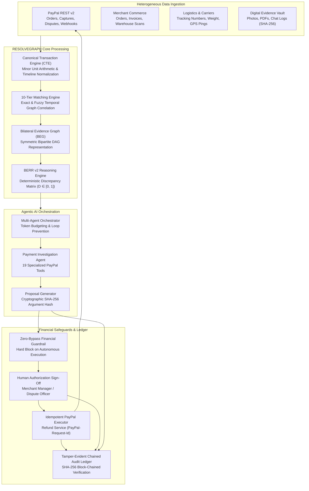
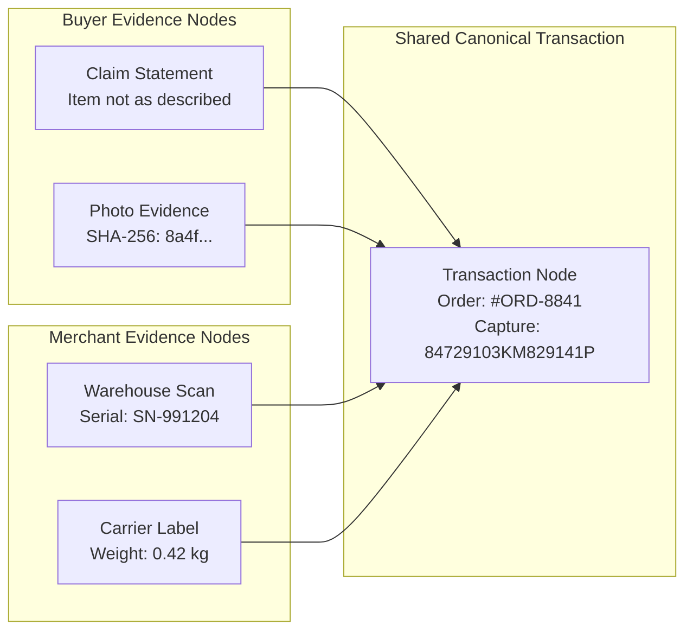
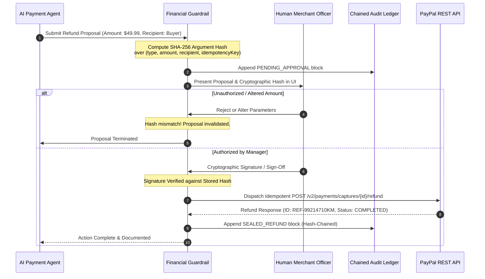

# RESOLVEGRAPH 2.0 — System Architecture & Technical Specifications

**Target:** PayPal AI Hackathon 2026  
**License:** Apache 2.0  
**Repository:** [https://github.com/bindudharad/RESOLVEGRAPH](https://github.com/bindudharad/RESOLVEGRAPH)  
**Branch:** `qa-hardening`  
**Tagline:** ONE PAYMENT. EVERY SOURCE. ONE EXPLAINABLE RESOLUTION.  

---

## 1. High-Level Architecture Overview

RESOLVEGRAPH 2.0 is an enterprise-grade, agentic payment investigation and evidence intelligence network. It bridges disparate financial, commercial, and logistical systems into an immutable, explainable resolution pipeline.

---

## 2. Core Subsystems & Components

### 2.1. Canonical Transaction Engine (CTE)
* **Purpose:** Normalizes disparate transaction schemas into a unified, vendor-neutral representation.
* **Minor Unit Discipline:** All monetary amounts are handled strictly as integer minor units (`totalAmountMinor: 4999` for \$49.99 USD) to prevent IEEE-754 floating-point inaccuracies.
* **Canonical States:** `PENDING`, `AUTHORIZED`, `COMPLETED`, `DISPUTED`, `REFUNDED`, `CHARGED_BACK`.

### 2.2. 10-Tier Transaction Matching Engine
Resolves disjoint transaction fragments through a 10-tier hierarchical matching ladder:
1. **Tier 1 — Exact Provider ID:** Direct match on `paypalOrderId`, `captureId`, or bank reference.
2. **Tier 2 — Exact Order Reference:** Match on merchant order number (`ORD-YYYY-XXXX`).
3. **Tier 3 — Cryptographic Evidence Hash:** Match on SHA-256 digest of uploaded receipt/invoice.
4. **Tier 4 — Deterministic Composite Key:** Compound match on `(buyerEmail, merchantOrgId, exactAmountMinor)`.
5. **Tier 5 — Fuzzy Temporal Correlation:** Matching timestamp within $\pm 15$ minutes with matching minor amount.
6. **Tier 6 — Shipping Manifest Match:** Correlating tracking number with carrier dispatch logs.
7. **Tier 7 — Itemized SKU Overlap:** Jaccard similarity $> 0.85$ on line items.
8. **Tier 8 — Payment Method Token Match:** Hashed credit card fingerprint or PayPal payer ID.
9. **Tier 9 — Dispute Context Match:** Existing active dispute against same order ID.
10. **Tier 10 — Heuristic Fallback:** Flagged for manual investigation review.

### 2.3. Bilateral Evidence Graph (BEG)
* **Bipartite DAG Architecture:** Models buyer evidence nodes on one side and merchant evidence nodes on the other, linked via bipartite edges to a shared transaction vertex.
* **Integrity Validation:** Every file undergoes binary magic-byte inspection (preventing file-extension spoofing) and SHA-256 checksum locking before graph ingestion.

### 2.4. Deterministic BERR v2 Reasoning Engine
Calculates an explainable Discrepancy Score ($D \in [0, 1]$) based on three orthogonal dimensions:

$$D = w_{\text{exact}} D_{\text{exact}} + w_{\text{semantic}} D_{\text{semantic}} + w_{\text{temporal}} D_{\text{temporal}}$$

Where:
* $D_{\text{exact}} \in \{0, 1\}$: Binary factual clashes (e.g., invoiced 1TB NVMe SSD vs. delivered 512GB NVMe SSD).
* $D_{\text{semantic}} \in [0, 1]$: Semantic distance between reported product condition and seller listing.
* $D_{\text{temporal}} \in [0, 1]$: Timing mismatch between carrier delivery confirmation and dispute filing.
* $w_{\text{exact}} = 0.50, w_{\text{semantic}} = 0.35, w_{\text{temporal}} = 0.15$.

---

## 3. Specialized AI Agent & 19 PayPal Tools

The `PaymentInvestigationAgent` operates in a sandboxed, deterministic loop with 19 domain-specific PayPal tools:

| Category | Tool Name | Functionality |
| :--- | :--- | :--- |
| **Order Tools** | `get_paypal_order_details` | Fetches order intent, status, items, and billing details. |
| | `list_paypal_orders` | Queries merchant orders filtered by date and status. |
| | `create_paypal_order` | Initializes a sandbox order session. |
| **Capture Tools** | `get_paypal_capture_details` | Inspects captured funds, payment processor fees, and settlement status. |
| | `capture_paypal_order` | Authorizes settlement of approved order funds. |
| **Refund Tools** | `get_paypal_refund_details` | Reads completed refund records, net balances, and parent capture IDs. |
| | `prepare_paypal_refund` | Calculates allowable refund amounts and constructs cryptographic proposal. |
| **Dispute Tools** | `list_paypal_disputes` | Retrieves active disputes with filing reason and response deadlines. |
| | `get_paypal_dispute_details` | Reads dispute evidence, messages, and offer history. |
| | `accept_paypal_claim` | Accepts buyer claim and authorizes merchant surrender. |
| | `propose_paypal_dispute_settlement` | Proposes bilateral partial refund settlement. |
| | `escalate_paypal_dispute` | Escalates dispute to PayPal formal arbitration. |
| | `appeal_paypal_dispute` | Files formal appeal with supplemental evidence links. |
| | `submit_paypal_dispute_evidence` | Submits validated file hashes to PayPal dispute dossier. |
| **Investigation Tools**| `correlate_transaction_records` | Triggers 10-tier matching across database records. |
| | `query_evidence_vault` | Ingests and inspects verified evidence metadata. |
| | `evaluate_berr_discrepancy` | Executes BERR v2 mathematical discrepancy matrix. |
| | `query_merchant_policy` | Retrieves relevant merchant dispute resolution rules. |
| | `build_investigation_dossier` | Compiles comprehensive, auditable forensic JSON report. |

---

## 4. Zero-Bypass Financial Guardrail Architecture

---

## 5. Tamper-Evident Chained Audit Ledger

Every security-sensitive event produces an immutable ledger block:

$$\text{BlockHash}_n = \text{SHA256}\Big(\text{BlockHash}_{n-1} \parallel \text{Timestamp} \parallel \text{EventType} \parallel \text{ActorId} \parallel \text{CanonicalPayload}\Big)$$

* **Block 0 (Genesis):** Initialized at repository boot with cryptographic seed.
* **Integrity Validation:** Sub-millisecond recursive traversal confirms that no historical block was altered, deleted, or reordered.
* **Auditor Verification:** An external regulator can verify the entire 13-stage investigation lifecycle using standard SHA-256 libraries.

---

## 6. Dual-Mode PayPal Engine: High-Fidelity Simulation & Live Gateway

RESOLVEGRAPH 2.0 features an adaptive provider pattern in `paypal-config.ts`:

1. **High-Fidelity Mock Mode (Default for Hackathon Testing):**
   * Enabled when `PAYPAL_CLIENT_ID` starts with `mock_` or `sb_`.
   * Simulates full PayPal REST v2 responses with realistic IDs (`5O190127TN364715T`, `84729103KM829141P`, `REF-99214710KM`).
   * Zero external network latency, 100% deterministic test pass rate, and zero risk of rate-limiting during judge evaluations.
2. **Live PayPal Sandbox Gateway Mode:**
   * Enabled when valid developer credentials are supplied in `.env`.
   * Dispatches live HTTPS requests to `https://api-m.sandbox.paypal.com`.
   * Acquires and caches OAuth2 bearer tokens (`v1/oauth2/token`).
   * Handles real sandbox webhooks, dispute notifications, and captures.
3. **Production Financial Safety Lock:**
   * Live production transactions are hard-blocked by default via `PAYPAL_LIVE_ENABLED=false` in the core configuration schema. Live money movement cannot be triggered accidentally.
