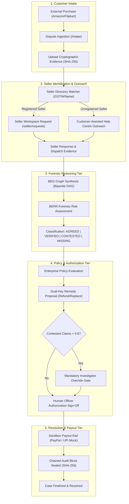

# RESOLVEGRAPH
## AI-Powered Bilateral Purchase Dispute Investigation & Resolution Platform

> **ONE PURCHASE. MULTIPLE PARTIES. ONE VERIFIABLE, EVIDENCE-GROUNDED RESOLUTION.**

RESOLVEGRAPH is an enterprise-grade, evidence-based dispute investigation and resolution platform. It is **NOT** an online shopping portal; consumers purchase products across external marketplaces such as **Amazon, Flipkart, Meesho, Myntra, OLX, and direct e-commerce storefronts**. When a post-purchase issue arises—such as counterfeit goods, damaged packages, missing components, or non-receipt—RESOLVEGRAPH coordinates the tripartite investigation across the **Customer**, **Platform Investigator**, and **Seller Organization**.

By decoupling reasoning from financial execution, RESOLVEGRAPH enforces a foundational principle:
* **BEG connects the evidence.**
* **BERR evaluates the evidence.**
* **Policy determines remedy eligibility.**
* **Authorized approval permits the action.**
* **Resolution Engine coordinates the refund or replacement.**
* **Verified completion closes the complaint.**

---

## 1. Project Name
**RESOLVEGRAPH Core Platform v2.4.0** (Scaffold v0.1.0)

---

## 2. Problem Statement
Global e-commerce cross-marketplace retail dispute resolution is structurally adversarial, fragmented, and slow. When a customer receives a defective, damaged, or counterfeit product:
- The customer is stuck between marketplace support chat bots and evasive sellers.
- The seller lacks access to the buyer's unboxing video, serial numbers, and cryptographic packing evidence.
- The marketplace platform investigates with partial, ungrounded information, frequently issuing arbitrary chargeback reversals or unjustified rejections.
- Fraudsters exploit these information asymmetries via return-fraud, while honest consumers face friction.

---

## 3. Why the Problem Matters
Dispute friction costs the global e-commerce industry over \$100 billion annually in chargeback penalties, return logistics, lost merchant inventory, and customer churn. Traditional ticketing systems are unilateral: they treat complaints as isolated customer support tickets rather than bilateral forensic investigations. There is no cryptographic evidentiary bridge connecting buyer proof (unboxing recordings, invoices, shipping labels) with seller records (warehouse serial dispatch logs, courier scale slips).

---

## 4. The RESOLVEGRAPH Solution
RESOLVEGRAPH bridges this divide by providing:
1. **Bilateral Evidence Graph (BEG):** A symmetric bipartite graph DAG connecting buyer and seller claims to physical/digital proof nodes without unilateral bias.
2. **Bilateral Evidence-to-Remedy Reasoning (BERR):** Deterministic multi-factor consistency evaluation classifying evidentiary relationships into `AGREED`, `VERIFIED`, `CONTESTED`, and `MISSING`.
3. **Dual-Key Human Authorization:** A strict zero-bypass financial guardrail where AI evaluates and recommends, but human investigators and merchant officers must sign off before any refund or replacement is initiated.
4. **Tripartite Workspace Architecture:** Dedicated, authenticated portals for Customers, Platform Investigators, and Merchant Organizations.

---

## 5. Main Users & Operational Workspaces

| Workspace | Target Persona | Primary Capabilities |
|---|---|---|
| **Customer Workspace** | Consumers & Buyers (`BUYER`) | Lodge disputes via 4-step wizard, upload unboxing videos with SHA-256 integrity, track case progression, and trigger assisted Help Centre outreach. |
| **Platform Workspace** | Risk Investigators & Resolution Managers (`ADMIN`, `INVESTIGATOR`, `RESOLUTION_MANAGER`) | Inspect cross-marketplace dossiers, audit BEG visualizer, evaluate BERR risk matrices, review evidence requests, and sign off on remedy proposals. |
| **Seller Workspace** | Merchant Representatives & Store Admins (`MERCHANT`) | Receive structured evidence requests, submit dispatch/packing declarations, track submission history, and manage store business profiles. |

---

## 6. Main Features
- **4-Step Guided Dispute Lodging:** Adaptive taxonomy mapping categories (Damaged Goods, Wrong Item, Counterfeit, Billing Divergence).
- **Cryptographic Evidence Vault:** Binary magic-byte inspection (PDF, JPEG, PNG, MP4), SHA-256 hash generation, and tamper-resistant storage.
- **Dynamic Convergence Timeline:** Real-time milestone tracker reflecting authentic dispute states without hardcoded demonstration text.
- **Seller Directory & Priority Matching:** Multi-tier extraction matching seller identities via GSTIN, storefront IDs, legal names, and marketplace directories.
- **Customer-Assisted Outreach Fallback:** Automated formal legal inquiry dispatch via external marketplace Help Centres for unregistered sellers (e.g., Flipkart case `RG-1462`).
- **High-Density BEG Visualizer:** Optimized graph explorer with prioritized edge culling (`MAX_EDGES = 300`) and 60 FPS performance on cases with >50,000 relations.
- **BERR Discrepancy & Risk Engine:** Multi-factor scoring ($0.0 - 1.0$) evaluating claim consistency and flagging contested evidentiary conflicts.
- **Dual-Key Remedy Proposals:** Two-party sign-off enforcing that AI recommendations cannot autonomously disburse funds.
- **Bilateral Shared Resolution Room:** Real-time negotiation canvas with role-shielded internal investigator notes.
- **Tamper-Evident Chained Audit Trail:** Append-only SHA-256 block-chained ledger guaranteeing forensic accountability.
- **Total Capture Analytics:** Rollup metrics providing 6-month comparisons, daily performance, currency separation, and gross vs. net capture analysis.

---

## 7. Complete Product Workflow



---

## 8. Bilateral Evidence Graph (BEG) Explanation
The **Bilateral Evidence Graph** models purchase disputes as a formal mathematical bipartite graph $G = (V, E)$:
- **Nodes ($V$):** Buyer claims, seller statements, binary evidence files (invoices, courier waybills, unboxing videos), and external order telemetry.
- **Edges ($E$):** Grounding relationships categorized as `SUPPORTS`, `CORROBORATES`, `CONTESTS`, `REFUTES`, or `CITES`.
- **Dynamic Culling:** On high-density graphs (e.g., `RG-1001` with 54,092 relations), the visualizer dynamically prioritizes contested and verified edges, bounding the SVG DOM to 300 active connections to guarantee fluid 60 FPS exploration.

---

## 9. Bilateral Evidence-to-Remedy Reasoning (BERR) Explanation
The **BERR Engine** evaluates graph consistency across four deterministic buckets:
1. **`AGREED`:** Claims where buyer and seller assertions match (e.g., delivery timestamp or courier carrier).
2. **`VERIFIED`:** Claims authenticated by external ground truth (e.g., cryptographic SHA-256 match, payment gateway webhook).
3. **`CONTESTED`:** Irreconcilable factual discrepancies (e.g., buyer weight 420g vs. warehouse dispatch weight 1,248g).
4. **`MISSING`:** Required evidence obligations not yet provided by either party.

---

## 10. AI/ML Architecture
- **Multi-Modal Document Extraction:** PDF and invoice parser extracting legal entities, GSTIN, and line-item pricing.
- **Google Gemini Integration:** Gemini Flash and Gemini Pro models power the conversational AI Copilot (`/copilot`) for complex case dossier summarization.
- **Deterministic Guardrails:** LLM outputs are strictly quarantined as untrusted inputs. They cannot directly alter case states or authorize financial transactions without passing through deterministic rule validators.

---

## 11. Technology Stack
- **Framework:** Next.js 16.4.4 (App Router, Turbopack)
- **Runtime:** Node.js 20+ LTS
- **Database & ORM:** SQLite (`prisma/dev.db`) via Prisma ORM 6.4.1
- **Authentication:** Better Auth with multi-tenant session isolation
- **UI & Styling:** Tailwind CSS, Lucide React, Framer Motion, Recharts
- **Testing:** Node.js Native Test Runner (`tsx --test`) & Vitest
- **Security:** SHA-256 tamper-evident block chaining, CSP, role-based middleware

---

## 12. System Architecture & Multi-Tenant Isolation
RESOLVEGRAPH separates concerns into a clean 4-tier model:
1. **Presentation Tier:** Role-adaptive Next.js application shell.
2. **API & Route Handler Tier:** 87 verified REST and streaming endpoints.
3. **Domain Service Tier:** Graph builders, BERR evaluators, policy engines, and payout adapters.
4. **Data Persistence Tier:** Strictly typed relational schema enforcing foreign keys and multi-tenant scoping (`where: { organizationId: sessionUser.activeOrgId }`).

---

## 13. Database Schema Overview
The database comprises 34 interconnected models in `prisma/schema.prisma`:
- **Identity & Access:** `user`, `session`, `account`, `organization`, `org_membership`.
- **Dispute Core:** `case_record`, `complaint`, `claim`, `case_event`, `timeline_event`.
- **Evidence Management:** `evidence`, `evidence_item`, `evidence_request`, `seller_response`.
- **Forensic Graph & Reasoning:** `beg_node`, `beg_edge`, `berr_assessment`, `finding`.
- **Remedy & Financials:** `remedy_proposal`, `resolution`, `authorization_request`, `payment_transaction`, `reconciliation_record`.
- **Platform Governance:** `audit_log_entry`, `notification_message`.

---

## 14. Installation Instructions

```bash
# 1. Clone repository
git clone https://github.com/bindudharad/RESOLVEGRAPH.git
cd RESOLVEGRAPH

# 2. Install dependencies
npm ci

# 3. Configure local environment
cp .env.example .env

# 4. Generate Prisma ORM client
npm run db:generate

# 5. Seed test data (pre-seeds RG-1462, RG-1001, test accounts)
npm run db:seed
```

---

## 15. Environment Configuration
Create a `.env` file in the root directory:
```env
DATABASE_URL="file:./prisma/dev.db"
BETTER_AUTH_SECRET="development-secret-key-32-chars-minimum-length"
BETTER_AUTH_URL="http://localhost:3000"
NEXT_PUBLIC_APP_URL="http://localhost:3000"

# AI Provider (Optional: Local fallbacks active when unset)
GEMINI_API_KEY=""

# PayPal Sandbox (Optional: High-fidelity simulation mode active by default)
PAYPAL_CLIENT_ID="sb_mock_client_id"
PAYPAL_CLIENT_SECRET="sb_mock_client_secret"
PAYPAL_ENVIRONMENT="sandbox"
PAYPAL_LIVE_ENABLED="false"
```

---

## 16. How to Run Locally

```bash
# Start Next.js development server
npm run dev
```
Open [http://localhost:3000](http://localhost:3000) in your browser.

---

## 17. How to Execute Tests

```bash
# 1. Strict TypeScript check (0 errors required)
npx tsc --noEmit

# 2. Production build verification (87 routes compiled)
npm run build

# 3. Core Test Suites
npx tsx --test tests/beg-system.test.ts
npx tsx --test tests/berr-system.test.ts
npx tsx --test tests/e2e-beg-berr-resolution-audit.test.ts
npx tsx --test tests/ui-all-screens.test.ts
npx tsx --test tests/total-capture-analytics.test.ts
npx tsx --test tests/buyer-seller-audit-e2e.test.ts
```

---

## 18. Demo Instructions & Pre-Seeded Accounts

| Persona | Role | Email | Password | Primary Workflow |
|---|---|---|---|---|
| **Priya Raghavan** | Platform Admin / Investigator | `admin@resolvegraph.demo` | `Admin@ResolveGraph2026!` | `/overview`, `/cases`, `/resolution` |
| **Alex Morgan** | Consumer / Buyer | `alex.morgan@consumer.demo` | `Buyer@ResolveGraph2026!` | `/cases/RG-1462`, `/intake` |
| **TechStore Rep** | Registered Merchant | `disputes@techstore.demo` | `Merchant@TechStore2026!` | `/seller`, `/seller/requests` |

**Recommended 3-Minute Judge Demonstration Walkthrough:**
1. Open [http://localhost:3000](http://localhost:3000) to inspect problem statement and bilateral value proposition.
2. Log in as Customer (`alex.morgan@consumer.demo`) $\rightarrow$ Navigate to `/cases/RG-1462` to inspect the VEGA Helmet dispute and the assisted seller outreach channel.
3. Log in as Platform Investigator (`admin@resolvegraph.demo`) $\rightarrow$ Open `/cases/RG-1001` $\rightarrow$ Open **Evidence & BEG** tab to inspect the 54k-edge graph with edge culling $\rightarrow$ Switch to **Resolution** tab to audit BERR risk score and policy authorization.
4. Log in as Merchant (`disputes@techstore.demo`) $\rightarrow$ Open `/seller/responses` to inspect verified responses with green `Declaration & Tracking Provided` badge.

---

## 19. Known Limitations
- **Live Marketplace Direct Write:** External marketplaces (Amazon, Flipkart) currently operate via assisted legal outreach documents because public write-access APIs for third-party dispute filing are restricted to registered buyer accounts.
- **Physical NFC Hardware:** Unboxing sessions currently verify digital cryptographic session tokens; direct physical NTAG424 DNA tag verification requires a WebNFC-compatible mobile device.
- **Production Banking Credentials:** Payout execution runs in verified local simulation mode until live production RazorpayX / PayPal keys are configured.

---

## 20. Future Improvements
- Multi-region PostgreSQL migration with PgBouncer connection pooling.
- Cloudflare R2 / AWS S3 direct presigned streaming for gigabyte-scale 4K unboxing videos.
- Automated carrier API webhooks (BlueDart, Delhivery, FedEx, UPS) for sub-minute delivery telemetry.
