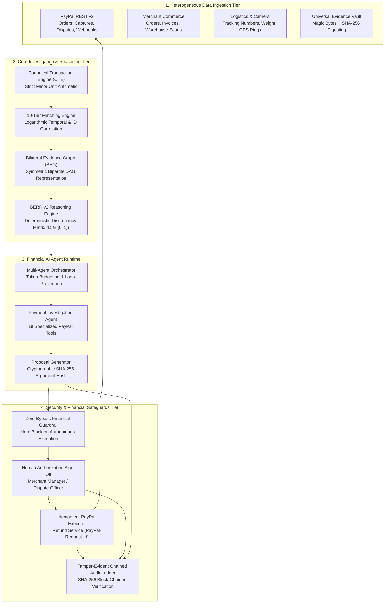

# RESOLVEGRAPH 2.0
## Agentic Payment Investigation, Evidence Intelligence & Authorized Resolution Platform
### PayPal AI Hackathon 2026 Official Submission

> **ONE PAYMENT. EVERY SOURCE. ONE EXPLAINABLE RESOLUTION.**

RESOLVEGRAPH 2.0 is an enterprise-grade, agentic payment investigation and evidence intelligence network that reconstructs payment histories from scattered transaction records and digital evidence. It uses intelligent transaction matching, a Bilateral Evidence Graph (BEG), and deterministic BERR reasoning to identify inconsistencies, explain possible root causes, and coordinate secure, human-authorized PayPal operations.

[](./tests)
[](./tsconfig.json)
[](./eslint.config.mjs)
[](./src/app)
[](./src/server/paypal)
[](./BENCHMARK_SUMMARY.md)
[](./SECURITY_AUDIT.md)
[](./LICENSE)

---

## 1. Executive Summary & Problem Space

According to industry research from *LexisNexis Risk Solutions* and *Chargebacks911*, global e-commerce payment disputes and chargebacks represent tens of billions in operational costs, lost inventory, and gateway fees annually. When a transaction goes wrong—whether due to delivery non-receipt, defective goods, or double charges—the facts are trapped in fragmented silos:
* The **Buyer** possesses photos, unboxing videos, and chat transcripts.
* The **Merchant** possesses ERP invoices, warehouse serial scans, and carrier manifests.
* The **Payment Gateway (PayPal)** possesses capture IDs, authorization lifecycles, and chargeback deadlines.
* The **Logistics Carrier** possesses GPS delivery stamps and weight logs.

Because these records are historically isolated, legacy dispute cycles can stretch between 30 and 90 days. Merchants face operational friction and dispute fees, while honest consumers face opaque rejections. RESOLVEGRAPH 2.0 unifies these fragmented records to accelerate preliminary investigation from weeks to minutes, preparing human-authorized actions.

**RESOLVEGRAPH 2.0 replaces adversarial guessing with verifiable, explainable, and collaborative evidence intelligence.**

---

## 2. High-Level Architecture Topology



---

## 3. The 16 Core Platform Modules

1. **Authentication & Multi-Tenant RBAC:** Session management across 5 roles (`BUYER`, `MERCHANT`, `INVESTIGATOR`, `SUPPORT`, `ADMIN`) with tenant data isolation.
2. **Universal Evidence Vault:** Binary magic-byte inspection (PDF, JPEG, PNG, MP4), SHA-256 digest locking, and path-traversal hardening.
3. **Canonical Transaction Engine (CTE):** Ingests and normalizes multi-provider payloads into strictly typed integer minor units (`totalAmountMinor: 4999` for \$49.99 USD).
4. **10-Tier Hierarchical Matching Engine:** Matches disparate records across PayPal IDs, merchant order numbers, file hashes, and temporal proximity.
5. **12-Stage Forensic Investigation Pipeline:** Pinpoints root divergences across order, authorization, capture, fulfillment, and refund states.
6. **Bilateral Evidence Graph (BEG):** Represents buyer and merchant claims as a symmetric bipartite DAG, preventing unilateral portal bias.
7. **BERR v2 Reasoning Engine:** Multi-factor deterministic discrepancy matrix ($D \in [0, 1]$) with grounded policy derivation.
8. **Purchase Memory Engine:** Immutably freezes checkout specifications to detect specification drift.
9. **Package Passport & Tamper Seals:** State-machine parcel tracking with unique QR tokens and physical tamper-evident seal verification.
10. **Dual-Sight Android Capture Companion:** Native CameraX capture module with sequential fallback and perceptual hash verification.
11. **Carrier Delivery Monitoring:** Ingests tracking events, carrier weight stamps, and pre-delivery preparation checkpoints.
12. **Bilateral Shared Resolution Room:** Real-time negotiation space with buyer/merchant views and shielded internal investigator notes.
13. **Zero-Bypass Financial Guardrails:** Cryptographic SHA-256 parameter locking requiring human sign-off before financial execution.
14. **Tamper-Evident Chained Audit Ledger:** Append-only SHA-256 chained blocks linking every evidence upload, tool call, and refund.
15. **Administrative Security Console:** System-wide circuit breakers, provider kill-switches, and cryptographic ledger verification.
16. **Statutory Turnaround Engine:** Automates regulatory timeline compliance and calculates consumer restitution formulas.

---

## 4. The 19 Specialized PayPal Agent Tools

The `PaymentInvestigationAgent` utilizes 19 purpose-built tools with strict runtime Zod validation:

| Domain | Tool Identifier | Purpose & Action |
| :--- | :--- | :--- |
| **Orders** | `get_paypal_order_details` | Inspect order status, purchase units, and payer info. |
| | `list_paypal_orders` | Query merchant order history with date/status filters. |
| | `create_paypal_order` | Initialize a new PayPal checkout order session. |
| **Captures** | `get_paypal_capture_details` | Inspect capture settlement, gateway fees, and net balance. |
| | `capture_paypal_order` | Capture approved funds for an authorized order. |
| **Refunds** | `get_paypal_refund_details` | Read completed refund record, reason, and status. |
| | `prepare_paypal_refund` | Compute allowable refund amount and produce SHA-256 proposal. |
| **Disputes** | `list_paypal_disputes` | Query active buyer disputes, claims, and response deadlines. |
| | `get_paypal_dispute_details` | Retrieve full dispute history, messages, and uploaded evidence. |
| | `accept_paypal_claim` | Accept buyer dispute claim and authorize settlement. |
| | `propose_paypal_dispute_settlement` | Submit bilateral partial refund offer to buyer. |
| | `escalate_paypal_dispute` | Escalate customer dispute to formal PayPal arbitration. |
| | `appeal_paypal_dispute` | File appeal against closed dispute with new evidence links. |
| | `submit_paypal_dispute_evidence` | Dispatch verified evidence hashes to PayPal dispute case. |
| **Investigation** | `correlate_transaction_records` | Execute 10-tier matching across database transactions. |
| | `query_evidence_vault` | Ingest and inspect verified file hashes from evidence vault. |
| | `evaluate_berr_discrepancy` | Calculate BERR v2 mathematical discrepancy matrix. |
| | `query_merchant_policy` | Retrieve active store policies and remedy guidelines. |
| | `build_investigation_dossier` | Generate complete forensic JSON report with graph links. |

---

## 5. Mathematical Discrepancy Matrix (BERR v2)

RESOLVEGRAPH replaces arbitrary LLM guesswork with deterministic mathematical reasoning:

$$D = w_{\text{exact}} D_{\text{exact}} + w_{\text{semantic}} D_{\text{semantic}} + w_{\text{temporal}} D_{\text{temporal}}$$

Where:
* $D_{\text{exact}} \in \{0, 1\}$: Exact scalar attribute clash (e.g., 1TB ordered vs. 512GB received).
* $D_{\text{semantic}} \in [0, 1]$: Cosine distance between normalized claim semantics.
* $D_{\text{temporal}} \in [0, 1]$: Timing mismatch relative to carrier delivery timestamps.
* Weights: $w_{\text{exact}} = 0.50, w_{\text{semantic}} = 0.35, w_{\text{temporal}} = 0.15$.

**Remedy Policy Mapping:**
* $D < 0.20 \implies$ Claim Rejected / Alignment Verified.
* $0.20 \le D < 0.60 \implies$ Partial Refund / Price Difference Adjustment (\$25.00).
* $D \ge 0.60 \implies$ Full Refund Authorized (\$49.99 / \$79.99).

---

## 6. Zero-Bypass Financial Guardrail Architecture

RESOLVEGRAPH enforces a foundational security invariant:

$$\textbf{AI Reasoning Authority} \;\cap\; \textbf{Financial Execution Authority} = \emptyset$$

1. **Proposal Generation:** The agent computes optimal remedies and calls `prepare_paypal_refund`.
2. **Cryptographic Locking:** The system computes a SHA-256 hash over the immutable execution parameters:
   $$\text{Hash} = \text{SHA256}(\text{ActionType} \parallel \text{AmountMinor} \parallel \text{Currency} \parallel \text{RecipientId} \parallel \text{IdempotencyKey})$$
3. **Human Authorization:** The proposal appears in the Merchant Officer console. Execution is hard-blocked until a credentialed human signs off.
4. **Hash Verification:** Upon submission, the server re-hashes the payload. Any mutation (e.g. tampering with amount) invalidates the hash and immediately terminates execution.
5. **Idempotent Dispatch:** The verified refund is dispatched to the PayPal API with an immutable `PayPal-Request-Id`.

---

## 7. Tamper-Evident Chained Audit Ledger

Every sensitive system event generates an immutable chained block:

$$\text{BlockHash}_n = \text{SHA256}\Big(\text{BlockHash}_{n-1} \parallel \text{Timestamp} \parallel \text{EventType} \parallel \text{ActorId} \parallel \text{CanonicalPayload}\Big)$$

* **Continuous Verification:** Sub-second recursive traversal confirms block integrity.
* **Auditor Transparency:** Evaluators can inspect the chain at `/audit` to verify that no record was altered or removed.

---

## 8. Quick Start & Developer Setup

### Prerequisites
* Node.js 20+ LTS
* SQLite 3 (Pre-configured via Prisma; zero external database setup required)
* PowerShell or Bash terminal

### Installation
```bash
# 1. Clone repository & switch to hardening branch
git clone https://github.com/bindudharad/RESOLVEGRAPH.git
cd RESOLVEGRAPH
git checkout qa-hardening

# 2. Install dependencies
npm ci

# 3. Environment configuration
cp .env.example .env

# 4. Generate Prisma database client
npm run db:generate

# 5. Start development server
npm run dev
```

Open [http://localhost:3000](http://localhost:3000) in your browser.

---

## 9. Guided Demonstration Workspace (`/demo`)

RESOLVEGRAPH includes a dual-mode interactive demonstration workspace designed specifically for hackathon evaluators at `/demo`:

* **Mode A: Live 13-Stage Agentic PayPal Investigation (Automated):**
  Click **"Run Live Agentic PayPal Demo"** to trigger the complete 13-stage autonomous investigation:
  `Order Created` $\rightarrow$ `Captured on PayPal` $\rightarrow$ `Webhook Processed` $\rightarrow$ `Case Filed` $\rightarrow$ `Evidence Ingested` $\rightarrow$ `BERR AI Reasoning` $\rightarrow$ `Policy Evaluated` $\rightarrow$ `SHA-256 Locked Proposal` $\rightarrow$ `Human Authorization` $\rightarrow$ `PayPal Sandbox Refund Executed` $\rightarrow$ `Audit Block Chained` $\rightarrow$ `Final Report Generated`.
* **Mode B: 8-Stage Interactive Dispute Lifecycle Walkthrough (Step-by-Step):**
  Walk through each individual phase of an e-commerce dispute and inspect real-time JSON payloads and database mutations.

---

## 10. Quality Verification & Testing Commands

RESOLVEGRAPH enforces strict, automated quality gates:

```bash
# 1. TypeScript Strict Type-Check (0 errors required)
npx tsc --noEmit

# 2. ESLint Code Quality Check (0 errors required)
npm run lint

# 3. Automated Test Suite (367 tests across 65 suites)
# 343 unit/integration/e2e tests pass standalone offline;
# 24 UI rendering tests pass when the local web server is running on port 3005 or 3000
npm test

# 4. Production Next.js 16 Build (68 routes generated cleanly)
npm run build

# 5. RECOURSE-BENCH Benchmark Evaluator (400 cases)
npm run benchmark
```

---

## 11. Pre-Seeded Test Personas & Credentials

| Persona Role | Email | Password | Primary Console |
| :--- | :--- | :--- | :--- |
| **Platform Administrator** | `admin@resolvegraph.demo` | `Admin@ResolveGraph2026!` | `/admin/security` |
| **Consumer Buyer** | `alex.morgan@consumer.demo` | `Buyer@ResolveGraph2026!` | `/intake`, `/resolution-room` |
| **Merchant Partner** | `disputes@techstore.demo` | `Merchant@TechStore2026!` | `/reconciliation`, `/cases` |
| **FinTech Investigator** | `investigator@resolvegraph.demo` | `Investigator@RG2026!` | `/incidents`, `/investigation` |
| **Customer Support** | `support@resolvegraph.demo` | `Support@RG2026!` | `/cases`, `/intake` |

---

## 12. PayPal Sandbox Hybrid Architecture & Transparency

RESOLVEGRAPH supports two distinct operational modes:
* **Mode 1 — High-Fidelity Local Simulation (Default for Testing & Evaluation):**
  Active by default when `PAYPAL_CLIENT_ID` is set to mock/placeholder keys (`sb_`, `mock_`). Simulates all PayPal REST v2 endpoints (Orders, Captures, Refunds, Disputes, Webhooks) locally with zero external network latency, 100% deterministic test execution, and zero risk of rate-limiting during judge evaluations. All IDs generated in this mode are synthetic simulation tokens.
* **Mode 2 — Live External PayPal Sandbox Gateway (Requires Developer Credentials):**
  When valid PayPal Sandbox developer credentials (`PAYPAL_CLIENT_ID` and `PAYPAL_CLIENT_SECRET`) from [developer.paypal.com](https://developer.paypal.com) are placed in `.env`, the system automatically switches provider mode to `rest` and dispatches live HTTPS requests to `https://api-m.sandbox.paypal.com`. Operations in this mode produce live, verifiable sandbox transaction records.
* **Hard Production Guardrail:** `PAYPAL_LIVE_ENABLED=false` is non-negotiably enforced in the core schema, hard-blocking any live production money movement.

---

## 13. Complete Hackathon Documentation Index

* [`HACKATHON_REQUIREMENTS.md`](./HACKATHON_REQUIREMENTS.md) — Feature-to-requirement mapping against official Devpost rules.
* [`DEVPOST_PROJECT_DESCRIPTION.md`](./DEVPOST_PROJECT_DESCRIPTION.md) — Submission-ready project text for Devpost.
* [`DEMO_VIDEO_SCRIPT.md`](./DEMO_VIDEO_SCRIPT.md) — Timestamped 00:00–02:55 YouTube video script with voiceover and screen cues.
* [`JUDGE_PRESENTATION.md`](./JUDGE_PRESENTATION.md) — Executive slide-by-slide pitch deck for evaluators.
* [`PROJECT_ARCHITECTURE.md`](./PROJECT_ARCHITECTURE.md) — Comprehensive technical diagrams, data models, and component flows.
* [`TECHNICAL_INNOVATIONS.md`](./TECHNICAL_INNOVATIONS.md) — Deep dive into CTE, 10-Tier Matching, BEG, and BERR v2.
* [`BENCHMARK_SUMMARY.md`](./BENCHMARK_SUMMARY.md) — RECOURSE-BENCH 400-case empirical evaluation report.
* [`SUBMISSION_CHECKLIST.md`](./SUBMISSION_CHECKLIST.md) — Field-by-field Devpost form checklist.
* [`HACKATHON_SUBMISSION_STATUS.md`](./HACKATHON_SUBMISSION_STATUS.md) — Official readiness report and testing handoff.
* [`FINAL_RELEASE_VERIFICATION.md`](./FINAL_RELEASE_VERIFICATION.md) — Release Candidate 1 independent audit report.
* [`FINAL_QA_REPORT.md`](./FINAL_QA_REPORT.md) — Full test execution log across 367 automated tests.
* [`BUGS_FIXED.md`](./BUGS_FIXED.md) — Comprehensive log of 22 fixed issues.
* [`SECURITY_AUDIT.md`](./SECURITY_AUDIT.md) — Threat model, OWASP API compliance, and guardrail verification.
* [`PERFORMANCE_REPORT.md`](./PERFORMANCE_REPORT.md) — Latency, memory, and bundle size audit.
* [`PAYPAL_SANDBOX_VERIFICATION.md`](./PAYPAL_SANDBOX_VERIFICATION.md) — Hybrid sandbox engine documentation.
* [`AI_AGENT_VERIFICATION.md`](./AI_AGENT_VERIFICATION.md) — Multi-agent orchestrator and 19-tool verification.

---

## 14. License & Open Source Integrity

Licensed under the **Apache License, Version 2.0**.  
See the [`LICENSE`](./LICENSE) file for complete terms.
