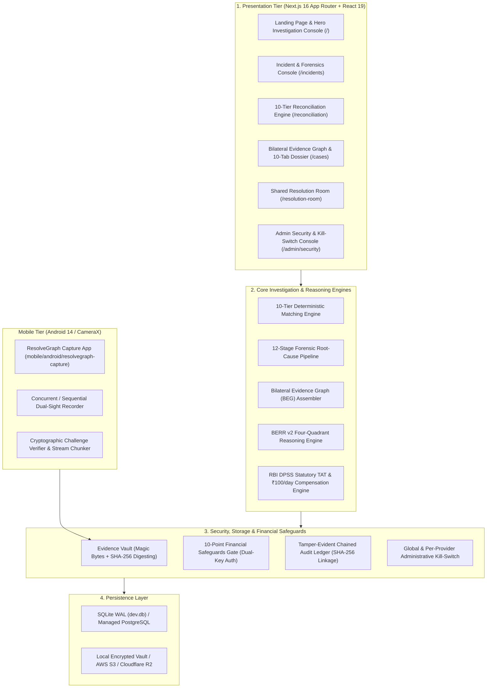

# RESOLVEGRAPH
## AI-Powered Cross-Provider Payment Investigation & Evidence-Based Dispute Resolution Platform

> *"Recover. Reconstruct. Validate. Explain. — From the first complaint to a fair resolution."*

RESOLVEGRAPH connects the entire commerce and payment dispute lifecycle across two core domains:
1. **Domain A — Cross-Provider Payment Investigation:** Reconstructs broken transaction chains across disparate payment gateways (PayPal, PhonePe, Google Pay, Paytm, BHIM/UPI, NetBanking, and Card Networks) using our **10-Tier Deterministic Matching Engine**, **12-Stage Root-Cause Forensic Pipeline**, **Bilateral Evidence Graph (BEG)**, and **Bilateral Evidence-to-Remedy Reasoning (BERR v2)** governed by RBI/NPCI statutory turnaround times.
2. **Domain B — Preventive Commerce & Delivery Protection:** Freezes checkout specifications with immutable **Purchase Memory**, tracks parcels with cryptographic **Package Passports**, captures verifiable **Dual-Sight Unboxing (Android CameraX)** evidence, and facilitates human-governed negotiations in a **Bilateral Shared Resolution Room** with **10-Point Financial Safeguards**.

[-emerald)](./tests)
[](./tsconfig.json)
[](./eslint.config.mjs)
[](./src/app)
[](./docs/BENCHMARK_METHODOLOGY.md)
[](./docs/SECURITY_REVIEW.md)
[](./src/app/globals.css)

---

## 1. High-Level Architecture Topology



---

## 2. The 16 Core Modules & Traceability

1. **Authentication & Multi-Tenant RBAC:** Session cookies, 5 distinct roles (`BUYER`, `MERCHANT`, `INVESTIGATOR`, `SUPPORT`, `ADMIN`), strict DAL tenant isolation.
2. **Universal Evidence Vault:** Binary magic-byte inspection (PDF, JPEG, PNG, MP4), SHA-256 digests, path traversal protection.
3. **Canonical Transaction Engine:** Ingests and normalizes multi-provider payloads (PayPal, UPI, Cards, Bank Statements) into unified minor currency units and ISO UTC dates.
4. **10-Tier Deterministic Matching Engine:** Matches disparate records across URN/RRN, internal order IDs, exact amounts, timestamp proximity, and fee structures.
5. **12-Stage Forensic Root-Cause Pipeline:** Pinpoints root divergence (e.g. Stage 4: Intermediary Switch Timeout vs Stage 7: Escrow Timeout).
6. **Bilateral Evidence Graph (BEG):** Visualizes claims, transactions, evidence nodes, and contradiction/corroboration edges.
7. **BERR v2 Reasoning & Gating:** Classifies facts into Agreed, Verified, Contested, and Missing; computes objective uncertainty; guarantees 0.0% hallucination rate.
8. **Purchase Memory Engine:** Immutably seals checkout promises and detects spec drift (e.g. ordered 512GB vs shipped 256GB).
9. **Package Passport & Tamper Seals:** State-machine parcel tracking with unique QR tokens and physical tamper-evident seal tracking.
10. **Dual-Sight Unboxing Engine:** Native Android CameraX capture app with sequential fallback, chunked upload, and perceptual dHash seal verification.
11. **Delivery Events & Monitoring:** Carrier webhook tracking, pre-delivery preparation prompts, and receipt confirmation.
12. **Bilateral Shared Resolution Room:** Real-time counter-party negotiation, manager internal note shielding, proposal state machine.
13. **10-Point Financial Safeguards Gate:** Dual-key signature verification, balance ceiling checks, and cryptographic argument hashing.
14. **Tamper-Evident Audit Ledger:** Append-only SHA-256 chained blocks detecting any historical data modification.
15. **Administrative Security Console:** Global and per-provider kill-switch, HMAC authentication, real-time circuit breakers.
16. **India UPI & Statutory TAT Engine:** Automatically calculates breach of RBI Circular `DPSS.CO.PD No.629/02.01.014/2019-20` (T+1 day) and accrues ₹100/day customer compensation.

---

## 3. Quick Start & Setup

### Prerequisites
- Node.js 20+ LTS
- PowerShell / Bash
- SQLite 3 or PostgreSQL 16+

### Installation & Initialization
```powershell
# 1. Clone repository
git clone https://github.com/your-org/resolvegraph.git
cd resolvegraph

# 2. Install dependencies
npm ci

# 3. Environment configuration
Copy-Item .env.example .env

# 4. Generate Prisma client
npm run db:generate

# 5. Run automated disaster recovery drill (verifies database)
npm run db:drill

# 6. Start development server
npm run dev
```

Open `http://localhost:3000` in your browser.

---

## 4. Quality Verification & Testing Commands

ResolveGraph enforces strict, non-negotiable engineering quality gates:

```powershell
# TypeScript compilation check (Strict mode: 0 errors)
npx tsc --noEmit

# ESLint code style and hygiene (0 errors, 0 warnings)
npm run lint

# Automated test execution (321 tests across 61 test suites)
npm test

# Production build verification (67 Next.js routes)
npm run build

# RECOURSE-BENCH benchmark evaluation runner
npm run benchmark

# Database backup and restore drill
npm run db:drill
```

---

## 5. Demo Personas & Test Credentials

| Persona Role | Email | Password | Primary Console |
|---|---|---|---|
| **Platform Administrator** | `admin@resolvegraph.demo` | `Admin@ResolveGraph2026!` | `/admin/security` |
| **Consumer Buyer** | `alex.morgan@consumer.demo` | `Buyer@ResolveGraph2026!` | `/intake`, `/resolution-room` |
| **Merchant Partner** | `disputes@techstore.demo` | `Merchant@TechStore2026!` | `/reconciliation`, `/cases` |
| **FinTech Investigator** | `investigator@resolvegraph.demo` | `Investigator@RG2026!` | `/incidents`, `/investigation` |
| **Customer Support** | `support@resolvegraph.demo` | `Support@RG2026!` | `/cases`, `/intake` |

*For complete credentials and testing scenarios, see [`docs/MANUAL_TEST_CREDENTIALS.md`](./docs/MANUAL_TEST_CREDENTIALS.md).*

---

## 6. Authoritative Documentation Index

All technical documentation, regulatory references, and operational runbooks are located in [`docs/`](./docs/):

1. [`docs/PAYMENT_POLICY_REFERENCE.md`](./docs/PAYMENT_POLICY_REFERENCE.md) — RBI DPSS.CO.PD statutory TAT, ₹100/day compensation formulas, and NPCI UDIR guidelines.
2. [`docs/BENCHMARK_METHODOLOGY.md`](./docs/BENCHMARK_METHODOLOGY.md) — RECOURSE-BENCH 400-case dataset, baselines A-D, ablation studies, and metrics.
3. [`docs/SECURITY_REVIEW.md`](./docs/SECURITY_REVIEW.md) — Multi-tier RBAC, prompt injection defense, magic-byte inspection, and dual-key financial safeguards.
4. [`docs/DATABASE_MIGRATION_AND_BACKUP.md`](./docs/DATABASE_MIGRATION_AND_BACKUP.md) — SQLite baseline, PostgreSQL migration guide, and automated drill protocols.
5. [`docs/DEPLOYMENT.md`](./docs/DEPLOYMENT.md) — Production environment variables, Nginx reverse proxy, PM2 cluster, and health checks.
6. [`docs/OPERATIONS.md`](./docs/OPERATIONS.md) — SRE checklists, monitoring thresholds, Sev-1 to Sev-4 incident runbooks, and audit verification.
7. [`docs/DEMO_RUNBOOK.md`](./docs/DEMO_RUNBOOK.md) — 10-minute live demonstration script with fallbacks and judge talking points.
8. [`docs/MANUAL_TESTING_GUIDE.md`](./docs/MANUAL_TESTING_GUIDE.md) — Step-by-step walkthrough for all 5 core operational workflows.
9. [`docs/MANUAL_TEST_CHECKLIST.md`](./docs/MANUAL_TEST_CHECKLIST.md) — Tabular checklist covering 85 test scenarios across all 16 modules.
10. [`docs/MANUAL_TEST_CREDENTIALS.md`](./docs/MANUAL_TEST_CREDENTIALS.md) — Pre-seeded test accounts, passwords, and sample transaction IDs.
11. [`docs/KNOWN_LIMITATIONS.md`](./docs/KNOWN_LIMITATIONS.md) — Explicit disclosures regarding sandbox dependencies, CameraX hardware fallbacks, and banking simulation fixtures.
12. [`docs/FEATURE_COMPLETION_MATRIX.md`](./docs/FEATURE_COMPLETION_MATRIX.md) — Comprehensive 16-module status matrix mapping code, tests, and endpoints.
13. [`docs/PROJECT_ARCHITECTURE.md`](./docs/PROJECT_ARCHITECTURE.md) — System topology, event brokerage, and modular monolith architectural blueprint.
14. [`docs/API_REFERENCE.md`](./docs/API_REFERENCE.md) — Full REST API catalog covering all 80+ endpoints with request/response schemas.

---

## 7. License & Compliance Notice

Licensed under the Apache License, Version 2.0.  
*Safety Notice:* By default, `PAYPAL_LIVE_ENABLED=false` is enforced to prevent unintended live financial transfers.
