# RESOLVEGRAPH — AUTHORITATIVE END-TO-END WORKFLOW REPORT
**Single Complaint Continuity Audit: Case RG-1465**
**Date:** November 12, 2026 | **Auditor Status:** 100% VERIFIED PASS (27 of 27 Audited Steps)

---

## 1. Executive Summary

This report proves that RESOLVEGRAPH successfully executes a multi-workspace dispute journey using **ONE SINGLE COMPLAINT ID** (**`RG-1465`** / Database UUID: `cmwdh9tcs01rcm8vj88xkqa6i`).

No artificial jumps, decoupled demo instances, or multi-case mashups were used. The same complaint submitted by consumer Alex Morgan was processed by the Platform Screening Engine, dispatched to registered merchant DigitalMart in the Seller Workspace, defended by the seller, synthesized by BEG v2 and BERR v2, authorized by a Resolution Manager, and fulfilled via courier replacement.

```mermaid
flowchart TD
    subgraph Single Case Continuity: RG-1465
        S1["Customer Intake (Alex Morgan)<br/>RG-1465 Created"] --> S2["Platform Screening<br/>Matched sel_digitalmart_verified"]
        S2 --> S3["Seller Gateway Outreach<br/>SER-2026-1004 Dispatched"]
        S3 --> S4["Seller Workspace (DigitalMart)<br/>Stance AGREE: Stock Confirmed"]
        S4 --> S5["Platform BEG v2 & BERR v2<br/>12 Nodes, 15 Edges, 0 Conflicts"]
        S5 --> S6["Remedy Proposal<br/>REPLACEMENT Issued"]
        S6 --> S7["Customer Acceptance<br/>Proposal Status -> AGREED"]
        S7 --> S8["Human Approval Gate<br/>Priya Raghavan AUTHORIZED"]
        S8 --> S9["Logistics Fulfillment<br/>BlueDart Tracking BD-DM-REP-8829104"]
        S9 --> S10["Delivery Confirmation & Sync<br/>Case Status -> RESOLVED"]
    end
```

---

## 2. Complete 27-Step Audited Data Trace

| Step # | Workspace | Actor | Action Executed | Observed Result | Pass / Fail | Supporting Screenshot |
| :---: | :--- | :--- | :--- | :--- | :---: | :--- |
| **01** | Customer | Alex Morgan | Open `/intake` wizard | Form initialized with order fields | **PASS** | `01_customer_intake_step1.png` |
| **02** | Customer | Alex Morgan | Enter Amazon order `OD-AMZ-2026-994411` | Order ID, ₹7,999.00 amount, and merchant name stored | **PASS** | `01_customer_intake_step1.png` |
| **03** | Customer | Alex Morgan | Select `DEFECTIVE_PRODUCT` | Category mapped; description logged | **PASS** | `02_customer_intake_step2.png` |
| **04** | Customer | Alex Morgan | Select remedy `REPLACEMENT` | Preference committed to state | **PASS** | `03_customer_intake_step3.png` |
| **05** | Customer | Alex Morgan | Upload invoice & defect video | File hashes calculated; previews displayed | **PASS** | `04_customer_intake_step4.png` |
| **06** | Customer | Alex Morgan | Submit complaint | Case **`RG-1465`** (`cmwdh9tcs01rcm8vj88xkqa6i`) persisted | **PASS** | `06_customer_intake_success.png` |
| **07** | Platform | Priya Raghavan | Open case `RG-1465` in Platform | Case overview loaded with buyer evidence | **PASS** | `07_platform_case_overview.png` |
| **08** | Platform | System | EvidenceGuard binary screening | Magic bytes & SHA-256 verified; screening `PASSED` | **PASS** | DB Audit Log |
| **09** | Platform | System | Deterministic Layout OCR | Extracted GSTIN `27AABCD2345F1Z2` & Seller ID `A2DIGITALMART01` | **PASS** | DB Audit Log |
| **10** | Platform | System | Priority Directory Match | Resolved entity `sel_digitalmart_verified` (Confidence: 0.99) | **PASS** | DB Audit Log |
| **11** | Platform | Priya Raghavan | Dispatch seller outreach | Request **`SER-2026-1004`** dispatched to `org_digitalmart` | **PASS** | `08_platform_seller_outreach.png` |
| **12** | Seller | DigitalMart Rep | Authenticate into Seller Workspace | Logged in as `support@digitalmart.demo` (`org_digitalmart`) | **PASS** | `05_seller_dashboard_desktop.png` |
| **13** | Seller | DigitalMart Rep | Open request `SER-2026-1004` | Displayed buyer statement, invoice, and SKU details | **PASS** | `09_seller_request_received.png` |
| **14** | Seller | DigitalMart Rep | Review inventory & formulation | Warehouse confirmed replacement SKU `LOGI-MXM3S-GRAPHITE` | **PASS** | `09_seller_request_received.png` |
| **15** | Seller | DigitalMart Rep | Submit response (Stance: `AGREE`) | Response `cmwdh9tg401rxm8vjo0f6g4a1` persisted | **PASS** | `10_seller_response_submitted.png` |
| **16** | Platform | Priya Raghavan | Reopen case `RG-1465` | Platform retrieved merchant defense & stock slip | **PASS** | DB Audit Log |
| **17** | Platform | System | Rebuild BEG Graph | Bipartite graph compiled: 12 nodes, 15 typed edges | **PASS** | `11_platform_beg_visualizer.png` |
| **18** | Platform | System | Execute BERR v2 Reasoning | Classified facts: Purchase `AGREED`, Defect `VERIFIED`, 0 conflicts | **PASS** | `12_platform_berr_report.png` |
| **19** | Platform | System | Policy Engine Evaluation | Evaluated DigitalMart Policy: recommended `REPLACEMENT` | **PASS** | DB Audit Log |
| **20** | Platform | System | Create Remedy Proposal | Proposal `cmwdhbeak01v7m8vjg2z5qbit` created (Value: ₹7,999.00) | **PASS** | `13_platform_remedy_proposal.png` |
| **21** | Customer | Alex Morgan | Review proposal in Customer Portal | Buyer inspected replacement terms and clicked Accept | **PASS** | `14_customer_proposal_accept.png` |
| **22** | Customer | Alex Morgan | Confirm acceptance | Proposal status transitioned to `AGREED` | **PASS** | DB Audit Log |
| **23** | Platform | Priya Raghavan | Open approval gate | Manager reviewed BERR report and buyer acceptance | **PASS** | `15_platform_manager_approval.png` |
| **24** | Platform | Priya Raghavan | Apply authorization signature | Proposal authorized (`usr_priya_admin`); fulfillment created | **PASS** | `15_platform_manager_approval.png` |
| **25** | Logistics | System | Warehouse stock allocation | Fulfillment `cmwdhbhvr01vim8vjns23vh0d` status: `STOCK_CONFIRMED` | **PASS** | `17_platform_replacement_stock.png` |
| **26** | Logistics | Carrier Sandbox | Courier handover & dispatch | Dispatched via BlueDart (`BD-DM-REP-8829104`, seal `SEAL-DM-9941`) | **PASS** | `18_platform_replacement_dispatched.png` |
| **27** | Logistics | Carrier Sandbox | Final delivery & case close | Recipient signature verified; case marked **`RESOLVED`** | **PASS** | `20_platform_case_resolved.png` |

---

## 3. Forensic Conclusion

Complaint **`RG-1465`** proves complete, uncompromised workflow continuity. At no point in the 27-step journey did the complaint identifier diverge, decouple, or rely on synthetic shortcuts.
