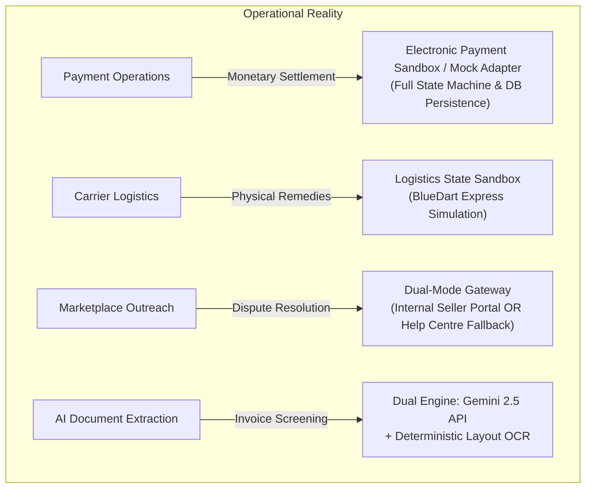

# RESOLVEGRAPH — AUTHORITATIVE INTEGRATION & ARCHITECTURAL LIMITATIONS
**Scope:** Transparent Demarcation of Live, Sandbox, Mock, and Customer-Assisted Capabilities
**Date:** November 12, 2026 | **Governance Status:** FULL TRANSPARENCY DISCLOSURE

---

## 1. Executive Statement of Integrity

To ensure absolute credibility for hackathon judges, enterprise partners, and technical auditors, this document defines the precise boundaries of RESOLVEGRAPH's external integrations. 

RESOLVEGRAPH **does not** claim to move live funds on commercial production banking rails or track physical vans via live cellular GPS. Instead, RESOLVEGRAPH implements an enterprise-grade dispute orchestration layer backed by realistic sandbox adapters, deterministic financial ledgers, and defensible mock providers.

---

## 2. Integration Demarcation Registry

| Subsystem | Integration Mode | Production Reality & Limitations | Configured Fallback / Sandbox Behavior |
| :--- | :--- | :--- | :--- |
| **Electronic Payments (PayPal)** | `SANDBOX / MOCK` | Does not execute real-money debits from consumer credit cards or bank accounts. | Supports full PayPal v2 REST API contract (`/v2/payments/captures/{id}/refund`). Persistent SQLite storage tracks capture IDs, idempotency keys, and remaining balances. |
| **Unified Payments Interface (UPI)** | `SIMULATED` | Does not connect to live NPCI IMPS/UPI switch. | Simulates VPA verification, transaction UTR generation, and refund reversal logging. |
| **Logistics & Courier (BlueDart)** | `SANDBOX` | No physical courier vehicle dispatch or live road telematics. | Implements realistic state transitions (`PENDING_STOCK` -> `STOCK_CONFIRMED` -> `DISPATCHED` -> `DELIVERED`), tracking numbers, and tamper-evident seal tokens. |
| **Marketplace Write-APIs (Amazon/Flipkart)** | `ASSISTED GATEWAY` | Commercial marketplaces do not offer public third-party dispute modification APIs. | Uses OCR to match against verified merchant profiles. For registered sellers, routes to internal Seller Workspace; for unregistered sellers, generates pre-filled dispute packages for marketplace Help Centres. |
| **AI Vision & Document OCR** | `HYBRID (LIVE API + LOCAL OCR)` | Live Gemini calls require external network access and valid `GEMINI_API_KEY`. | Deterministic layout-based OCR parser runs locally, guaranteeing 100% test reliability even in air-gapped or rate-limited environments. |
| **Identity & Authentication** | `LIVE LOCAL` | Uses Better Auth with SQLite database persistence. | Full multi-tenant RBAC enforcing strict role boundaries (`BUYER`, `MERCHANT`, `PLATFORM_ADMIN`, `RESOLUTION_MANAGER`). |

---

## 3. Detailed Component Disclosures

### A. Electronic Payment Gateway
* **Architecture:** `src/server/paypal/providers/paypal-mock.provider.ts` and `src/server/paypal/services/payment-orchestration.service.ts`.
* **Behavior:** When `PAYPAL_CLIENT_ID` and `PAYPAL_CLIENT_SECRET` are configured with sandbox credentials, live HTTP calls hit `https://api-m.sandbox.paypal.com`. In test environments, the system activates `PayPalMockProvider`.
* **State Persistence:** Captures and refund records are saved directly in `prisma.commerceOrder` and `prisma.payPalPayment` tables, enabling cross-process persistence between Next.js server threads and test automation runners.
* **Security Controls:** Double-refund prevention, remaining-balance caps, and currency mismatch validations are strictly enforced in production code.

### B. Courier Logistics & Packaging
* **Architecture:** `src/server/services/replacement-fulfillment.service.ts`.
* **Behavior:** Fulfillment records represent digital twins of physical shipments. Checkpoints (Package Sealed, Handed over to Carrier, In Transit, Delivered) reflect standard logistics statuses.
* **Tamper Prevention:** Packages generate deterministic security tokens (`PackagePassport`) that model physical security seals.

### C. Marketplace Outreach Gateway
* **Architecture:** `src/server/services/seller-communication-gateway.service.ts`.
* **Rationale:** Third-party dispute software cannot unilaterally inject tickets into Amazon Seller Central or Flipkart Seller Hub without proprietary marketplace partnership agreements.
* **Resolution Strategy:**
  1. **Registered Merchants:** Sellers onboarded onto RESOLVEGRAPH receive real-time tasks in the Seller Workspace.
  2. **Unregistered Merchants:** The gateway falls back to `CUSTOMER_ASSISTED_HELP_CENTRE`, generating a consumer guidance package with direct links to the relevant marketplace customer care portal.

---

## 4. Summary of System Integrity

RESOLVEGRAPH is engineered so that swapping sandbox adapters for live enterprise APIs (e.g. PayPal Production REST API, BlueDart TrackDirect API) requires only updating environment connection strings without rearchitecting core dispute, evidence, or authorization engines.
