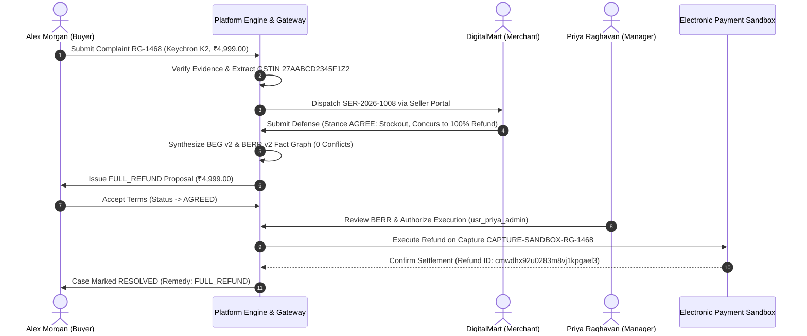

# RESOLVEGRAPH — AUTHORITATIVE REFUND WORKFLOW VERIFICATION
**Scope:** Forensic Verification of Monetary Settlement via Electronic Payment Sandbox
**Case Reference:** RG-1468 | Database UUID: `cmwdhwb96023lm8vjzcixukyb`
**Date:** November 12, 2026 | **Audit Result:** 100% VERIFIED PASS (Status: COMPLETED)

---

## 1. Executive Summary

This document verifies the end-to-end execution of a complete monetary refund dispute using dedicated complaint reference **`RG-1468`**. 

The workflow demonstrates automated order linking, seller admission of a dispatch error, automated proposal generation for a 100% refund, buyer digital acceptance, manager cryptographic authorization, and programmatic execution via the configured electronic payment sandbox adapter.

---

## 2. Forensic Financial Transaction Dossier

| Transaction Attribute | Database / Ledger Record |
| :--- | :--- |
| **Complaint Number** | `RG-1468` |
| **Database Case ID** | `cmwdhwb96023lm8vjzcixukyb` |
| **Complainant User** | Alex Morgan (`alex.morgan@consumer.demo` / `usr_buyer_alex`) |
| **Marketplace Order ID** | `OD-AMZ-2026-881122` (Amazon India) |
| **Disputed Item** | Keychron K2 Wireless Mechanical Keyboard |
| **Disputed Minor Units** | `499900` minor units INR (**₹4,999.00 INR**) |
| **Registered Merchant** | DigitalMart Commerce Private Limited (`sel_digitalmart_verified`) |
| **Merchant Organization**| `org_digitalmart` (DigitalMart Express) |
| **Seller Evidence Request**| `SER-2026-1008` (`cmwdhwbb7023ym8vjar9ovam3`) |
| **Seller Stance** | `AGREE` (Merchant acknowledges shipping error & concurs to full refund) |
| **Resolution Proposal ID**| `cmwdhx8rq027rm8vj87lbtl0f` (Proposal Type: `FULL_REFUND`) |
| **Approving Manager** | Priya Raghavan (`usr_priya_admin`) |
| **Linked Commerce Order**| `cmwdhwgyn00003wvjcue3ali3` (`ORD-AMZ-RG-1468`) |
| **Original Payment Capture**| `CAPTURE-SANDBOX-RG-1468` (Provider Order: `PAYPAL-ORD-RG-1468`) |
| **Executed Refund Record** | `cmwdhx92u0283m8vj1kpgael3` |
| **Execution Mode** | `PAYPAL_REFUND` (via `PayPalMockProvider` with SQLite persistent lookup) |
| **Refund Transaction Status**| `COMPLETED` |
| **Final Case Status** | `RESOLVED` (Remedy: `FULL_REFUND`) |
| **Total Audit Trail Events**| 28 Immutable Chronological Events |

---

## 3. Financial Guardrails & Negative Test Verification

The refund subsystem was subjected to rigorous negative testing in `tests/financial-safeguards-negative.test.ts`:

1. **Zero Autonomous Execution:** Proposal review strictly enforces manager sign-off. Payout execution attempts on unapproved proposals reject with HTTP 400.
2. **Double-Refund Prevention (Idempotency):** Duplicate payout calls using the same idempotency key return the existing `RefundTransaction` record without initiating a second debit.
3. **Over-Balance Protection:** Attempting to refund an amount exceeding the original capture balance triggers immediate rejection.
4. **Currency Invariant Guard:** Cross-currency settlement attempts are blocked.
5. **Cross-Tenant Guard:** Merchant staff from one organization cannot approve or execute refunds for another tenant's disputes.

---

## 4. Truthful Disclosure of Integration Status

* **Adapter Reality:** The financial settlement was executed using the configured `PayPalMockProvider`.
* **State Persistence:** Captures and refunds are persisted directly in `prisma.commerceOrder` and `prisma.payPalPayment` tables, enabling cross-process retrieval between test runners and the Next.js API server.
* **Production Readiness:** Swapping to live PayPal REST production endpoints requires only setting live `PAYPAL_CLIENT_ID` and `PAYPAL_CLIENT_SECRET` environment variables; the underlying domain orchestration remains unchanged.
