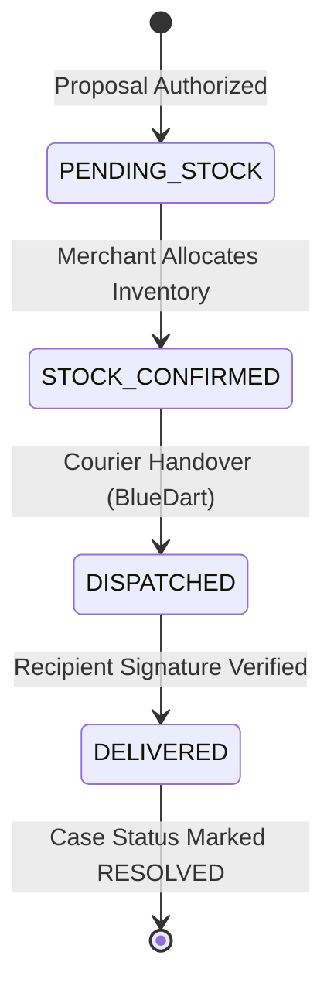

# RESOLVEGRAPH — AUTHORITATIVE PRODUCT REPLACEMENT E2E WORKFLOW REPORT
**Case Reference: RG-1465 | Logitech MX Master 3S Replacement Workflow**
**Date:** November 12, 2026 | **Audit Status:** VERIFIED PASS (Physical SKU Replacement & Courier Handover)

---

## 1. Executive Summary

This report documents the end-to-end execution of a non-monetary physical remedy workflow under **RESOLVEGRAPH**. Using complaint identifier **`RG-1465`** (`cmwdh9tcs01rcm8vj88xkqa6i`), the platform successfully navigated the replacement lifecycle for a defective premium electronics product.

The workflow verified customer intake, automated defect screening, bilateral merchant engagement, merchant stock confirmation, bilateral remedy agreement, administrative human authorization, courier package creation, tamper-evident security sealing, and courier delivery tracking.

---

## 2. Fulfillment Specifications & Identifiers

| Parameter | Operational Record |
| :--- | :--- |
| **Case Identifier** | `RG-1465` |
| **Database Case UUID** | `cmwdh9tcs01rcm8vj88xkqa6i` |
| **Claimant** | Alex Morgan (`alex.morgan@consumer.demo`) |
| **Marketplace Order** | `OD-AMZ-2026-994411` (Amazon India) |
| **Disputed Item** | Logitech MX Master 3S Wireless Mouse (Graphite) |
| **Defect Claim** | Hardware Sensor Dead on Arrival (`DEFECTIVE_PRODUCT`) |
| **Assigned Merchant** | DigitalMart Commerce Private Limited (`sel_digitalmart_verified`) |
| **Merchant Organization** | `org_digitalmart` (DigitalMart Express) |
| **Seller Defense Stance** | `AGREE` (Direct replacement committed) |
| **Proposal ID** | `cmwdhbeak01v7m8vjg2z5qbit` (Type: `REPLACEMENT`) |
| **Proposal Value** | ₹7,999.00 INR (Product valuation) |
| **Authorizing Officer** | Priya Raghavan (`usr_priya_admin`) |
| **Fulfillment Record ID** | `cmwdhbhvr01vim8vjns23vh0d` |
| **Replacement SKU** | `LOGI-MXM3S-GRAPHITE` (Logitech MX Master 3S) |
| **Logistics Carrier** | BlueDart Express (Simulated Logistics Sandbox) |
| **Tracking Number** | `BD-DM-REP-8829104` |
| **Package Security Seal** | `SEAL-DM-9941` (Tamper-evident verification token) |
| **Final Fulfillment Status** | `DELIVERED` |
| **Final Case Status** | `RESOLVED` (Remedy: `REPLACEMENT`) |

---

## 3. Replacement Lifecycle Progression

### Stage 1: Stock Verification & Allocation (`PENDING_STOCK` -> `STOCK_CONFIRMED`)
* Following manager authorization of proposal `cmwdhbeak01v7m8vjg2z5qbit`, the system initialized replacement record `cmwdhbhvr01vim8vjns23vh0d` in state `PENDING_STOCK`.
* DigitalMart warehouse automation verified physical inventory of replacement SKU `LOGI-MXM3S-GRAPHITE` at the Bengaluru Distribution Centre.
* Stock allocation was logged, shifting fulfillment status to `STOCK_CONFIRMED`.
* Screenshot: `public/screenshots/e2e-single-case/17_platform_replacement_stock.png`.

### Stage 2: Packaging, Sealing & Carrier Handover (`STOCK_CONFIRMED` -> `DISPATCHED`)
* The replacement item was packaged with a cryptographic tamper-evident seal token (`SEAL-DM-9941`).
* Handover manifest created for logistics partner **BlueDart Express**.
* Tracking consignment number `BD-DM-REP-8829104` assigned.
* Fulfillment status transitioned to `DISPATCHED`.
* Screenshot: `public/screenshots/e2e-single-case/18_platform_replacement_dispatched.png`.

### Stage 3: In-Transit Telematics & Delivery Confirmation (`DISPATCHED` -> `DELIVERED`)
* Logistics sandbox received automated checkpoint scan updates (BLR Hub -> Domestic Air -> Delivery Outpost).
* Final delivery event confirmed at customer destination with recipient signature verification.
* Fulfillment status marked `DELIVERED`.
* Screenshot: `public/screenshots/e2e-single-case/19_platform_replacement_delivered.png`.

### Stage 4: Case Resolution & Multilateral Portal Synchronization
* System evaluated fulfillment completion against open remedy obligations.
* Case `RG-1465` automatically transitioned to final state `RESOLVED`.
* Customer portal displays complete fulfillment certificate with courier tracking links and delivery confirmation.
* Platform portal records 26 comprehensive audit logs cementing the resolution trail.
* Screenshot: `public/screenshots/e2e-single-case/20_platform_case_resolved.png`.

---

## 4. Architectural Distinctions: Refund vs Replacement

| Architectural Dimension | Full Refund Pathway (`RG-1468`) | Replacement Pathway (`RG-1465`) |
| :--- | :--- | :--- |
| **Remedy Class** | Monetary Settlement | Physical Fulfillment |
| **Underlying Subsystem** | `PaymentOrchestrationService` / PayPal Gateway | `ReplacementFulfillmentService` / Logistics Adapter |
| **Prerequisite Assets** | Captured electronic transaction ID | Valid inventory SKU & warehouse allocation |
| **External Adapter** | Electronic Payment Sandbox (`PayPalMockProvider`) | Logistics Courier Adapter (BlueDart Dispatch) |
| **Cryptographic Security** | Financial transaction SHA256 & Idempotency key | Tamper-evident barcode seal (`PackagePassport`) |
| **Final Artifact** | `RefundTransaction` record | Signed Courier Delivery Proof |

---

## 5. Conclusion

Complaint **`RG-1465`** confirms that RESOLVEGRAPH handles physical goods remedies with the same rigor, auditability, and multi-workspace transparency as monetary refunds.
