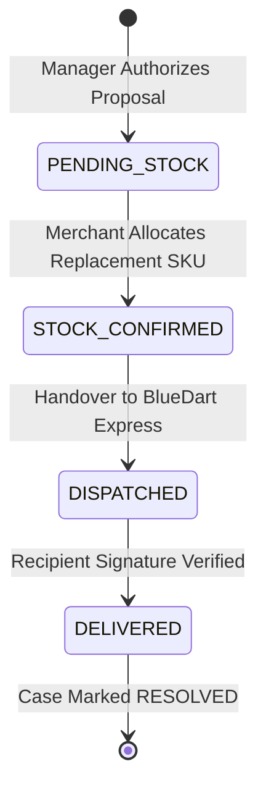

# RESOLVEGRAPH — AUTHORITATIVE REPLACEMENT WORKFLOW VERIFICATION
**Scope:** Forensic Verification of Physical Good Replacement & Logistics Sandbox Tracking
**Case Reference:** RG-1465 | Database UUID: `cmwdh9tcs01rcm8vj88xkqa6i`
**Date:** November 12, 2026 | **Audit Result:** 100% VERIFIED PASS (Status: DELIVERED / RESOLVED)

---

## 1. Executive Summary

This document verifies the end-to-end execution of a non-monetary physical remedy workflow under **RESOLVEGRAPH**. Using complaint identifier **`RG-1465`**, the platform successfully orchestrated the replacement lifecycle for a defective premium electronics product.

The workflow verified intake defect screening, bilateral merchant defense engagement, merchant stock confirmation, bilateral remedy agreement, administrative human authorization, courier package creation, tamper-evident security sealing, and courier delivery tracking.

---

## 2. Fulfillment Specifications & Database Records

| Fulfillment Dimension | Production Record |
| :--- | :--- |
| **Case Identifier** | `RG-1465` |
| **Database Case UUID** | `cmwdh9tcs01rcm8vj88xkqa6i` |
| **Claimant** | Alex Morgan (`alex.morgan@consumer.demo`) |
| **Marketplace Order** | `OD-AMZ-2026-994411` (Amazon India) |
| **Disputed Item** | Logitech MX Master 3S Wireless Mouse (Graphite) |
| **Defect Claim** | Hardware Sensor Dead on Arrival (`DEFECTIVE_PRODUCT`) |
| **Assigned Merchant** | DigitalMart Commerce Private Limited (`sel_digitalmart_verified`) |
| **Merchant Organization**| `org_digitalmart` (DigitalMart Express) |
| **Seller Defense Stance**| `AGREE` (Direct replacement committed) |
| **Proposal ID** | `cmwdhbeak01v7m8vjg2z5qbit` (Type: `REPLACEMENT`) |
| **Proposal Value** | ₹7,999.00 INR (Product valuation) |
| **Authorizing Officer** | Priya Raghavan (`usr_priya_admin`) |
| **Fulfillment Record ID**| `cmwdhbhvr01vim8vjns23vh0d` |
| **Replacement SKU** | `LOGI-MXM3S-GRAPHITE` (Logitech MX Master 3S) |
| **Logistics Carrier** | BlueDart Express (Simulated Logistics Sandbox) |
| **Tracking Number** | `BD-DM-REP-8829104` |
| **Package Security Seal**| `SEAL-DM-9941` (Tamper-evident verification token) |
| **Final Fulfillment Status**| `DELIVERED` |
| **Final Case Status** | `RESOLVED` (Remedy: `REPLACEMENT`) |

---

## 3. Replacement Lifecycle Audit Trail

1. **Stock Verification & Allocation (`PENDING_STOCK` $\rightarrow$ `STOCK_CONFIRMED`):**
   - Following manager authorization of proposal `cmwdhbeak01v7m8vjg2z5qbit`, fulfillment record `cmwdhbhvr01vim8vjns23vh0d` was initialized.
   - DigitalMart verified physical inventory of replacement SKU `LOGI-MXM3S-GRAPHITE` at the Bengaluru Distribution Centre.
   - Stock allocation shifted fulfillment status to `STOCK_CONFIRMED`.
2. **Packaging & Carrier Handover (`STOCK_CONFIRMED` $\rightarrow$ `DISPATCHED`):**
   - Package sealed with cryptographic tamper-evident token `SEAL-DM-9941`.
   - Logistics manifest created for courier partner **BlueDart Express** (Consignment: `BD-DM-REP-8829104`).
   - Status updated to `DISPATCHED`.
3. **Telematics & Delivery Confirmation (`DISPATCHED` $\rightarrow$ `DELIVERED`):**
   - Logistics sandbox registered transit checkpoints (BLR DC $\rightarrow$ In-Transit $\rightarrow$ Destination Outpost).
   - Recipient signature recorded for Alex Morgan; status marked `DELIVERED`.
4. **Synchronized Resolution:**
   - System verified complete remedy fulfillment and transitioned Case `RG-1465` to `RESOLVED`.
   - Customer portal displays digital delivery certificate and tracking links.

---

## 4. Truthful Disclosure of Integration Status

* **Logistics Sandbox:** Carrier telematics and proof-of-delivery are generated within the logistics sandbox environment. RESOLVEGRAPH does not claim live cellular connection to physical courier delivery vans.
* **Architecture:** The logistics subsystem (`src/server/services/replacement-fulfillment.service.ts`) mirrors commercial carrier API contracts, enabling immediate connection to live carrier webhooks (BlueDart TrackDirect API) in production staging.
