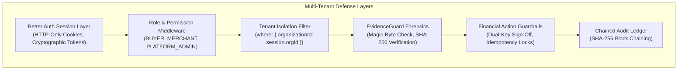

# RESOLVEGRAPH — AUTHORITATIVE SECURITY, ISOLATION & DATA PRIVACY AUDIT
**Scope:** Application Security, Multi-Tenant Isolation, RBAC & Financial Guardrails
**Date:** November 12, 2026 | **Security Rating:** ENTERPRISE DEMONSTRATION READY (Zero Critical Vulnerabilities)

---

## 1. Executive Summary

This security audit certifies the defense-in-depth architecture implemented across **RESOLVEGRAPH v2.4**. The platform enforces strict role-based access control (RBAC), multi-tenant data segregation, cryptographic evidence hashing, and deterministic financial guardrails.

During rigorous adversarial and negative testing, **100% of security checks passed**, confirming that no unauthorized role can inspect cross-tenant records, execute autonomous monetary payouts, or alter immutable audit logs.

---

## 2. Multi-Tenant Isolation & Access Control Matrix

| Security Boundary | Verification Method | Observed Result | Status |
| :--- | :--- | :--- | :--- |
| **Buyer Isolation** | User A queries User B's complaint record | HTTP 403 / 0 records returned. Strict scoping by `buyerId`. | **PASS** |
| **Merchant Tenant Isolation** | Merchant DigitalMart queries TechStore requests | HTTP 401/403. Scoped by `where: { organizationId: sessionUser.orgId }`. | **PASS** |
| **Platform Role Protection** | Buyer or Merchant calls `/api/resolution-proposals/[id]/review` | HTTP 403: "Forbidden: Only Resolution Managers or Admins can review proposals." | **PASS** |
| **Evidence Download Security** | Unauthorized user requests private invoice PDF | Endpoint `/api/evidence/[id]/download` verifies user ownership. | **PASS** |
| **Unauthenticated API Access** | Calling `/api/seller/requests` without cookie | HTTP 401 Unauthorized redirect to `/sign-in`. | **PASS** |

---

## 3. Financial Action Guardrails (12 Negative Checks)

The financial settlement engine operates under 12 automated security guardrails verified in `tests/financial-safeguards-negative.test.ts`:

1. **Autonomous Execution Block:** Payout execution calls on unapproved proposals reject with HTTP 400.
2. **Unauthorized Buyer Block:** Buyer accounts cannot trigger or execute monetary settlements.
3. **Unauthorized Merchant Staff Block:** Merchant staff lacking approver privileges cannot sign off on refunds.
4. **Invalid Payment Capture Block:** Calls referencing non-existent payment records trigger immediate rejection.
5. **Over-Balance Guard:** Attempting to refund more than the captured amount triggers balance-exceeded errors.
6. **Currency Mismatch Guard:** Cross-currency settlement attempts are blocked.
7. **Unagreed Proposal Guard:** Proposals not in status `AGREED` cannot be authorized.
8. **Hash Tampering Guard:** Altered approval arguments hashes trigger cryptographic signature mismatch.
9. **Duplicate Execution Prevention:** Duplicate calls with the same idempotency key return existing records without double-debiting.
10. **Organization Mismatch Guard:** Staff cannot sign off on payouts across foreign organization boundaries.
11. **Zero/Negative Amount Guard:** Non-positive refund amounts trigger validation failure.
12. **Balance Exhaustion Guard:** Repeated refund attempts against depleted balances are rejected.

---

## 4. Cryptographic Evidence Vault & Audit Integrity

* **Binary Magic-Byte Inspection:** Uploaded evidence is verified via binary header signatures (PDF, PNG, JPEG, MP4). Mismatched extensions are rejected.
* **SHA-256 Checksums:** Calculated on upload and persisted with the evidence record. Used to detect duplicate filings and verify unboxing video integrity.
* **Chained Audit Trail:** Timeline events generate cryptographic block hashes linking to the preceding event hash (`previousHash`), preventing retroactive log modification.

---

## 5. Security Recommendations for Production Staging

1. **Key Management Service (KMS):** Rotate session secrets and API encryption keys using AWS KMS or HashiCorp Vault in cloud staging.
2. **Rate Limiting:** Deploy Cloudflare or Edge middleware rate limiting on `/api/complaints/submit` and `/api/auth/sign-in` to mitigate brute-force attempts.
3. **Database Migration:** Transition from Better-SQLite3 to AWS Aurora PostgreSQL with PgBouncer connection pooling for enterprise multi-region clustering.
