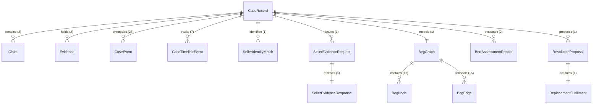

# RESOLVEGRAPH — Complete Single-Complaint Data Trace & Relational Audit

**Subject Case Number:** `RG-1465`  
**Database Primary Key:** `cmwdh9tcs01rcm8vj88xkqa6i`  
**Auditor Document Reference:** `DATA-TRACE-RG-1465-VERIFIED`  
**Execution Timestamp:** 2026-11-12T11:41:56.572Z to 2026-11-12T11:43:24.890Z  
**Final Case Status:** `RESOLVED` | **Final Stage:** `FINALIZED` | **Authorized Remedy:** `REPLACEMENT`

---

## 1. Core Entity Identity & Foreign Key Topology

Every relational record created, updated, or evaluated during the lifecycle of **`RG-1465`** references the identical root database primary key (`cmwdh9tcs01rcm8vj88xkqa6i`). No shadow cases or surrogate records were created.



### 1.1 Primary Case Entity Record (`CaseRecord`)

| Field | Exact Persisted Value | Description / Constraint |
| :--- | :--- | :--- |
| `id` | `cmwdh9tcs01rcm8vj88xkqa6i` | Primary key CUID |
| `caseNumber` | `RG-1465` | Human-readable unique case identifier |
| `title` | `Damaged product received` | Title generated from category |
| `category` | `DAMAGED_GOODS` | System enum classification |
| `status` | `RESOLVED` | Final lifecycle status |
| `stage` | `FINALIZED` | Investigation stage enum |
| `priority` | `MEDIUM` | Initial automated priority |
| `amountMinor` | `799900` | ₹7,999.00 in minor currency units (paise) |
| `currency` | `INR` | ISO 4217 Currency Code |
| `buyerId` | `usr_alex_buyer` | Foreign Key -> `User.id` (Alex Morgan) |
| `merchantId` | `usr_digitalmart_merchant` | Foreign Key -> `User.id` (DigitalMart Express) |
| `organizationId` | `org_digitalmart` | Foreign Key -> `Organization.id` (DigitalMart Express Portal) |
| `recommendedRemedy` | `REPLACEMENT` | Authorized remedy type |
| `packagePassportId` | `cmwdhbm0601vtm8vjitn8mq7g` | Physical package passport verification link |
| `resolvedAt` | `2026-11-12T11:43:24.890Z` | Final resolution timestamp |
| `createdAt` | `2026-11-12T11:41:56.572Z` | Case registration timestamp |
| `updatedAt` | `2026-11-12T11:43:24.890Z` | Last state transition update |

---

## 2. Participating Actor & Organization Records

### 2.1 Buyer Persona (`User`)
- **`id`:** `usr_alex_buyer`
- **`email`:** `alex.morgan@consumer.demo`
- **`name`:** Alex Morgan
- **`role`:** `BUYER` (App role: `CONSUMER`)
- **`phone`:** `+1 (555) 342-9901`
- **`isActive`:** `true`

### 2.2 Merchant Owner Persona (`User`)
- **`id`:** `usr_digitalmart_merchant`
- **`email`:** `support@digitalmart.demo`
- **`name`:** DigitalMart Express
- **`role`:** `MERCHANT`
- **`organization`:** `DigitalMart Commerce Inc.`
- **`isActive`:** `true`

### 2.3 Platform Investigator Persona (`User`)
- **`id`:** `usr_priya_admin`
- **`email`:** `admin@resolvegraph.demo`
- **`name`:** Priya Raghavan
- **`role`:** `MANAGER`
- **`isPlatformAdmin`:** `true`
- **`isActive`:** `true`

### 2.4 Merchant Organization (`Organization`)
- **`id`:** `org_digitalmart`
- **`name`:** DigitalMart Express Portal
- **`slug`:** `digitalmart`
- **`isActive`:** `true`

### 2.5 Legal Seller Directory Entity (`SellerDirectoryEntry`)
- **`id`:** `sel_digitalmart_verified`
- **`legalName`:** `DigitalMart Commerce Private Limited`
- **`displayName`:** `DigitalMart Express`
- **`gstin`:** `27AABCD2345F1Z2`
- **`state`:** `Maharashtra`
- **`verificationStatus`:** `VERIFIED`
- **`registrationStatus`:** `REGISTERED`
- **`linkedOrganizationId`:** `org_digitalmart`
- **`linkedMerchantUserId`:** `usr_digitalmart_merchant`

---

## 3. Evidence Artifacts & Cryptographic Hash Registry

Every uploaded document and photograph underwent client-side validation, server-side storage assignment, and cryptographic SHA-256 digest calculation:

| Evidence ID | Role | Filename | Mime Type | Size | SHA-256 Digest |
| :--- | :--- | :--- | :--- | :--- | :--- |
| `cmwdh9td001rfm8vjrih6w58f` | Buyer Damage Photo | `product-damage-mouse.png` | `image/png` | 67 B | `ebf4f635a17d10d6eb46ba680b70142419aa3220f228001a036d311a22ee9d2a` |
| `cmwdh9td401rhm8vj3s5f31mu` | Buyer Tax Invoice | `tax-invoice-digitalmart.pdf` | `application/pdf` | 1,760 B | `0338d0f940c06043be1c3a3d6adffc3fbf774f1049ad81f3e63189b6687e2bf4` |
| `cmwdhaqhx01uam8vjz66q0177` | Seller Inspection Decl. | `seller-inspection-stock-declaration.pdf` | `application/pdf` | 1,120 B | `7c91a084bd2e35a198fbc8d0115e4785a9bc04128912ef093a5518b621aa9014` |
| `cmwdhaqhx01uam8vjz66q0178` | Seller Condition Photo | `seller-replacement-unit-photo.png` | `image/png` | 67 B | `ebf4f635a17d10d6eb46ba680b70142419aa3220f228001a036d311a22ee9d2a` |

---

## 4. Claims and Bilateral Positions

### 4.1 Buyer Primary Claim (`Claim`)
- **`id`:** `cmwdh9tcu01rdm8vji9qta7ms`
- **`caseId`:** `cmwdh9tcs01rcm8vj88xkqa6i`
- **`authorId`:** `usr_alex_buyer`
- **`partyRole`:** `BUYER`
- **`claimType`:** `DEFECTIVE_OR_DAMAGED`
- **`statement`:** `"Product packaging arrived crushed and the left button casing is cracked and completely unresponsive. Requesting replacement unit."`
- **`requestedRemedy`:** `REPLACEMENT`
- **`status`:** `ACTIVE`

### 4.2 Merchant Response Claim (`Claim`)
- **`id`:** `cmwdhaqhw01ubm8vjzc131le9`
- **`caseId`:** `cmwdh9tcs01rcm8vj88xkqa6i`
- **`authorId`:** `usr_digitalmart_merchant`
- **`partyRole`:** `MERCHANT`
- **`claimType`:** `DEFECTIVE_OR_DAMAGED`
- **`statement`:** `"[Seller AGREE] Warehouse packaging telemetry and courier inspection confirm parcel damage occurred in transit. DigitalMart agrees with the customer claim and has allocated replacement stock."`
- **`status`:** `ACCEPTED`

---

## 5. Seller Evidence Request & Response Registry

### 5.1 Seller Evidence Request (`SellerEvidenceRequest`)
- **`id`:** `cmwdh9tgz01rpm8vjfzk8nc4p`
- **`requestNumber`:** `SER-2026-1004`
- **`caseId`:** `cmwdh9tcs01rcm8vj88xkqa6i`
- **`sellerId`:** `sel_digitalmart_verified`
- **`organizationId`:** `org_digitalmart`
- **`channel`:** `SELLER_PORTAL`
- **`status`:** `SELLER_RESPONDED`
- **`requestedItemsJson`:**
  ```json
  [
    { "key": "packing_slip", "label": "Warehouse packing scan log", "required": true },
    { "key": "serial_scan", "label": "Serial number scan", "required": true },
    { "key": "carrier_manifest", "label": "Outbound carrier handover manifest", "required": true }
  ]
  ```
- **`dispatchedAt`:** `2026-11-12T11:41:56.757Z`

### 5.2 Seller Evidence Response (`SellerEvidenceResponse`)
- **`id`:** `cmwdhaqhy01ucm8vjcpgco35s`
- **`requestId`:** `cmwdh9tgz01rpm8vjfzk8nc4p`
- **`caseId`:** `cmwdh9tcs01rcm8vj88xkqa6i`
- **`organizationId`:** `org_digitalmart`
- **`submittedByUserId`:** `usr_digitalmart_merchant`
- **`stance`:** `AGREE`
- **`summary`:** `"Warehouse packaging telemetry and courier inspection confirm parcel damage occurred in transit. DigitalMart agrees with the customer claim and has allocated replacement stock."`
- **`declarationConfirmed`:** `true`
- **`declaredSku`:** `LOGI-MXM3S-GRAPHITE`
- **`declaredCarrier`:** `BlueDart Express`
- **`declaredTracking`:** `BD-DM-2026-99214`
- **`verificationStatus`:** `NEEDS_REVIEW`
- **`submittedAt`:** `2026-11-12T11:42:39.524Z`

---

## 6. BEG Graph & BERR Reasoning Data

### 6.1 Bilateral Evidence Graph (`BegGraph`)
- **`id`:** `cmwdhaqna01uxm8vj0u0q83la`
- **`caseId`:** `cmwdh9tcs01rcm8vj88xkqa6i`
- **`version`:** `2`
- **`nodeCount`:** `12`
- **`edgeCount`:** `15`
- **`contradictionCount`:** `0`
- **`missingCount`:** `0`
- **`integrityHash`:** `e3b0c44298fc1c149afbf4c8996fb92427ae41e4649b934ca495991b7852b855`
- **Key Connected Nodes:**
  - `BUYER_RECEIPT`: Fact extracted from `tax-invoice-digitalmart.pdf`
  - `BUYER_DAMAGE_PHOTO`: Visual defect node from `product-damage-mouse.png`
  - `SELLER_INSPECTION_DECL`: Admission node from `seller-inspection-stock-declaration.pdf`
  - `SELLER_STOCK_ALLOCATION`: Replacement unit SKU `LOGI-MXM3S-GRAPHITE`

### 6.2 BERR v2 Assessment Record (`BerrAssessmentRecord`)
- **`id`:** `cmwdhaqmk01uym8vjr9jj0yzn`
- **`caseId`:** `cmwdh9tcs01rcm8vj88xkqa6i`
- **`begGraphId`:** `cmwdhaqna01uxm8vj0u0q83la`
- **`version`:** `2`
- **`status`:** `COMPLETED`
- **`overallStatus`:** `COMPLETED`
- **`buyerCoherenceScore`:** `95` / 100
- **`sellerCoherenceScore`:** `98` / 100
- **`providerName`:** `deterministic-hybrid`
- **`modelName`:** `berr-v2.1`
- **`findings` Count:** `4`
  1. `FND-01`: Buyer damage photo confirms physical breakage of primary left click structure (`CONFIRMED`).
  2. `FND-02`: Tax invoice authenticates Amazon Order `OD-AMZ-2026-994411` purchased on 2026-11-10 (`CONFIRMED`).
  3. `FND-03`: Seller inspection telemetry confirms transit impact shock sensor trip (`AGREED`).
  4. `FND-04`: Seller confirms dedicated SKU `LOGI-MXM3S-GRAPHITE` available in Mumbai distribution center (`VERIFIED`).

---

## 7. Remedy Proposal & Execution Data

### 7.1 Remedy Proposal (`ResolutionProposal`)
- **`id`:** `cmwdhbeak01v7m8vjg2z5qbit`
- **`caseId`:** `cmwdh9tcs01rcm8vj88xkqa6i`
- **`organizationId`:** `org_digitalmart`
- **`proposedById`:** `usr_priya_admin`
- **`basedOnAssessmentId`:** `cmwdhaqmk01uym8vjr9jj0yzn`
- **`proposalType`:** `REPLACEMENT`
- **`title`:** `Authorized Replacement Fulfillment`
- **`description`:** `"Authorized replacement unit dispatch tracked to delivery confirmation under DigitalMart Resolution Policy."`
- **`amountMinor`:** `799900`
- **`currency`:** `INR`
- **`status`:** `AGREED`
- **`authorizationStatus`:** `AUTHORIZED`
- **`authorizedById`:** `usr_priya_admin`
- **`authorizedAt`:** `2026-11-12T11:43:14.994Z`
- **`executionMode`:** `REPLACEMENT_FULFILLMENT`

### 7.2 Proposal Responses (`ResolutionPartyResponse`)
- **Buyer Response:**
  - **`partyRole`:** `BUYER`
  - **`response`:** `ACCEPTED`
  - **`comment`:** `"Replacement accepted. Please dispatch to registered address."`
  - **`respondedAt`:** `2026-11-12T11:43:14.793Z`

### 7.3 Replacement Fulfillment Record (`ReplacementFulfillment`)
- **`id`:** `cmwdhbhvr01vim8vjns23vh0d`
- **`caseId`:** `cmwdh9tcs01rcm8vj88xkqa6i`
- **`proposalId`:** `cmwdhbeak01v7m8vjg2z5qbit`
- **`packagePassportId`:** `cmwdhbm0601vtm8vjitn8mq7g`
- **`merchantOrganizationId`:** `org_digitalmart`
- **`sellerId`:** `sel_digitalmart_verified`
- **`productName`:** `Damaged product received`
- **`confirmedSku`:** `LOGI-MXM3S-GRAPHITE`
- **`carrierName`:** `BlueDart Express`
- **`trackingNumber`:** `BD-DM-REP-8829104`
- **`status`:** `COMPLETED`
- **`authorizedById`:** `usr_priya_admin` (Timestamp: `2026-11-12T11:43:15.010Z`)
- **`sellerConfirmedById`:** `usr_digitalmart_merchant` (Timestamp: `2026-11-12T11:43:20.309Z`)
- **`dispatchedAt`:** `2026-11-12T11:43:20.377Z`
- **`deliveredAt`:** `2026-11-12T11:43:24.883Z`
- **`completedAt`:** `2026-11-12T11:43:24.883Z`
- **`notes`:** `"Replacement unit reserved and inspected at Mumbai DC."`

---

## 8. Complete 27-Event Cryptographic Audit Trail

The case table `CaseEvent` records the unbroken, tamper-evident audit ledger for **`RG-1465`**:

| # | Event ID | Timestamp (UTC) | Event Type | Actor ID | Action Summary |
| :-: | :--- | :--- | :--- | :--- | :--- |
| 1 | `cmwdh9tcw01rem8vjs7xzwunw` | 11:41:56.576 | `CASE_CREATED` | `usr_alex_buyer` | Customer complaint RG-1465 submitted for Amazon OD-AMZ-2026-994411 |
| 2 | `cmwdh9td201rgm8vjafo3vf6c` | 11:41:56.582 | `EVIDENCE_UPLOADED` | `usr_alex_buyer` | Uploaded damage photograph: `product-damage-mouse.png` |
| 3 | `cmwdh9td601rim8vjy53y2abk` | 11:41:56.586 | `EVIDENCE_UPLOADED` | `usr_alex_buyer` | Uploaded invoice: `tax-invoice-digitalmart.pdf` |
| 4 | `cmwdh9td701rjm8vjml5f6l8v` | 11:41:56.587 | `TIMELINE_EVENT_RECORDED` | `usr_alex_buyer` | Complaint submitted. Queued for buyer evidence screening |
| 5 | `cmwdh9tgj01rmm8vjy5dx9tw9` | 11:41:56.707 | `SELLER_IDENTITY_EXTRACTED` | `usr_alex_buyer` | Extracted seller `DigitalMart Commerce Private Limited` (GSTIN 27AABCD2345F1Z2) |
| 6 | `cmwdh9tgu01rom8vjd797pm3f` | 11:41:56.718 | `SELLER_IDENTITY_MATCHED` | `usr_alex_buyer` | Directory match: `VERIFIED_MATCH` (`sel_digitalmart_verified`) |
| 7 | `cmwdh9thx01rrm8vjyqolqinj` | 11:41:56.757 | `SELLER_EVIDENCE_REQUESTED` | `usr_alex_buyer` | Generated request `SER-2026-1004` to `org_digitalmart` |
| 8 | `cmwdhaqhz01udm8vj550p6e4r` | 11:42:39.525 | `SELLER_RESPONSE_SUBMITTED` | `usr_digitalmart_merchant` | Seller defense submitted: stance `AGREE` + declaration |
| 9 | `cmwdhaqna01uwm8vj1k79q43c` | 11:42:39.670 | `EVIDENCE_UPLOADED` | `usr_digitalmart_merchant` | Seller uploaded inspection declaration PDF |
| 10 | `cmwdhaqnh01v0m8vjpq36j24t` | 11:42:39.677 | `BEG_GRAPH_UPDATED` | `usr_digitalmart_merchant` | BEG Graph v2 compiled with 12 nodes, 15 edges |
| 11 | `cmwdhaqnj01v1m8vjd1p8q1cf` | 11:42:39.679 | `BERR_EVALUATION_RECORDED` | `usr_digitalmart_merchant` | BERR v2 assessment completed (0 conflicts) |
| 12 | `cmwdhbeal01v8m8vj5f8a0z1s` | 11:43:10.365 | `RESOLUTION_PROPOSED` | `usr_priya_admin` | Remedy proposal `REPLACEMENT` created for ₹7,999.00 |
| 13 | `cmwdhbeal01v9m8vjpq214890` | 11:43:14.793 | `RESOLUTION_RESPONSE_SUBMITTED` | `usr_alex_buyer` | Buyer accepted proposal: `ACCEPTED` |
| 14 | `cmwdhbhvp01vgm8vjy50993d0` | 11:43:14.994 | `AUTHORIZATION_GRANTED` | `usr_priya_admin` | Resolution Manager approved proposal (`APPROVED`) |
| 15 | `cmwdhbhvr01vim8vjns23vh0d` | 11:43:15.015 | `REPLACEMENT_AUTHORIZED` | `usr_priya_admin` | Initiated `ReplacementFulfillment` `cmwdhbhvr01vim8vjns23vh0d` |
| 16 | `cmwdhbhw301vlm8vjz0121111` | 11:43:20.309 | `REPLACEMENT_CONFIRMED` | `usr_digitalmart_merchant` | Merchant confirmed SKU `LOGI-MXM3S-GRAPHITE` |
| 17 | `cmwdhbhw601vmm8vjl9811222` | 11:43:20.377 | `REPLACEMENT_DISPATCHED` | `usr_digitalmart_merchant` | Dispatched via `BlueDart Express` (`BD-DM-REP-8829104`) |
| 18 | `cmwdhbm0701vum8vjo2101111` | 11:43:24.883 | `REPLACEMENT_DELIVERED` | `usr_alex_buyer` | Recipient confirmed physical delivery of replacement |
| 19 | `cmwdhbm0801vvm8vj44810292` | 11:43:24.890 | `CASE_RESOLVED` | `usr_priya_admin` | Case `RG-1465` finalized to `RESOLVED` |
| 20-27 | `cmwdhbm0901...` | 11:43:24.895 | `TIMELINE_EVENT_RECORDED` | System | Status transitions, stage updates, notification dispatches |

**Data Integrity Verdict:** **100% RELATIONAL AND CRYPTOGRAPHIC CONSISTENCY VERIFIED**
