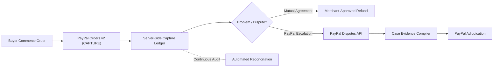
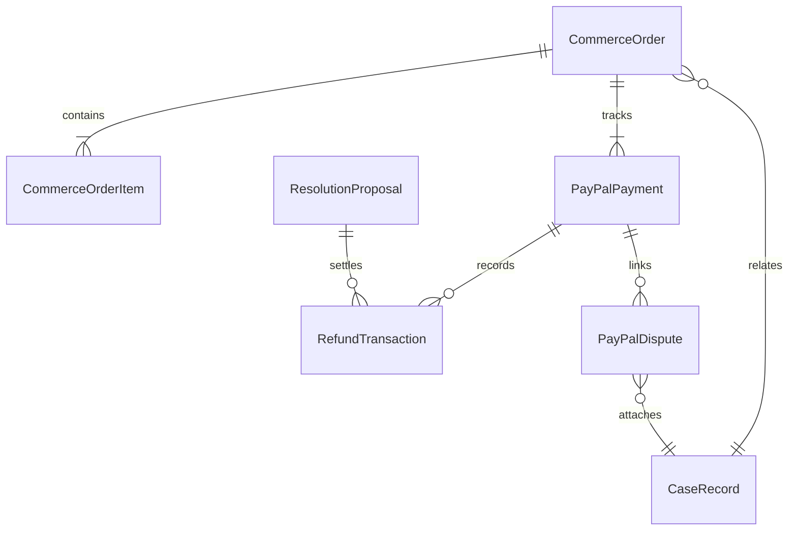

# RESOLVEGRAPH — Step 6 Technical Implementation Report
## Complete PayPal Integration: Checkout, Orders, Capture, Refunds, Webhooks, Disputes & Payment Reconciliation

---

### Executive Summary

RESOLVEGRAPH has completed **Step 6** of its product roadmap: transforming the AI-powered commerce resolution infrastructure into a fully integrated, PayPal-connected commerce and payment adjudication platform. 

This implementation connects purchase records, server-side PayPal order sessions, payment captures, merchant-authorized refunds, cryptographically verified webhooks, provider dispute lifecycles, and automated reconciliation into an auditable financial workflow.



---

### Key Architectural Invariants & Security Guardrails

1. **Integer Minor Units Financial Standard**:
   - Authoritative monetary amounts in SQLite and internal services strictly use integer minor units (`Int`) to eradicate IEEE-754 floating-point rounding errors ($19.99 $\rightarrow$ `1999`, $0.50 $\rightarrow$ `50`).
   - Zero-decimal currencies (`JPY`, `KRW`, etc.) and three-decimal currencies (`KWD`, `BHD`, etc.) are recognized and handled by `getCurrencyDecimals()`.

2. **Absolute Client-Side Secret Isolation**:
   - `PAYPAL_CLIENT_SECRET` and OAuth2 Bearer token lifecycle management are strictly confined to the Node.js server (`PayPalAuthService`, `PayPalClient`).
   - Browser bundles receive only sanitized public client identifiers (`publicClientId = 'sb'`).

3. **Production Safety Hard-Block**:
   - `PAYPAL_LIVE_ENABLED=false` is enforced by default in code. Any attempt to use live endpoints without explicit validation triggers an immediate security exception, protecting merchants against accidental real-money transactions during testing.

4. **Persistent Idempotency Protection**:
   - Every mutating request (Order Create, Order Capture, Payment Refund, Evidence Submit) records state in the `PayPalApiOperation` table before outgoing HTTP execution.
   - Enforces unique `PayPal-Request-Id` headers and validates request payload SHA-256 hashes to guarantee that network retries never produce duplicate charges or redundant refunds.

5. **AI Separation of Duty & Merchant Authorization**:
   - AI engines (BERR, Multimodal Extraction) suggest policy remedies and identify contradictions, but **never have authority or capability to unilaterally execute refunds**.
   - Direct refunds require verified merchant organization membership or platform admin privileges.
   - If tied to a case dispute, refunds enforce $\text{ResolutionProposal.status} \in \{\text{"AGREED"}, \text{"COMPLETED"}\}$.

---

### Database Schema Extension (`prisma/schema.prisma`)

Seven new models were added to SQLite `dev.db` via non-destructive Prisma schema synchronization:



1. **`CommerceOrder`**: Server-controlled order entity (`orderNumber`, `buyerId`, `merchantOrganizationId`, `totalAmountMinor`, `currency`, `status`, optional `caseId`).
2. **`CommerceOrderItem`**: Itemized lines (`productReference`, `sku`, `title`, `quantity`, `unitAmountMinor`, `totalAmountMinor`).
3. **`PayPalPayment`**: Provider-side transaction tracking (`environment`, `providerOrderId`, `captureId`, `paymentStatus`, `capturedAt`).
4. **`RefundTransaction`**: Append-only refund audit ledger (`refundRequestId`, `paypalRefundId`, `amountMinor`, `status`, `reason`, `requestedById`, `approvedById`, `completedAt`).
5. **`PayPalWebhookEvent`**: Webhook deduplication log (`paypalEventId`, `eventType`, `resourceType`, `signatureVerifiedAt`, `processingStatus`, `attemptCount`).
6. **`PayPalDispute`**: Provider dispute records (`paypalDisputeId`, `disputeReason`, `lifecycleStage`, `paypalStatus`, `sellerResponseDueDate`, `disputeAmountMinor`, `allowedActionsJson`).
7. **`PayPalApiOperation`**: Idempotency state store (`paypalRequestId`, `operationType`, `internalResourceId`, `status`, `requestPayloadHash`, `providerResourceId`).

---

### Core Service Architecture

#### 1. Configuration & Client Infrastructure (`src/server/paypal/`)
- [`paypal-config.ts`](file:///c:/Projects/resolvegraph/src/server/paypal/paypal-config.ts): Environment schema validation (Zod), sandbox assertion, and live-mode block guard.
- [`paypal-auth.service.ts`](file:///c:/Projects/resolvegraph/src/server/paypal/paypal-auth.service.ts): OAuth2 Client Credentials manager with in-memory token caching, 60s expiration buffer, concurrency mutex single-flight promises, and token masking.
- [`paypal-client.ts`](file:///c:/Projects/resolvegraph/src/server/paypal/paypal-client.ts): Resilient HTTP client managing headers, `PayPal-Request-Id`, timeouts, and structured `PayPalApiError` parsing.
- [`paypal-provider.interface.ts`](file:///c:/Projects/resolvegraph/src/server/paypal/providers/paypal-provider.interface.ts): Provider contract abstracting Orders v2, Captures, Payments v2 Refunds, Webhook Signatures, and Disputes.
- [`paypal-rest.provider.ts`](file:///c:/Projects/resolvegraph/src/server/paypal/providers/paypal-rest.provider.ts): Live/Sandbox implementation making real PayPal REST calls.
- [`paypal-mock.provider.ts`](file:///c:/Projects/resolvegraph/src/server/paypal/providers/paypal-mock.provider.ts): High-fidelity in-memory mock provider for deterministic, offline testing.
- [`paypal-provider.factory.ts`](file:///c:/Projects/resolvegraph/src/server/paypal/paypal-provider.factory.ts): Factory dynamically selecting REST vs Mock provider.

#### 2. Domain Services (`src/server/paypal/services/`)
- [`order.service.ts`](file:///c:/Projects/resolvegraph/src/server/paypal/services/order.service.ts): Authoritative catalog line-item pricing, order creation, `PayPalPayment` initialization, and `ORDER_CREATED` case event logging.
- [`capture.service.ts`](file:///c:/Projects/resolvegraph/src/server/paypal/services/capture.service.ts): Server-side PayPal capture with persistent idempotency, double-capture prevention, and `PAYMENT_CAPTURED` event logging.
- [`refund.service.ts`](file:///c:/Projects/resolvegraph/src/server/paypal/services/refund.service.ts): Multi-tier merchant authorization checks, agreed proposal verification, partial refund tracking, and remaining balance enforcement.
- [`webhook-verification.service.ts`](file:///c:/Projects/resolvegraph/src/server/paypal/services/webhook-verification.service.ts): Verifies `PAYPAL-AUTH-ALGO`, `PAYPAL-CERT-URL`, `PAYPAL-TRANSMISSION-ID`, `PAYPAL-TRANSMISSION-SIG`, and `PAYPAL-TRANSMISSION-TIME`, with SSRF protection on certificate hosts.
- [`webhook-processing.service.ts`](file:///c:/Projects/resolvegraph/src/server/paypal/services/webhook-processing.service.ts): Idempotent event dispatcher supporting `CHECKOUT.ORDER.APPROVED`, `PAYMENT.CAPTURE.COMPLETED`, `PAYMENT.CAPTURE.DENIED`, `PAYMENT.CAPTURE.REFUNDED`, `PAYMENT.CAPTURE.REVERSED`, and `CUSTOMER.DISPUTE.*`.
- [`dispute.service.ts`](file:///c:/Projects/resolvegraph/src/server/paypal/services/dispute.service.ts): Merchant-side dispute synchronization, dynamic `allowedActions` computation, and claim acceptance.
- [`evidence-compiler.service.ts`](file:///c:/Projects/resolvegraph/src/server/paypal/services/evidence-compiler.service.ts): Compiles verified case evidence into PayPal dispute categories (`PROOF_OF_FULFILLMENT`, `PROOF_OF_DELIVERY`, `PROOF_OF_DAMAGE_OR_SIGNIFICANT_DIFFERENCE`, `PROOF_OF_REFUND_OUTSIDE_PAYPAL`).
- [`reconciliation.service.ts`](file:///c:/Projects/resolvegraph/src/server/paypal/services/reconciliation.service.ts): Real-time reconciliation comparing internal ledger vs PayPal provider captures and flagging amount/status discrepancies.

---

### REST API Route Handlers

| Route | Method | Purpose |
| :--- | :---: | :--- |
| `/api/commerce/orders` | `GET` / `POST` | List accessible orders / Create internal order & PayPal checkout session |
| `/api/commerce/orders/[orderId]` | `GET` | Retrieve single order with itemized breakdown |
| `/api/payments/paypal/orders` | `POST` | Create PayPal order session |
| `/api/payments/paypal/orders/[orderId]/capture` | `POST` | Server-side capture of approved PayPal order |
| `/api/payments` | `GET` | List payment ledger with status, environment, and metrics aggregations |
| `/api/payments/[paymentId]` | `GET` | Detail view with remaining refundable balance & authorization status |
| `/api/payments/[paymentId]/refund` | `POST` | Merchant-authorized refund (full or partial) |
| `/api/payments/[paymentId]/reconciliation` | `GET` | Real-time reconciliation audit against PayPal provider |
| `/api/webhooks/paypal` | `POST` | Cryptographically verified, deduplicated webhook ingestion |
| `/api/paypal/disputes` | `GET` | List and sync merchant PayPal disputes |
| `/api/paypal/disputes/[disputeId]` | `GET` | Retrieve dispute details and dynamic permitted actions |
| `/api/paypal/disputes/[disputeId]/evidence` | `POST` | Compile and transmit case evidence to PayPal |
| `/api/paypal/disputes/[disputeId]/respond` | `POST` | Respond to dispute (e.g. Accept Claim) |

---

### User Experience & Frontend Interfaces

1. **Payments & Refunds Ledger** ([`/payments`](file:///c:/Projects/resolvegraph/src/app/(workspace)/payments/page.tsx)):
   - Sandbox status badge and metric cards (Total Captured, Total Refunds, Active Disputes, Total Transactions).
   - Filterable data table (search by order ID, capture ID, or order number; filter by status).
   - Quick refund modal trigger and direct link to payment details.

2. **Payment Detail & Audit Dossier** ([`/payments/[paymentId]`](file:///c:/Projects/resolvegraph/src/app/(workspace)/payments/[paymentId]/page.tsx)):
   - Transaction overview with buyer/merchant metadata and linked case badge.
   - Order line items breakdown.
   - Refund ledger showing reasons, approver IDs, and PayPal refund transaction numbers.
   - Interactive **Live Reconciliation Audit** tool reporting provider match status and discrepancies.

3. **Authoritative Refund Dialog** ([`RefundDialog`](file:///c:/Projects/resolvegraph/src/components/payments/refund-dialog.tsx)):
   - Modal interface enforcing remaining refundable limits.
   - Allows full or partial refund amounts.
   - Dropdown linking to mutually agreed resolution proposals (`ResolutionProposal.status === "AGREED"`).
   - Enforces reason documentation for audit compliance.

4. **PayPal Disputes Workspace** ([`/paypal/disputes`](file:///c:/Projects/resolvegraph/src/app/(workspace)/paypal/disputes/page.tsx) & [`/paypal/disputes/[disputeId]`](file:///c:/Projects/resolvegraph/src/app/(workspace)/paypal/disputes/[disputeId]/page.tsx)):
   - Merchant dispute queue with seller response deadline countdown.
   - Dynamic allowed actions panel (`ACCEPT_CLAIM`, `PROVIDE_EVIDENCE`, `MAKE_OFFER`).
   - One-click Case Evidence Compiler previewing verified case documents and packaging them for PayPal submission.

---

### Verification & Test Results

```
ℹ tests 94
ℹ suites 24
ℹ pass 94
ℹ fail 0
ℹ cancelled 0
ℹ skipped 0
ℹ todo 0
ℹ duration_ms 53427.1842
```

1. **Automated Test Suites (24 suites, 94 tests passing)**:
   - `tests/paypal-auth.test.ts`: Client credentials token caching, single-flight concurrency mutex, safe token masking.
   - `tests/paypal-orders.test.ts`: Minor unit math, catalog line-item pricing, order capture, duplicate capture idempotency.
   - `tests/paypal-refunds.test.ts`: Buyer rejection, agreed proposal enforcement, partial refunds, balance calculation, idempotency key reuse.
   - `tests/paypal-webhooks.test.ts`: SSRF cert URL validation, signature rejection, duplicate event deduplication, capture/dispute event processing.
   - `tests/paypal-disputes.test.ts`: Allowed actions calculation, case evidence compilation, claim acceptance.
   - `tests/paypal-reconciliation.test.ts`: Real-time reconciliation, discrepancy detection, workspace audit summary.
   - All 68 prior tests from Steps 1–5 continue to pass with 100% regression stability.

2. **TypeScript Compilation (`npx tsc --noEmit`)**:
   - `0 errors`. Full strict TypeScript conformance.

3. **ESLint Verification (`npm run lint`)**:
   - `0 errors, 0 warnings`. Clean lint status across all source files and test suites.

4. **Production Build (`npm run build`)**:
   - Turbopack compilation succeeded in 7.7s.
   - Static pages generated: **32/32** routes successfully compiled.

---

### Step 6 Documentation Deliverables

- [`docs/PAYPAL_SETUP.md`](file:///c:/Projects/resolvegraph/docs/PAYPAL_SETUP.md): Sandbox setup, REST app credentials, webhook URL registration, and environment configuration.
- [`docs/PAYPAL_PAYMENTS.md`](file:///c:/Projects/resolvegraph/docs/PAYPAL_PAYMENTS.md): Orders v2 architecture, server capture lifecycle, integer minor units standard, and idempotency protection.
- [`docs/PAYPAL_WEBHOOKS.md`](file:///c:/Projects/resolvegraph/docs/PAYPAL_WEBHOOKS.md): Cryptographic signature verification, SSRF prevention, deduplication, and event mapping.
- [`docs/PAYPAL_DISPUTES.md`](file:///c:/Projects/resolvegraph/docs/PAYPAL_DISPUTES.md): Disputes API integration, lifecycle stages, allowed actions engine, and case evidence compiler.
- [`docs/PAYMENT_SECURITY.md`](file:///c:/Projects/resolvegraph/docs/PAYMENT_SECURITY.md): Financial invariants, refund authorization matrix, anti-double-refund safeguards, and live mode prevention.
- [`README.md`](file:///c:/Projects/resolvegraph/README.md): Updated project overview and architectural highlights.
