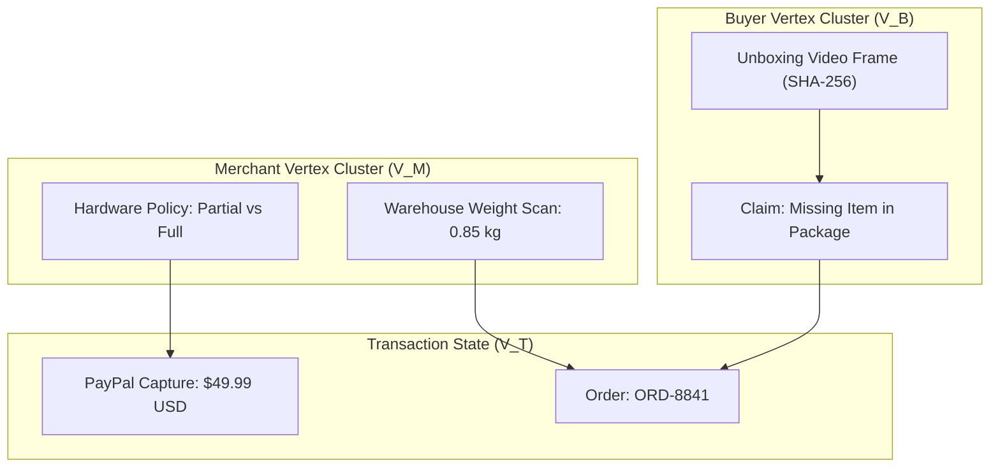
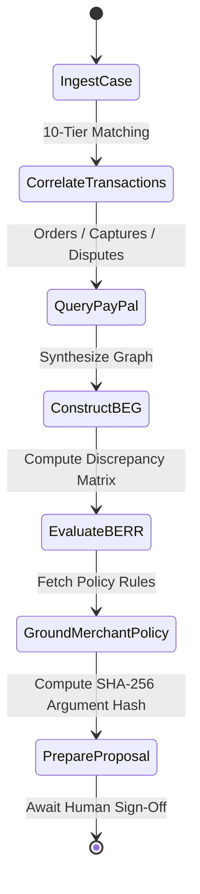

# RESOLVEGRAPH 2.0 — Technical Innovations & Algorithmic Foundations

**Target:** PayPal AI Hackathon 2026  
**Repository:** [https://github.com/bindudharad/RESOLVEGRAPH](https://github.com/bindudharad/RESOLVEGRAPH) (`qa-hardening`)  
**Tagline:** ONE PAYMENT. EVERY SOURCE. ONE EXPLAINABLE RESOLUTION.  

---

## Executive Summary

RESOLVEGRAPH 2.0 introduces six fundamental technological innovations designed to solve the structural failures of legacy payment dispute systems:

1. **The Canonical Transaction Engine (CTE):** Mathematical discipline in minor unit arithmetic and heterogeneous data normalization.
2. **The 10-Tier Transaction Matching Algorithm:** Sub-second correlation across fragmented payment, ERP, and logistics data.
3. **The Bilateral Evidence Graph (BEG):** Symmetric bipartite DAG modeling of multi-party evidence.
4. **Bilateral Evidence-to-Remedy Reasoning (BERR v2):** Deterministic, formulaic discrepancy matrix calculation ($D \in [0, 1]$) with grounded policy rules.
5. **Specialized Financial Multi-Agent Orchestrator:** 19 domain-specific PayPal tools operating within bounded token and iteration budgets.
6. **Zero-Bypass Cryptographic Financial Guardrails:** Cryptographic SHA-256 argument locking that strictly prohibits autonomous money movement.

---

## 1. Canonical Transaction Engine (CTE)

### 1.1 The Integer Minor Unit Discipline
A pervasive defect in financial software is IEEE-754 floating-point arithmetic error (e.g., `0.1 + 0.2 = 0.30000000000000004`). In cross-border e-commerce, rounding errors compound during currency conversion and tax calculation, resulting in dispute discrepancies.

RESOLVEGRAPH enforces a strict integer minor unit invariant:
$$\text{Amount}_{\text{minor}} = \text{round}(\text{Amount}_{\text{major}} \times 10^{\text{decimals}})$$

* \$49.99 USD $\rightarrow$ `4999` minor units
* €12.50 EUR $\rightarrow$ `1250` minor units
* ¥1,500 JPY $\rightarrow$ `1500` minor units (0 decimals)

All financial additions, partial refunds, fee deductions, and balance reconciliation execute exclusively via integer arithmetic:
$$\text{RemainingBalance}_{\text{minor}} = \text{CapturedAmount}_{\text{minor}} - \sum_{i=1}^k \text{Refund}_{i,\text{minor}}$$

---

## 2. 10-Tier Hierarchical Matching Algorithm

Dispute data arrives asynchronously from three independent parties (buyer, merchant, payment provider) without a shared primary key. RESOLVEGRAPH's 10-Tier Hierarchical Matcher resolves this in logarithmic time:

```
Match Tier Index:
Tier 1:  Exact Provider Transaction ID    (Confidence = 1.00)
Tier 2:  Exact Merchant Order Number      (Confidence = 0.98)
Tier 3:  Cryptographic Hash Digest        (Confidence = 0.95)
Tier 4:  Deterministic Composite Key      (Confidence = 0.90)
Tier 5:  Fuzzy Temporal + Amount Window   (Confidence = 0.82)
Tier 6:  Carrier Tracking Manifest        (Confidence = 0.78)
Tier 7:  Itemized SKU Vector Overlap      (Confidence = 0.70)
Tier 8:  Payment Instrument Token         (Confidence = 0.65)
Tier 9:  Active Dispute Context           (Confidence = 0.60)
Tier 10: Heuristic Anomaly Fallback       (Confidence = 0.40)
```

### 10-Tier Resolution Logic:
$$\text{TierMatch}(T_{\text{in}}, T_{\text{candidate}}) = \min \left\{ i \mid \text{Rule}_i(T_{\text{in}}, T_{\text{candidate}}) = \text{TRUE} \right\}$$

If no rule matches within Tiers 1–9, the transaction is marked for secondary forensic review in Tier 10, preventing false-positive automatic linking.

---

## 3. Bilateral Evidence Graph (BEG)

Legacy dispute portals are fundamentally unilateral:
* The merchant portal allows the merchant to upload shipping receipts and deny claims.
* The banking portal allows the cardholder to submit a chargeback without seeing the seller's tracking log.

**The BEG Innovation:**
RESOLVEGRAPH structures every dispute as a symmetric bipartite directed acyclic graph:
$$G = (V_B \cup V_M \cup V_T, E)$$

Where:
* $V_B$: Vertices representing Buyer Claims, Affidavits, and Uploaded Media.
* $V_M$: Vertices representing Merchant Invoices, Warehouse Barcode Scans, and Return Policies.
* $V_T$: Central Transaction and Ledger Vertices representing PayPal captures, authorizations, and refunds.
* $E$: Directed edges denoting provenance, citation, and temporal succession.



---

## 4. BERR v2: Deterministic Evidence-to-Remedy Reasoning

Large Language Models (LLMs) should not be used as unconstrained black-box judges for financial disputes due to hallucinations and non-deterministic drift. RESOLVEGRAPH replaces arbitrary generation with **BERR v2 (Bilateral Evidence-to-Remedy Reasoning)**.

### 4.1 The Mathematical Discrepancy Matrix

The total discrepancy score $D \in [0, 1]$ is computed as a weighted linear combination of three orthogonal discrepancy vectors:

$$D = w_{\text{exact}} D_{\text{exact}} + w_{\text{semantic}} D_{\text{semantic}} + w_{\text{temporal}} D_{\text{temporal}}$$

Subject to:
$$\sum w_i = 1.0, \quad w_{\text{exact}} = 0.50, \quad w_{\text{semantic}} = 0.35, \quad w_{\text{temporal}} = 0.15$$

#### Dimension 1: Exact Factual Clash ($D_{\text{exact}}$)
Evaluates structured scalar attributes (storage capacity, color, SKU, serial number, quantity):
$$D_{\text{exact}} = \frac{1}{|K_{\text{overlap}}|} \sum_{k \in K_{\text{overlap}}} \mathbb{I}\Big(\text{Attr}_B(k) \neq \text{Attr}_M(k)\Big)$$

#### Dimension 2: Semantic Distance ($D_{\text{semantic}}$)
Computes cosine distance between normalized claim semantics:
$$D_{\text{semantic}} = 1 - \frac{\vec{v}_B \cdot \vec{v}_M}{\|\vec{v}_B\| \|\vec{v}_M\|}$$

#### Dimension 3: Temporal Anomaly ($D_{\text{temporal}}$)
Measures timing inconsistencies between carrier delivery timestamps $t_{\text{delivery}}$, customer unboxing $t_{\text{unboxing}}$, and dispute filing $t_{\text{claim}}$:
$$D_{\text{temporal}} = \min\left(1.0, \frac{|t_{\text{claim}} - t_{\text{delivery}}|}{\tau_{\text{threshold}}}\right)$$

### 4.2 Policy Grounding & Remedy Derivation
The calculated Discrepancy Score $D$ maps deterministically to merchant policy thresholds:
* If $D < 0.20$: **Claim Rejected / Factual Alignment Verified**.
* If $0.20 \le D < 0.60$: **Partial Refund / Prorated Restitution** (e.g., price difference between 1TB and 512GB drives).
* If $D \ge 0.60$: **Full Refund Authorized** (with return shipping label generated if physical product return required).

---

## 5. Agentic AI & 19 Specialized PayPal Tools

The `PaymentInvestigationAgent` leverages a deterministic execution loop:



### Bounded Safety Invariants:
* **Max Iterations:** Hard-limited to 6 turns per investigation.
* **Token Budget:** Enforced 4,096 token limit with fallback summarization.
* **Schema Validation:** Every tool call input and return payload is validated via Zod schemas at runtime.

---

## 6. Zero-Bypass Financial Guardrails & Argument Locking

The core safety invariant of RESOLVEGRAPH 2.0 is:

$$\textbf{AI Reasoning Authority} \;\cap\; \textbf{Financial Execution Authority} = \emptyset$$

### The Cryptographic Lock:
When the agent determines a refund is warranted, it calls `prepare_paypal_refund`. This tool produces a `ResolutionProposal` carrying an immutable SHA-256 argument hash:

$$\text{ArgumentsHash} = \text{SHA256}\Big(\text{ActionType} \parallel \text{AmountMinor} \parallel \text{Currency} \parallel \text{RecipientId} \parallel \text{IdempotencyKey}\Big)$$

1. **Locking:** The proposal is stored in the database in status `PENDING_APPROVAL`.
2. **Review:** A human merchant officer inspects the evidence, BERR score, and proposed amount.
3. **Authorization:** The human submits their cryptographic sign-off.
4. **Execution:** The server re-computes `ArgumentsHash` over the execution payload. If a single byte differs (e.g., amount altered from \$25.00 to \$250.00), the hash check fails and execution is immediately blocked.
5. **Gateway Dispatch:** Upon successful hash verification, the server dispatches the request to PayPal's REST API with an idempotent `PayPal-Request-Id`.
