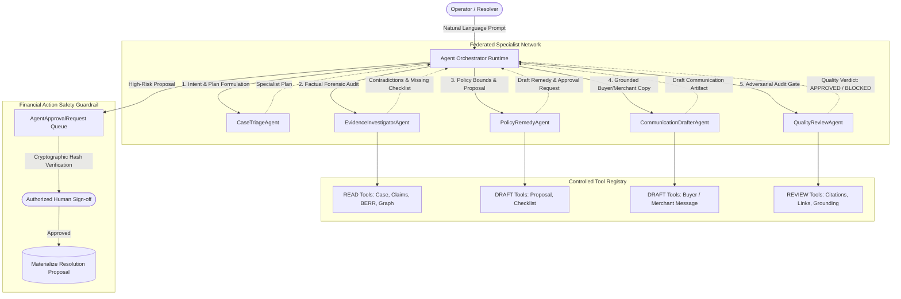
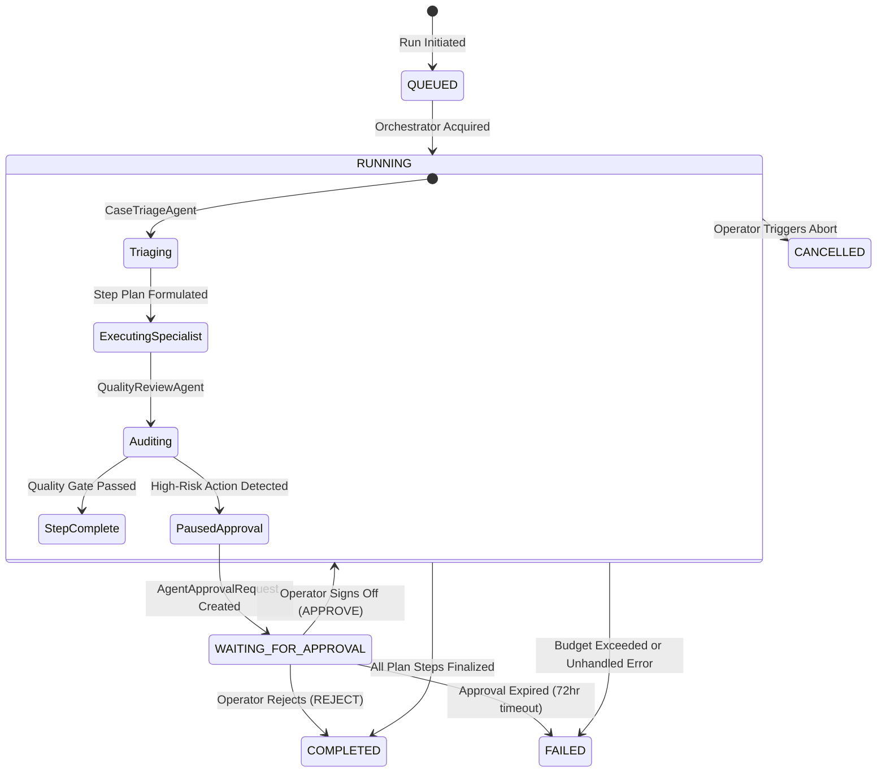

# ResolveGraph Multi-Agent AI Architecture

## 1. Executive Summary

ResolveGraph Step 8 establishes an enterprise-grade, human-governed multi-agent AI architecture engineered specifically for fintech commerce dispute reconciliation. Instead of relying on a monolithic, unconstrained large language model with unchecked autonomy, ResolveGraph deploys a **federated network of 5 specialized agents** coordinated by a central orchestrator.

Every subagent is bound by strict role boundaries, typed tool registries, independent RBAC authorization gates, and non-negotiable financial guardrails.

---

## 2. Multi-Agent Topology & Role Specialization

### Specialist Subagent Profiles

| Agent Name | Architectural Role | Permitted Tools | Core Deliverable |
| :--- | :--- | :--- | :--- |
| **`CaseTriageAgent`** | Prompt analysis & workflow planning | `get_case_summary` | Discrepancy, Policy, or Dispute classification and multi-step plan |
| **`EvidenceInvestigatorAgent`** | Forensic synthesis & reconciliation | `get_case_findings`, `get_case_claims`, `get_case_evidence_metadata`, `create_missing_evidence_checklist`, `create_investigation_summary` | Forensic dossier, discrepancy score, and missing evidence checklist |
| **`PolicyRemedyAgent`** | Policy bound assessment & draft remedy | `get_applicable_policy`, `get_payment_status`, `create_draft_resolution_proposal` | Grounded remedy recommendation with approval gate for financial terms |
| **`CommunicationDrafterAgent`** | Factual grounded message drafting | `create_draft_buyer_message`, `create_draft_merchant_message` | Objective draft communication citing verified case evidence (draft-only) |
| **`QualityReviewAgent`** | Adversarial auditor & safety gate | `validate_claim_evidence_links`, `validate_source_citations`, `validate_policy_conditions`, `validate_agent_result` | Citation audit, hallucination check, and pass/block gate verdict |

---

## 3. Orchestration Runtime State Machine

The multi-agent execution lifecycle is maintained durably in SQLite with resilient step progression:

---

## 4. Durable SQLite Persistence Models

1. **`AgentRun`**: Tracks top-level execution, user prompt, intent, current step, maximum step budget, token expenditure, and overall status.
2. **`AgentStep`**: Checkpoints each subagent's execution step, goal, duration, and structured output JSON.
3. **`AgentToolInvocation`**: Full forensic audit log recording exact tool input JSON, output JSON, duration, category, and execution status (`SUCCEEDED`, `FAILED`, `BLOCKED_GUARDRAIL`).
4. **`AgentApprovalRequest`**: High-risk action container storing cryptographic SHA-256 argument hashes (`argumentsHash`), operator notes, and authorized signatures.
5. **`AgentArtifact`**: Versioned, operator-reviewable artifacts (`DRAFT_MESSAGE`, `DRAFT_PROPOSAL`, `INVESTIGATION_SUMMARY`, `EVIDENCE_CHECKLIST`, `QUALITY_REPORT`).
