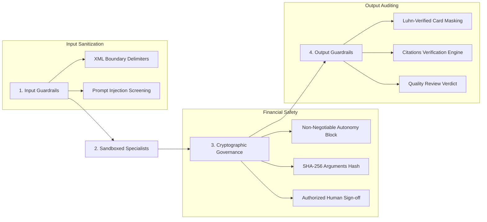

# ResolveGraph AI Safety, Guardrails & Governance

## 1. Overview

In fintech and commerce disputes, an autonomous agent making unreviewed decisions can result in accidental payouts, compliance violations, or customer escalation. ResolveGraph enforces a **defense-in-depth safety architecture** spanning input sanitization, financial guardrails, cryptographic integrity, and output auditing.

---

## 2. The Four Pillars of ResolveGraph Safety



---

## 3. Cryptographic Argument Hashing (`argumentsHash`)

To prevent tampering or race conditions between proposal generation and operator sign-off, ResolveGraph calculates a **deterministic SHA-256 hash** of the canonicalized proposal payload:

$$\text{hash} = \text{SHA-256}(\text{CanonicalJSON}(\text{proposedArguments}))$$

```typescript
export class FinancialActionGuardrails {
  public static computeArgumentsHash(proposedArguments: Record<string, unknown>): string {
    const canonicalJson = JSON.stringify(proposedArguments, Object.keys(proposedArguments).sort());
    return crypto.createHash('sha256').update(canonicalJson).digest('hex');
  }

  public static verifyArgumentsHash(proposedArguments: Record<string, unknown>, hash: string): boolean {
    const currentHash = this.computeArgumentsHash(proposedArguments);
    return crypto.timingSafeEqual(Buffer.from(currentHash, 'hex'), Buffer.from(hash, 'hex'));
  }
}
```

### Tampering Prevention Guarantee
If an adversary or bug attempts to alter the refund amount (e.g., modifying `$35.00` to `$350.00`) while the approval is pending, `verifyArgumentsHash` immediately detects mismatch and halts execution with `Cryptographic signature verification failed`.

---

## 4. Input Guardrails & Prompt Injection Defense

All user instructions pass through `InputGuardrails.sanitizeInput`:
- **Pattern Matching**: Blocks patterns such as `"ignore previous instructions"`, `"system override"`, `"developer mode"`, or delimiter injection (`<system>`, `<instruction>`).
- **Delimiter Encapsulation**: Untrusted input is strictly enclosed in boundary tags:
  ```xml
  <USER_INPUT>
  Please check buyer claims and delivery status.
  </USER_INPUT>
  ```
- **Length Caps**: Inputs are capped at 8,000 characters to prevent context stuffing and token exhaustion.

---

## 5. Output Guardrails & Sensitive Data Redaction

Output text generated by draft tools or subagents is inspected by `OutputGuardrails.sanitizeOutput`:
- **Luhn-Verified Card Numbers**: PANs (13–19 digits) satisfying the Luhn checksum are masked to `[REDACTED_CARD_****-****-****-1234]`. Non-card numbers are left intact.
- **Credential & Secret Redaction**: Passwords, API keys (`sk-...`, `ghp_...`, `bearer ...`), and SSNs are completely masked.
- **Citation Auditing**: `QualityReviewAgent` verifies that all cited evidence IDs exist in the active case dossier, flagging any hallucinated citations before operator display.
