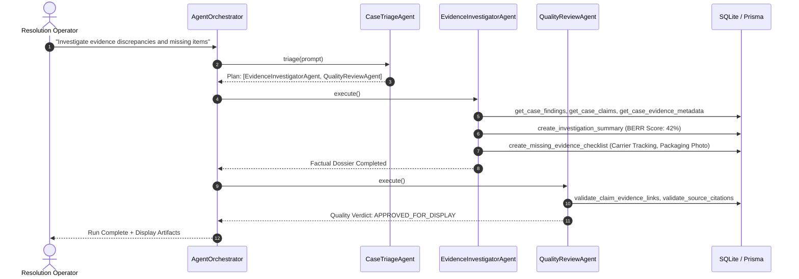
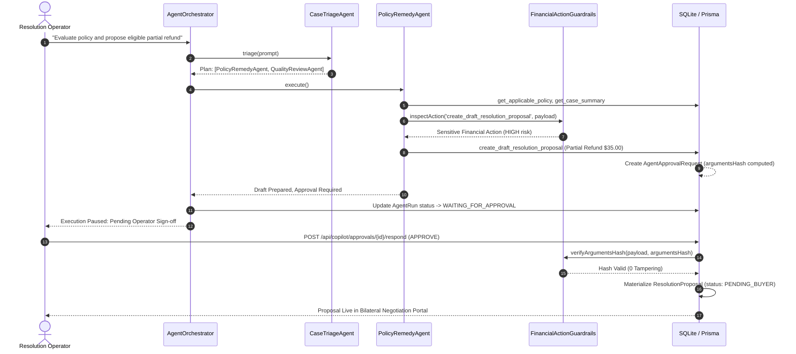
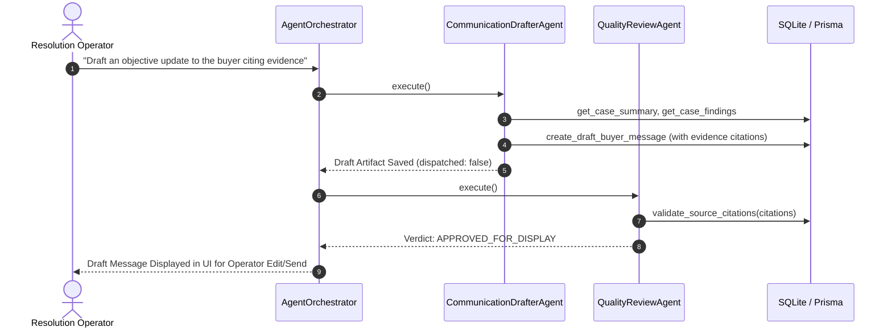

# ResolveGraph Intelligent Copilot Workflows

ResolveGraph Step 8 supports **4 primary enterprise resolution workflows**, executable from the Copilot Command Center (`/copilot`) or directly within the Case Workspace (`/cases/[caseId]` Tab 11).

---

## Workflow 1: Discrepancy & Forensic Investigation

**Intent**: `INVESTIGATE_DISCREPANCIES`  
**Goal**: Audit claims and evidence, identify contradictions, and generate a missing evidence checklist.

---

## Workflow 2: Policy Evaluation & Resolution Proposal (Human-in-the-Loop)

**Intent**: `EVALUATE_POLICY`  
**Goal**: Evaluate merchant policy bounds and formulate an authorized bilateral remedy proposal.

---

## Workflow 3: Grounded Buyer / Merchant Communication

**Intent**: `DRAFT_COMMUNICATION`  
**Goal**: Draft professional, objective correspondence grounded in verified evidence without unilateral dispatch.

---

## Workflow 4: PayPal Dispute Defense Dossier

**Intent**: `PREPARE_DISPUTE_DOSSIER`  
**Goal**: Assemble chronological facts and verified evidence for external PayPal dispute defense.

1. **Evidence Investigator**: Pulls carrier tracking proof, merchant fulfillment invoices, and buyer complaint excerpts.
2. **Quality Review**: Ensures 100% citation grounding and redacts payment card numbers.
3. **Artifact Output**: Creates an exportable PayPal Dispute Defense brief ready for submission.
