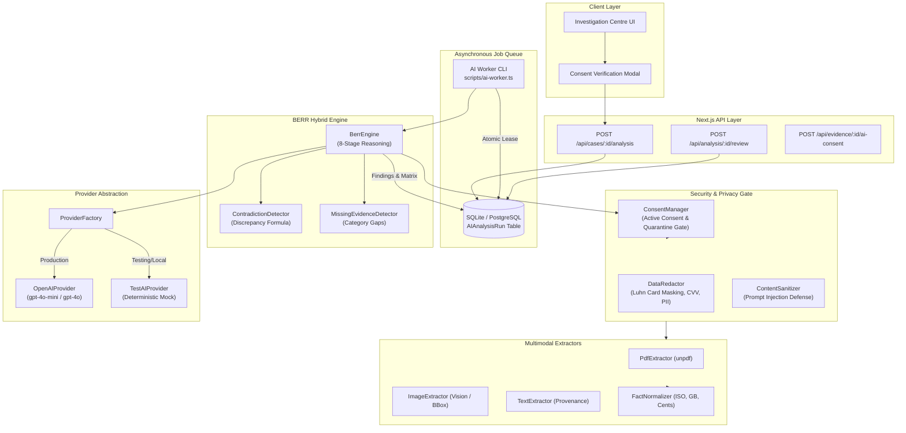

# RESOLVEGRAPH — AI Architecture & Provider Infrastructure

## 1. Architectural Philosophy

ResolveGraph implements a **provider-independent, privacy-first, verifiable AI infrastructure** designed specifically for high-stakes commerce disputes. The architecture guarantees that:

1. **AI is an investigative copilot, not a judge**: AI never autonomously issues refunds, moves funds, or closes dispute cases.
2. **Provider independence**: Business logic is completely decoupled from any single LLM or cloud vendor.
3. **Multi-tenant isolation & consent gating**: No evidence or claim statement is ever transmitted to an external model without explicit, active consent and security sanitization.
4. **Deterministic testability**: Complete offline reproducibility without paid API keys via high-fidelity test providers.



---

## 2. Provider Abstraction Layer

The interface `AIProvider` (`src/server/ai/providers/ai-provider.interface.ts`) defines four core operations:

```typescript
export interface AIProvider {
  name: string;
  extractDocument(req: ExtractionRequest): Promise<ExtractionResponse>;
  analyzeMultimodal(req: MultimodalAnalysisRequest): Promise<MultimodalAnalysisResponse>;
  reasonBERR(req: BerrReasoningRequest): Promise<BerrReasoningResponse>;
  healthCheck(): Promise<{ ok: boolean; provider: string; model: string; error?: string }>;
}
```

### 2.1 OpenAI Responses API (`OpenAIProvider`)
- Implemented in `src/server/ai/providers/openai.provider.ts`.
- Utilizes the OpenAI SDK with structured JSON schemas (`response_format: { type: 'json_object' }`).
- Multimodal support: vision image inputs encoded as high-resolution base64 data URLs (`data:image/jpeg;base64,...`).
- Configurable model (defaults to `gpt-4o-mini` with fallback to `gpt-4o`).
- Automatic retry, backoff, and token usage accounting.

### 2.2 Deterministic Mock Provider (`TestAIProvider`)
- Implemented in `src/server/ai/providers/test.provider.ts`.
- 100% reproducible, zero-network-dependency provider for continuous integration, regression testing, and local development without paid keys.
- Accurately parses product specifications, tracking numbers, dates, prices, and bounding boxes.

### 2.3 Provider Factory (`getAIProvider`)
- Dynamically resolves provider based on `AI_PROVIDER` and `AI_PROCESSING_ENABLED` environment variables.
- Safely falls back to `TestAIProvider` if `OPENAI_API_KEY` is not present, ensuring the application never crashes in development or test environments.

---

## 3. Asynchronous Job Processing & Queue Architecture

High-throughput, resilient asynchronous processing handles long-running multimodal vision and reasoning tasks without blocking HTTP server threads.

### 3.1 Job States
1. `QUEUED`: Analysis requested by user; pending lease acquisition.
2. `PROCESSING`: Leased by an active worker process; lease expiration timer active.
3. `COMPLETED`: Analysis succeeded with discrepancy score $D < 0.50$.
4. `NEEDS_HUMAN_REVIEW`: Analysis succeeded but detected substantive conflict ($D \ge 0.50$) or evidence gaps requiring human resolution manager determination.
5. `FAILED`: Run encountered execution error; retried up to 3 times before terminal failure.

### 3.2 Atomic Lease Locking
Workers use atomic database lease locking to prevent duplicate processing across distributed containers:
```typescript
const locked = await prisma.aIAnalysisRun.update({
  where: { id: candidate.id },
  data: {
    status: 'PROCESSING',
    lockedAt: new Date(),
    lockedBy: workerId,
    leaseExpiresAt: new Date(Date.now() + 60000),
    attemptCount: { increment: 1 }
  }
});
```

### 3.3 Worker CLI
- Continuous loop mode: `npm run ai:worker`
- Single-job execution: `npm run ai:worker:once`
- Graceful shutdown on `SIGINT` and `SIGTERM`.
