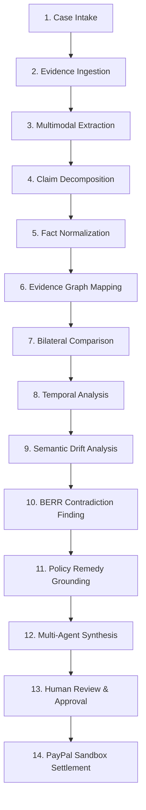

# RESOLVEGRAPH — Complete AI Architecture & Pipeline Specification
**Phase:** Step 11 Final Submission & Presentation Readiness  
**Target:** AI Researchers, Solution Architects & Hackathon Judges  
**Models Utilized:** OpenAI `gpt-4o-mini`, Multimodal Vision API, Heuristic Regex/AST Fallbacks  
**Version:** 1.0.0 (November 2026)

---

## 1. Architectural Principles: AI as Copilot, Not Adjudicator

ResolveGraph enforces strict taxonomy between deterministic software logic and artificial intelligence. We believe reliable enterprise software must never delegate database transactions, financial debits, or legal conclusions to opaque probabilistic models.

### Operational Taxonomy

```
┌──────────────────────────────────────┬───────────────────────────────────────────────────────────┐
│ System Layer                         │ Exact Implementation in ResolveGraph                      │
├──────────────────────────────────────┼───────────────────────────────────────────────────────────┤
│ 1. Deterministic Application Logic   │ Next.js App Router, Prisma ORM, SQLite/Postgres queries,  │
│                                      │ Zod v4 schema validation, SHA-256 cryptographic hashing.  │
├──────────────────────────────────────┼───────────────────────────────────────────────────────────┤
│ 2. AI-Generated Extraction           │ OpenAI gpt-4o-mini structured JSON responses, bounding     │
│                                      │ box normalization (0-1000 scale), unpdf text extraction. │
├──────────────────────────────────────┼───────────────────────────────────────────────────────────┤
│ 3. AI-Assisted Interpretation        │ Semantic distance evaluation, plain-language customer     │
│                                      │ explanation drafting, specialist agent synthesis.         │
├──────────────────────────────────────┼───────────────────────────────────────────────────────────┤
│ 4. Rule-Based Mathematical Validation│ BERR weighted discrepancy scoring (D), return window rules│
│                                      │ evaluation, minor unit financial math, cycle checks.      │
├──────────────────────────────────────┼───────────────────────────────────────────────────────────┤
│ 5. Human Decision (The Gate)         │ Authorized merchant manager reviews proposed remedy and   │
│                                      │ signs cryptographic execution hash.                       │
├──────────────────────────────────────┼───────────────────────────────────────────────────────────┤
│ 6. Payment Provider Execution        │ PayPal Sandbox REST API call (/v2/payments/captures/... )  │
└──────────────────────────────────────┴───────────────────────────────────────────────────────────┘
```

---

## 2. The 14-Stage Processing Pipeline



### Stage-by-Stage Implementation Mapping

| Stage | Implementation Component | Method / Model | Deterministic vs Probabilistic |
|---|---|---|---|
| **1. Case Intake** | `CaseService.createCase()` | REST API + Zod schema validation | **Deterministic** (Database insert) |
| **2. Evidence Ingestion** | `LocalEvidenceStorage` | Binary magic-byte sniffing + SHA-256 | **Deterministic** (Buffer inspection) |
| **3. Text & Vision Extraction** | `MultimodalExtractor` | `gpt-4o-mini` with fallback heuristic | **AI-Generated Extraction** |
| **4. Claim Decomposition** | `ClaimExtractor` | Prompt: `prompt_claim_decomposition_v2` | **AI-Generated Extraction** |
| **5. Fact Normalization** | `FactNormalizer` | Unit conversion (GB, minor cents, ISO dates) | **Deterministic** (Regex/Math) |
| **6. Evidence Graph Mapping** | `GraphBuilder` | Directed graph adjacency matrix | **Deterministic** (Graph traversal) |
| **7. Bilateral Comparison** | `BilateralComparator` | Symmetrical property matching | **Deterministic** (Factual alignment) |
| **8. Temporal Analysis** | `TemporalEngine` | Sequence sorting & counterfactual replay | **Deterministic** (Chronological order) |
| **9. Semantic Analysis** | `SemanticDriftEngine` | Cosine semantic distance scoring | **AI-Assisted Interpretation** |
| **10. BERR Findings** | `BerrEngine` | Multimodal discrepancy formula $D$ | **Rule-Based Validation** |
| **11. Policy Grounding** | `ResolutionEngine` | Schema-driven policy rule matching | **Rule-Based Validation** |
| **12. Multi-Agent Synthesis** | `Orchestrator` | Specialist subagents (`CaseTriageAgent`, etc.)| **AI-Assisted Interpretation** |
| **13. Human Review** | `AgentApprovalRequest` | Manager cryptographic signoff | **Human Decision** |
| **14. Action Execution** | `RefundService` | PayPal Sandbox API call with idempotency | **Payment Provider Action** |

---

## 3. Prompts & Safety Guardrails

### 3.1 Prompt Isolation Boundaries
All user-provided text (complaint statements, merchant rebuttals) is wrapped inside secure XML tags (`<user_claim>` and `<merchant_statement>`) before prompt submission to prevent prompt injection and instruction override attacks.

### 3.2 Automated Redaction
The `DataRedactor` utility scans all outbound and inbound LLM payloads, stripping:
- Valid Credit Card numbers passing the Luhn check algorithm (`4111-XXXX-XXXX-1111`)
- CVV security codes
- Authentication bearer tokens and passwords
- Social security numbers and personal identity numbers

### 3.3 Offline Heuristic Fallback
If the OpenAI API returns an HTTP error, 429 rate limit, or if `OPENAI_API_KEY` is omitted, the `FallbackHeuristicExtractor` activates instantaneously:
- Extracts dimensions, capacities (e.g. `1TB`, `512GB`), serial numbers, and monetary figures using deterministic regex and pattern matching.
- Flags the response with `"extractionMode": "fallback_heuristic"` to maintain complete transparency with human operators.
