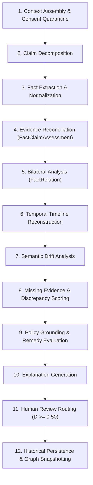

# BERR Advanced: 12-Stage Bilateral Reasoning Engine

## 1. Overview & Research Methodology

**BERR (Bilateral Evidence-to-Remedy Reasoning)** is ResolveGraph's research-grounded framework for automated dispute reconciliation. Unlike one-sided claim scoring, BERR enforces bilateral symmetry, mathematical discrepancy calibration, semantic drift detection, and policy-grounded remedy formulation.

---

## 2. The 12-Stage Reasoning Pipeline

### Detailed Pipeline Stages:
1. **Case Context Assembly & Consent Quarantine**:
   - Validates active user consents via `ConsentManager`.
   - Generates cryptographic SHA-256 hashes (`AIAnalysisInput`) for every permitted claim and evidence item.
2. **Claim Decomposition**:
   - Parses natural language claim statements into structured claims with designated party roles (`BUYER` or `MERCHANT`).
3. **Fact Extraction & Normalization**:
   - Normalizes storage capacities, currencies, serial numbers, SKUs, and calendar dates into canonical representations.
4. **Evidence Reconciliation (`FactClaimAssessment`)**:
   - Assesses whether individual extracted facts support, contradict, or partially corroborate party claims.
5. **Bilateral Analysis (`FactRelation`)**:
   - Pairs buyer-side facts with merchant-side facts to detect `EQUIVALENT`, `CONTRADICTS`, or `SUPERSEDES` relationships.
6. **Temporal Timeline Reconstruction (`CaseTimelineEvent`)**:
   - Sequences real-world transaction milestones (`occurredAt`) and identifies timestamp inversions.
7. **Semantic Drift Analysis**:
   - Pinpoints transition points where specifications or commitments diverge across the commercial lifecycle.
8. **Missing Evidence & Discrepancy Scoring**:
   - Identifies evidentiary gaps and calculates the multi-factor discrepancy score $D$.
9. **Policy Grounding & Remedy Evaluation**:
   - Evaluates active versioned resolution policies (`ResolutionEngine`) to suggest compliant remedy options.
10. **Explanation Generation**:
    - Synthesizes an evidence-backed audit brief citing specific findings, facts, and policy clauses.
11. **Human Review Routing**:
    - If total discrepancy $D \ge 0.50$ or critical contradictions exist, the run automatically transitions to `NEEDS_HUMAN_REVIEW`.
12. **Historical Persistence & Graph Snapshotting**:
    - Serializes and stores a complete snapshot (`GraphSnapshot`) for fast audit retrieval and counterfactual replay.

---

## 3. Mathematical Discrepancy Formulation

The overall discrepancy score $D \in [0.0, 1.0]$ is computed as:

$$D = \alpha D_{\text{exact}} + \beta D_{\text{semantic}} + \gamma D_{\text{temporal}}$$

Where:
- $\alpha = 0.40$: Weight for exact deterministic mismatches (SKUs, serial numbers, monetary values, storage capacities).
- $\beta = 0.40$: Weight for semantic specification divergence (condition, cosmetic variances, promised accessories).
- $\gamma = 0.20$: Weight for temporal variances (transit delays, delivery receipt window lapses).
- Constraint: $\alpha + \beta + \gamma = 1.0$.

---

## 4. Semantic Drift Across Commercial Stages

Semantic drift captures how product representation changes across transaction stages:

$$\text{OFFER} \xrightarrow{\Delta_1} \text{ORDER} \xrightarrow{\Delta_2} \text{DISPATCH} \xrightarrow{\Delta_3} \text{DELIVERY} \xrightarrow{\Delta_4} \text{CLAIM}$$

The `SemanticDriftEngine` pinpoints the earliest transition point $\Delta_i$ where variance becomes observable without speculative attribution of intent.
