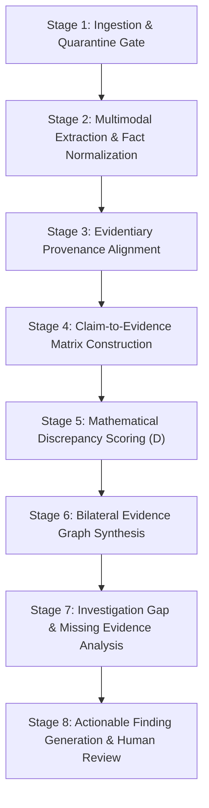

# RESOLVEGRAPH — BERR Methodology & Discrepancy Reasoning

> [!NOTE]
> **Scientific Disclosure**: BERR (Bilateral Evidence-to-Remedy Reasoning) is a **proposed applied research methodology** designed for multi-party commerce reconciliation. It is not an established scientific dogma or legally binding judicial algorithm.

---

## 1. What is BERR?

In online commerce disputes, buyers and merchants frequently describe the same event through contradictory lenses. Traditional e-commerce platforms either rely on opaque black-box AI decisions or impose rigid manual review that burdens operations.

**BERR (Bilateral Evidence-to-Remedy Reasoning)** is an 8-stage hybrid forensic methodology that aligns bilateral claims against verified evidence, computes mathematical discrepancy scores, pinpoints missing evidentiary documentation, and generates actionable investigative next steps for human resolution managers.

---

## 2. The 8 Discrete Reasoning Stages

### Stage 1: Ingestion & Quarantine Gate
- Verifies provider-specific processing consent (`AIProcessingConsent`).
- Checks malware status; strictly excludes any item flagged as `INFECTED` or `QUARANTINED`.
- Records cryptographic input hashes (`AIAnalysisInput`) for tamper detection.

### Stage 2: Multimodal Extraction & Fact Normalization
- Extracts verifiable facts from PDFs, high-resolution imagery, and text statements.
- Normalizes disparate units (capacities to GB, amounts to cents, dates to ISO).

### Stage 3: Evidentiary Provenance Alignment
- Maps facts to exact source offsets (`pageNumber`, `characterStart`, `characterEnd`, `boundingBoxJson`).
- Validates verbatim excerpts against sanitized source text.

### Stage 4: Claim-to-Evidence Matrix Construction
- Constructs pairwise relationships between claims and evidence (`ClaimEvidenceAssessment`).
- Categorizes relationships: `SUPPORTS`, `CONTRADICTS`, `MENTIONS`, `DOES_NOT_ADDRESS`.

### Stage 5: Mathematical Discrepancy & Contradiction Scoring
- Evaluates divergence between buyer claims, merchant statements, and physical evidence.
- Computes weighted discrepancy score $D$ (detailed below).

### Stage 6: Bilateral Evidence Graph Synthesis
- Segregates facts into:
  - **Shared Facts**: Mutually agreed specifications and verified transaction totals.
  - **Conflicting Facts**: Divergent attributes (e.g. 512GB vs 1TB, pristine vs damaged).
  - **Unilateral Claims**: Unsubstantiated claims asserted by one party alone.

### Stage 7: Investigation Gap & Missing Evidence Analysis
- Evaluates dispute type against requisite commerce proof standards:
  - *Non-delivery*: requires formal tracking scan and signature proof/GPS.
  - *Not as described*: requires itemized merchant invoice and clear serial/specification photo.
  - *Damaged in transit*: requires outer packaging photograph and damage detail.
  - *Refund dispute*: requires return courier receipt and drop-off confirmation.
- Pinpoints exactly which party is missing what piece of evidence.

### Stage 8: Actionable Finding Generation & Human Review
- Generates structured `BerrFinding` objects categorized by severity (`CRITICAL`, `HIGH`, `MEDIUM`, `LOW`).
- Provides specific, operational investigative steps (e.g. "Request carrier GPS coordinate delivery report within 48 hours").
- Routes cases with $D \ge 0.50$ to human resolution managers for confirmation or override.

---

## 3. Mathematical Discrepancy Scoring Formula

The total discrepancy index $D \in [0.0, 1.0]$ is formulated as a linear combination of exact, semantic, and temporal divergence:

$$D = \alpha D_{exact} + \beta D_{semantic} + \gamma D_{temporal}$$

Where:
- $D_{exact} \in [0.0, 1.0]$: Divergence across verifiable numeric specifications, prices, and model numbers.
- $D_{semantic} \in [0.0, 1.0]$: Contradictions in reported condition, functionality, and descriptive claims.
- $D_{temporal} \in [0.0, 1.0]$: Inconsistencies in dispatch schedules, delivery scans, and return handover dates.
- Default weights: $\alpha = 0.4$, $\beta = 0.4$, $\gamma = 0.2$ ($\alpha + \beta + \gamma = 1.0$).

### Thresholds & Workflow Routing
- **$D < 0.25$ (Low Discrepancy)**: Substantial alignment between buyer declarations and merchant records; status `COMPLETED`. Standard claim reconciliation protocol applies.
- **$0.25 \le D < 0.50$ (Moderate Discrepancy)**: Minor variances (e.g. cosmetic wear or delivery hour discrepancies); status `COMPLETED`.
- **$D \ge 0.50$ (High Discrepancy)**: Substantive specification mismatch, non-receipt with conflicting delivery scans, or physical damage in transit; status automatically flagged as `NEEDS_HUMAN_REVIEW`.

---

## 4. Strict Safety & Ethical Boundaries

ResolveGraph enforces hard boundaries on AI operations:
1. **NO Autonomous Refunds**: The engine never disburses refunds, modifies bank balances, or triggers payment reversals.
2. **NO Automated Case Closures**: Disputes can only be resolved or closed by authorized human participants or resolution managers.
3. **NO Autonomous Fraud or Criminal Determinations**: AI flags evidentiary contradictions; it never accuses parties of fraud or criminality.
4. **Human Review Priority**: Every AI finding can be `CONFIRMED`, `CORRECTED`, `REJECTED`, or marked `INCONCLUSIVE` by an authorized reviewer.
