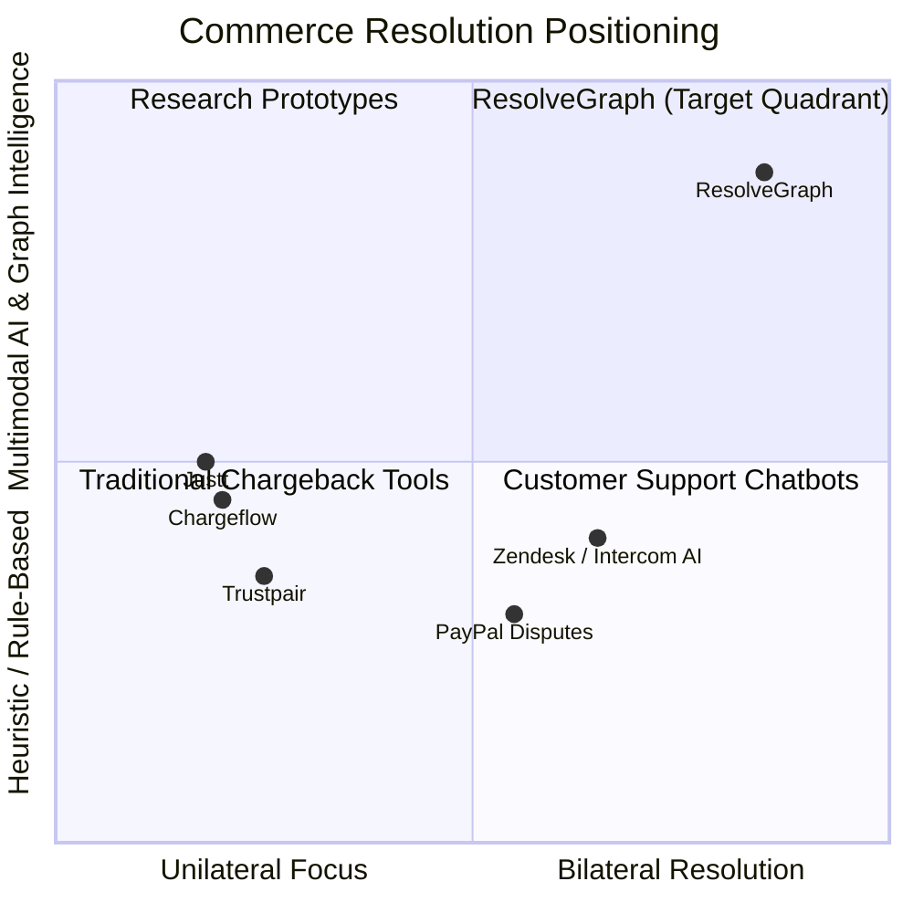

# ResolveGraph Competitive Analysis & Market Landscape

## 1. Competitive Overview

Commercial solutions and protocols in the payment and dispute resolution space generally target **one side of the transaction** (either the merchant looking to defend chargebacks or the buyer filing a credit card complaint), or operate at the **low-level transaction protocol** layer. 

ResolveGraph is positioned as **bilateral commerce resolution infrastructure** that bridges buyers, merchants, and payment rails through grounded evidence reconciliation prior to chargeback escalation.

---

## 2. Deep-Dive Comparative Matrix

| System | Primary Problem Solved | Target User | AI Capabilities | Evidence Model | Autonomous Execution | Human Governance |
| :--- | :--- | :--- | :--- | :--- | :--- | :--- |
| **Chargeflow** | Post-chargeback win-rate recovery | Merchants only | Template LLM dispute letters | Merchant receipts & shipping scans | Autonomously submits chargeback representments | Low (primarily "set and forget") |
| **Justt** | Chargeback defense automation | Enterprise merchants | Machine learning win-rate predictor | Unilateral merchant data ingestion | Submits chargeback representment packages | Low (automated submission) |
| **Trustpair** | B2B wire & payment fraud prevention | Corporate treasuries | Entity bank account matching | Vendor master data verification | Flags risky payouts | Medium (approval workflows for wire transfers) |
| **Google AP2 / Agentic Protocol** | Agent-to-agent checkout authorization | Buyers / Autonomous agents | LLM mandate signing | Cryptographic mandate tokens | Executes agent payments within budget bounds | Medium (user sets initial spending caps) |
| **PayPal Disputes** | Native payment resolution | Buyers, Merchants & PayPal | Basic document uploads & dispute portal | File attachments (PDF/JPG) without graph linking | Automated closure on merchant default | High (manual review by PayPal dispute agents) |
| **ResolveGraph** | Pre-chargeback bilateral evidence reconciliation & policy-aware remedy | Buyers, Merchants, Resolution Operators | Multimodal extraction, BERR, Evidence Graph, Temporal Drift | Bilateral Evidence Graph linking claims, facts & provenance | Draft-only tools; NO autonomous payouts/refunds | **Non-negotiable Cryptographic Sign-Off Gate** |

---

## 3. Detailed Mechanism Comparisons

### A. Chargeflow vs ResolveGraph
- **Chargeflow**: Focuses on *representment automation* after a chargeback is already initiated by the buyer's credit card issuing bank. Collects merchant data (order, delivery proof, customer communications), dynamically generates a template response, and submits it to Visa/Mastercard rails.
  - *Limitation*: Excludes the buyer completely; reactive to chargebacks (which already incur $\$15$–$\$25$ merchant dispute fees); does not reconcile contradictions in evidence.
  - *ResolveGraph Differentiation*: Resolves disputes **pre-chargeback** in a shared bilateral workspace. Reconciles buyer and merchant statements, computes weighted discrepancy scores ($D$), and facilitates agreed settlements (refund, replacement, return) before costly bank disputes occur.

### B. Justt vs ResolveGraph
- **Justt**: Uses ML models trained on historical chargeback outcomes to select customized evidence arguments for card network dispute rules (Visa Compelling Evidence 3.0, Mastercard rules).
  - *Limitation*: Proprietary black-box; unilateral merchant advocacy; does not extract or evaluate multimodal buyer damage photographs.
  - *ResolveGraph Differentiation*: White-box Bilateral Evidence Graph with visual explanation paths and explicit citation provenance for both buyer and merchant.

### C. Google AP2 / Agentic Protocols vs ResolveGraph
- **Google AP2 / Universal Commerce Protocol (UCP)**: Focuses on the *purchase and mandate phase*—enabling AI agents to discover products, negotiate purchase terms, and authorize payment captures using cryptographically signed mandates.
  - *Limitation*: Protocol handles forward commerce; does not provide evidence reconciliation when physical delivery diverges from the digital contract (e.g., damaged goods, counterfeit products, missing items).
  - *ResolveGraph Integration*: Complementary. Where AP2 creates the initial purchase mandate, ResolveGraph provides the *resolution infrastructure* when reality diverges from the mandate.
