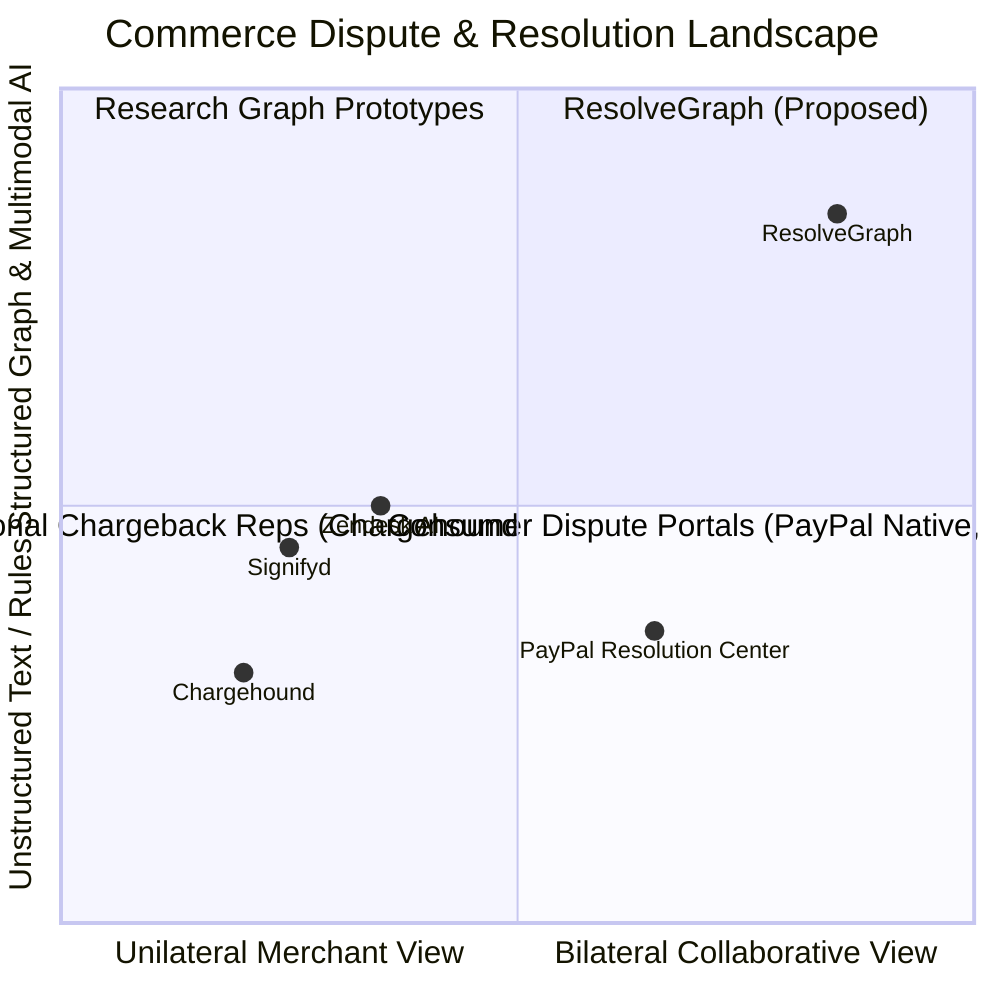

# RESOLVEGRAPH — Competitive Positioning & Comparative Analysis
**Phase:** Step 11 Final Submission & Presentation Readiness  
**Subject:** Comparative Landscape, Adjacent Technologies & Differentiation Hypothesis  
**Public Sources Reference Date:** November 2026  
**Version:** 1.0.0

---

## 1. Executive Positioning Statement

ResolveGraph is positioned as an **Evidence-First Commerce Resolution Infrastructure**. 

> [!IMPORTANT]
> **Positioning Hypothesis**: ResolveGraph's proposed differentiation lies in the architectural synthesis of **bilateral source-grounded evidence reconciliation**, **multimodal factual extraction**, **temporal and semantic drift analysis**, and **human-governed policy remedy preparation**. This positioning is presented as an engineering hypothesis being validated through empirical benchmarking and controlled pilot testing, rather than a proven commercial monopoly.

---

## 2. Adjacent Market Categories & Comparative Matrix

ResolveGraph operates at the intersection of four established technology categories:

### Detailed Comparative Analysis

| Feature Dimension | Traditional Chargeback Reps (Chargehound / Midigator) | Fraud Prevention Platforms (Signifyd / Riskified) | AI Support Agents (Decagon / Sierra / Zendesk) | PayPal Native Resolution Center | RESOLVEGRAPH (This Project) |
|---|---|---|---|---|---|
| **Primary Perspective** | Unilateral Merchant (Rebuttal generation) | Unilateral Merchant (Pre-auth risk score) | Unilateral Merchant (Deflect tickets) | Bilateral Intake (Adversarial portal) | **Bilateral Collaborative (Co-examination)** |
| **Evidence Processing** | PDF template collation | Behavioral telemetry, device fingerprinting | Unstructured text chat NLP | Attachment storage (unparsed PDFs/JPEGs) | **Multimodal Extraction & Unit Normalization** |
| **Reasoning Model** | Rule-based form filling | Machine learning risk classifiers | Generative conversational LLMs | Human caseworkers & heuristic timeouts | **BERR 10-Stage Factual Reconciliation** |
| **Relationship Modeling**| Flat document list | Graph fraud rings (syndicate detection) | Chat session turn history | Case message threads | **Directed Knowledge Graph with Cycles Check** |
| **Temporal Analysis** | Date stamp logging | Velocity checks (orders/hour) | None | SLA countdown timers | **Sequence Alignment & Counterfactual Replay** |
| **Financial Execution** | Submit chargeback representment | Chargeback financial guarantee | None (hands off to billing system) | Native PayPal disputes & charge reversals | **Human-Governed PayPal Sandbox Integration** |

---

## 3. Deep-Dive Comparator Evaluations

### 3.1 Chargeback Automation (e.g., Chargehound, Midigator)
- **Problem Addressed**: Automated collation of merchant order logs into formal representment PDF letters to satisfy card network dispute rules (Visa/Mastercard).
- **Public Documentation Baseline**: Uses rule-based templates pulling merchant CRM data (AVS/CVV match, tracking link) into PDF submissions.
- **Where ResolveGraph Overlaps**: Both systems compile merchant evidence into structured packages for dispute resolution.
- **Where ResolveGraph Differs**: Chargeback tools operate post-chargeback from an exclusively adversarial merchant standpoint. ResolveGraph operates pre-chargeback and during disputes, parsing buyer photos and merchant invoices symmetrically to reconcile facts before bank escalations occur.
- **What Remains Unproven**: Whether card issuers will accept structured knowledge graph exports in lieu of traditional representment PDF packets.

### 3.2 Fraud Prevention & Risk Platforms (e.g., Signifyd, Riskified)
- **Problem Addressed**: Evaluating checkout transactions in real time to prevent unauthorized credit card fraud and offer chargeback guarantees.
- **Public Documentation Baseline**: Evaluates device fingerprints, behavioral biometric graphs, and global identity networks to issue approve/decline scores.
- **Where ResolveGraph Overlaps**: Both inspect transaction and order data.
- **Where ResolveGraph Differs**: Fraud engines focus primarily on *pre-purchase authorization* and *identity theft*. ResolveGraph focuses on *post-delivery fulfillment disputes* (damaged goods, specification mismatch, missing items) where both parties are verified but physical goods are contested.
- **What Remains Unproven**: Long-term merchant ROI comparison between pre-purchase fraud prevention and post-purchase resolution automation.

### 3.3 Generative Customer Support AI (e.g., Decagon, Sierra, Zendesk AI)
- **Problem Addressed**: Conversational ticket deflection and customer inquiry automation via natural language chatbots.
- **Public Documentation Baseline**: Retrieval-Augmented Generation (RAG) over merchant help center knowledge bases.
- **Where ResolveGraph Overlaps**: Both employ LLM-based text analysis.
- **Where ResolveGraph Differs**: Conversational bots lack bilateral knowledge graphs and multimodal evidence normalization; they rely on text chat. ResolveGraph anchors investigation directly in immutable evidence files, cross-checking physical drive labels against invoices.
- **What Remains Unproven**: End-user preference between conversational conversational interfaces and structured evidence workspaces.

### 3.4 PayPal Native Resolution Center
- **Problem Addressed**: Secure, neutral payment network dispute mediation for millions of buyers and sellers worldwide.
- **Public Documentation Baseline**: Secure messaging, file attachment uploads, and formal escalation stages (Inquiry $\rightarrow$ Dispute $\rightarrow$ Claim).
- **Where ResolveGraph Overlaps**: ResolveGraph directly integrates with PayPal APIs (Sandbox Orders V2, Captures, Refunds, Disputes V1).
- **Where ResolveGraph Differs**: ResolveGraph does not attempt to replace PayPal. Instead, ResolveGraph functions as an intelligent, evidence-grounded copilot layer *on top of* PayPal, extracting facts from uploaded attachments, scoring discrepancies, and drafting grounded resolution agreements for human review.
- **What Remains Unproven**: Direct API throughput when ingesting multi-gigabyte dispute media across global PayPal production volumes.

---

## 4. What ResolveGraph Does NOT Claim

In keeping with our commitment to honest technical evaluation:
- ❌ We do **NOT** claim to be the "first AI dispute system in the world".
- ❌ We do **NOT** claim "guaranteed fraud elimination".
- ❌ We do **NOT** claim "100% automated dispute resolution without human involvement".
- ❌ We do **NOT** claim to replace PayPal's proprietary risk models or dispute architecture.

ResolveGraph provides an open, evidence-grounded infrastructure layer that makes dispute data transparent, structured, and mutually understandable.
