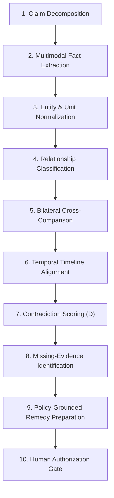

# RESOLVEGRAPH — Core Innovation & Architectural Differentiation
**Phase:** Step 11 Final Submission & Presentation Readiness  
**Subject:** Technical Innovation, Methodological Novelty & Architectural Integrity  
**Version:** 1.0.0 (November 2026)

---

## 1. Executive Overview

Modern e-commerce dispute resolution is plagued by **unilateral information silos**. Today's dispute portals (both on marketplace platforms and payment networks) typically collect isolated buyer statements and merchant rebuttals, throwing text and attachments across an adversarial divide. Human agents or crude rule engines must manually cross-reference invoices, courier tracking numbers, photos, and merchant return policies.

ResolveGraph introduces an **evidence-first, bilateral reconciliation architecture** designed to bridge this divide. Rather than treating disputes as adversarial arguments, ResolveGraph treats them as **reconcilable data graphs**.

---

## 2. Methodology A: Bilateral Evidence-to-Remedy Reasoning (BERR)

> [!NOTE]
> **Methodological Disclosure**: Bilateral Evidence-to-Remedy Reasoning (BERR) is the specialized algorithmic framework proposed, developed, and empirically benchmarked within the ResolveGraph project. It is presented as a novel applied engineering methodology, not an established industry-wide scientific standard.

### 2.1 The 10-Stage Reasoning Pipeline

The BERR pipeline processes dispute inputs across ten deterministic stages:



1. **Claim Decomposition**: Atomic claim decomposition isolates subjective grievances into verifiable factual propositions (e.g. *"Drive does not hold 1TB"* decomposes into proposition $P_1$: `Device.StorageCapacity < 1000 GB`).
2. **Multimodal Fact Extraction**: Vision-language models and OCR parsers extract structured key-value facts from binary uploads (PDF invoices, JPEG photos of packaging, tracking slips).
3. **Entity & Unit Normalization**: Standardizes non-uniform units across commercial conventions (e.g. `1024 MB` $\rightarrow$ `1.024 GB`, `₹6,499` $\rightarrow$ `649900 paise`, `04/11/26` $\rightarrow$ `2026-11-04`).
4. **Relationship Classification**: Labels graph relationships between entities (`SUPPORTS`, `CONTRADICTS`, `SUPERSEDES`, `CORROBORATES`).
5. **Bilateral Cross-Comparison**: Maps buyer-provided facts directly against merchant-provided facts to isolate areas of consensus from points of conflict.
6. **Temporal Timeline Alignment**: Sequences events chronologically to detect physical impossibilities (e.g. claim filed before carrier delivery confirmation).
7. **Contradiction Scoring ($D$)**: Evaluates a multi-factor discrepancy score:
   $$D = \alpha D_{\text{exact}} + \beta D_{\text{semantic}} + \gamma D_{\text{temporal}}$$
   Where $D_{\text{exact}} \in [0, 1]$ represents direct numerical/factual mismatches, $D_{\text{semantic}} \in [0, 1]$ represents descriptive divergence, and $D_{\text{temporal}} \in [0, 1]$ represents chronological violations (calibrated weights: $\alpha=0.45, \beta=0.35, \gamma=0.20$).
8. **Missing-Evidence Identification**: Evaluates category-specific completeness checklists. Flags missing proof (e.g. carrier Proof of Delivery for INR claims).
9. **Policy-Grounded Remedy Preparation**: Ingests published merchant return/dispute policies and maps verified facts to eligible contractual remedies (Full Refund, Partial Refund, Return for Replacement).
10. **Human Authorization Gate**: Formats the final dossier into an interactive proposal requiring human sign-off before financial execution.

---

## 3. Methodology B: The Bilateral Evidence Graph

Disputes cannot be resolved fairly through unstructured text threads. ResolveGraph represents the complete dispute context as a **Directed Multi-Relational Knowledge Graph**.

```
[Buyer Entity] ──────► [Buyer Claim: Not As Described]
       │                                │
       ▼                                ▼
[Order: ORD-8841] ───► [Product: ApexDrive Pro 1TB] ◄─── [Merchant Listing]
       │                                ▲                         ▲
       ▼                                │                         │
[PayPal Capture] ──► [Evidence: Invoice] ◄─[CONTRADICTS]─► [Evidence: Photo]
                                                                  │
                                                                  ▼
                                                      [Extracted Fact: 512GB]
```

### Why Traceable Evidence Relationships Matter
- **Traceability (Provenance)**: Every assertion in the system links directly to an underlying document hash and visual bounding box or excerpt offset.
- **Bilateral Symmetry**: Both parties are held to identical evidential standards. Merchant fulfillment records and buyer unboxing photos receive equal evidentiary weight.
- **Explainability**: Rather than providing a "black-box" AI score, the graph displays the exact chain of reasoning linking invoice facts to delivery facts.

---

## 4. Methodology C: Temporal & Semantic Drift Analysis

### 4.1 Chronological Anomaly Detection
The `TemporalEngine` orders case events across four discrete lifecycle phases:
- `PHASE_PURCHASE`: Checkout, authorization, capture.
- `PHASE_FULFILLMENT`: Dispatch, tracking scan, courier handoff.
- `PHASE_DELIVERY`: Carrier delivery confirmation, signature receipt.
- `PHASE_DISPUTE`: Claim filing, evidence submission, manager escalation.

Any backward timestamp ordering (e.g. delivery date prior to dispatch date) triggers an immediate **Temporal Anomaly Alert** ($D_{\text{temporal}} > 0.80$).

### 4.2 Semantic Drift Across Case Lifecycle
Buyers and merchants often alter their narratives as disputes progress. The `SemanticDriftEngine` measures semantic distance between the initial complaint text and subsequent evidence statements. If a claim drifts from *"I never received the item"* to *"The item arrived damaged"*, the system pinpoints the transition point and alerts the human reviewer.

---

## 5. Methodology D: Human-Governed Resolution

A foundational architectural principle of ResolveGraph is that **AI prepares, investigates, and recommends—but NEVER independently adjudicates or moves money**.

### Architectural Safeguards
1. **Advisory Role Only**: The BERR engine and multi-agent copilot generate `ResolutionProposal` drafts with confidence scores and source citations.
2. **Cryptographic Action Hashing**: High-risk operations (such as issuing a PayPal refund) generate an `AgentApprovalRequest` containing a SHA-256 hash of the exact execution arguments. If arguments are altered after signing, execution fails.
3. **Dual-Role Signoff**: A merchant manager must review and authorize the financial remedy before the PayPal Sandbox API is invoked.
4. **No Autonomous Legal Adjudication**: ResolveGraph does not assert legal guilt, fraud, or intentional misconduct. It simply identifies factual discrepancies between provided records.

---

## 6. Methodology E: Unbroken Case Continuity

In conventional commerce platforms, a dispute begins in an e-commerce support inbox, escalates to a Zendesk ticket, shifts to a PayPal dispute portal, and ends in an offline ERP spreadsheet. Context is lost at every handoff.

ResolveGraph maintains an **unbroken audit thread** from initial purchase to final refund:
- **Unified Identifier**: Case `RG-1001` remains linked to `CommerceOrder ORD-2026-8841`, PayPal Capture ID `84729103KM829141P`, and PayPal Dispute ID `PP-D-49210`.
- **Append-Only Audit Ledger**: Every status transition, evidence upload, AI analysis run, and human approval is cryptographically logged in an append-only event sequence (`CaseEvent`).
- **Auditability**: Post-resolution chargebacks or arbitration inquiries can instantly retrieve the complete evidentiary graph and decision provenance.
