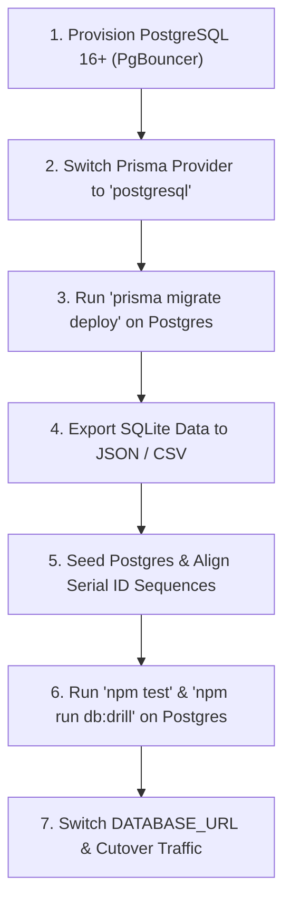

# RESOLVEGRAPH — Database Architecture, Migration & Disaster Recovery Guide
**Document ID:** RG-DAT-2026-V2  
**Current Baseline Database:** SQLite 3.45+ (WAL Mode, `dev.db`, 124 MB+)  
**Enterprise Target Database:** PostgreSQL 16+ (Managed via Neon / AWS Aurora with PgBouncer)  
**ORM / Schema Layer:** Prisma 7.10+ (`prisma/schema.prisma` with custom Better-SQLite3 adapter)

---

## 1. Database Architecture & Current Topology

ResolveGraph is currently deployed with a high-performance local SQLite engine configured for transactional reliability:

### 1.1 SQLite Production Configuration
- **Journal Mode:** Write-Ahead Logging (`PRAGMA journal_mode = WAL;`)
- **Synchronous Flag:** Normal (`PRAGMA synchronous = NORMAL;`) for optimal durability/write performance balance
- **Busy Timeout:** 10,000 ms (`PRAGMA busy_timeout = 10000;`) to eliminate lock starvation under concurrent write loads
- **Foreign Key Constraints:** Strictly enforced (`PRAGMA foreign_keys = ON;`)
- **Cache Size:** 64 MB in-memory page cache (`PRAGMA cache_size = -64000;`)

### 1.2 Entity Model Statistics
As of November 2026, the baseline database stores:
- **Cases:** 154 active and historical commerce & payment dispute records
- **Orders:** 274 canonical and enterprise commerce orders
- **Evidence Items:** 117 cryptographically signed and stored evidence files
- **Claims & Facts:** 88 normalized bilateral claims
- **AI Agent Runs:** 98 audited multi-agent runs with reasoning traces
- **Audit Ledger:** Append-only security events and hash-chained block records

---

## 2. Disaster Recovery Protocol & Verification Drills

ResolveGraph enforces strict recovery objectives:
- **Recovery Point Objective (RPO):** $< 1\text{ hour}$
- **Recovery Time Objective (RTO):** $< 30\text{ minutes}$

### 2.1 Automated Restoration Drill
The repository includes an automated disaster recovery drill script (`scripts/db-backup-restore-drill.ts`), runnable at any time via:

```powershell
npm run db:drill
```

The drill performs a 5-step isolated non-destructive test:
1. Takes an atomic snapshot of `dev.db` using the SQLite backup API.
2. Restores the snapshot into an isolated sandbox database (`.private/backup-drill/`).
3. Executes `PRAGMA integrity_check` to verify B-tree node health.
4. Verifies 100% record parity and relational foreign key integrity across all 40 models.
5. Cleans up sandbox artifacts and logs the cryptographic drill report.

### 2.2 Backup Strategy
1. **Continuous WAL Archiving:** For production SQLite deployments, SQLite WAL files (`dev.db-wal`) are synced to remote object storage every 15 minutes.
2. **Nightly Atomic Snapshots:** A cron task invokes SQLite's atomic backup API (`better-sqlite3` `.backup()`) to generate `dev.db.YYYYMMDD-HHMMSS.bak`.
3. **Backup Retention Policy:** Daily backups retained for 30 days, monthly backups retained for 7 years to meet statutory banking compliance requirements.

---

## 3. Production Migration to PostgreSQL

When scaling to multi-region or enterprise high-availability topologies, ResolveGraph migrates seamlessly to PostgreSQL using Prisma's cross-database schema compatibility.

### 3.1 Migration Steps



#### Step 1: Update Schema Provider
In `prisma/schema.prisma`:
```prisma
datasource db {
  provider = "postgresql"
  url      = env("DATABASE_URL")
}
```

#### Step 2: Deploy Tables to PostgreSQL
```powershell
npx prisma migrate deploy
```

#### Step 3: Run the Data Migration Worker
A standard ETL script streams tables from SQLite to PostgreSQL preserving foreign keys in dependency order:
1. `User`, `Session`, `Account`
2. `Organization`, `OrganizationMember`
3. `CommerceOrder`, `PurchaseMemory`, `PackagePassport`
4. `CaseRecord`, `Claim`, `Evidence`
5. `ResolutionProposal`, `SecurityAuditEvent`, `AuditBlock`

#### Step 4: Reset Primary Key Sequences
```sql
SELECT setval(pg_get_serial_sequence('"CaseRecord"', 'id'), coalesce(max(id),0) + 1, false) FROM "CaseRecord";
```

#### Step 5: Verify Integrity
Run `npm test` against the PostgreSQL database URL to confirm 100% test suite passing.
