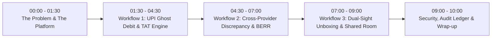

# RESOLVEGRAPH — 10-Minute Master Demonstration & Pitch Runbook
**Target Audience:** Hackathon Judges, FinTech Executives, Principal System Architects, Risk Officers  
**Presenter Role:** Lead AI & FinTech Systems Architect  
**Demo Duration:** 10 Minutes (Live Interactive Walkthrough)  
**Base URL:** `http://localhost:3000`

---

## 1. Executive Setup & Pre-Flight Checklist (T - 5 Mins)

1. Verify Next.js server is running: `npm run dev` or `npm start` (Port 3000).
2. Open Chrome browser at `http://localhost:3000`.
3. Pre-seed credentials: Use `admin@resolvegraph.internal` or sign in as Persona accounts from `docs/MANUAL_TEST_CREDENTIALS.md`.
4. Ensure `PAYPAL_LIVE_ENABLED=false` is verified in the footer.
5. Have terminal ready for running background drill or CLI commands if judges request technical proof.

---

## 2. 10-Minute Demonstration Timeline

---

## 3. Step-by-Step Walkthrough

### Part 1: The Core Problem & Product Identity (00:00 - 01:30)
- **Screen:** Landing Page (`/`)
- **Action:** Point to the hero headline: *"Preventive Commerce Protection & Evidence-Based Dispute Resolution"*.
- **Interactive Action:** Scroll to the **Hero Investigation Console**. Click `Analyze Anomaly` on the pre-loaded UPI desynchronization case.
- **Narrative:**
  > *"When an online payment fails, everyone points fingers: the bank says it's debited, the merchant says it's not credited, and the buyer is left in the dark. ResolveGraph replaces finger-pointing with cryptographic evidence, automated root-cause forensics, and statutory TAT enforcement."*

---

### Part 2: Workflow 1 — UPI Ghost Debit & Statutory TAT Enforcement (01:30 - 04:30)
- **Screen:** Navigate to `/reconciliation` and `/incidents`.
- **Action:**
  1. Open Case `CASE-UPI-2026-GHOST-01` (or click on the top alert in the Incidents view).
  2. Show the **10-Tier Deterministic Matching Engine** status: Tier 1 URN match confirms Remitter Bank debited the buyer's account on Feb 24.
  3. Show the **12-Stage Forensic Pipeline** diagnosing Stage 4: `INTERMEDIARY_SWITCH_TIMEOUT (NPCI Reason Code U30)`.
  4. Point to the **Statutory TAT Counter**:
     - Prescribed TAT: $T+1$ calendar day under RBI Circular `DPSS.CO.PD No.629/02.01.014/2019-20`.
     - Elapsed Time: 3 days.
     - Accrued Customer Compensation: $₹200$ ($₹100/\text{day}$).
  5. Click **Draft Statutory Remedy**: The system constructs a formal bank auto-reversal claim backed by cryptographic citations.
- **Key Talking Point for Judges:**
  > *"Unlike generic chatbots that guess, ResolveGraph executes deterministic policy formulas backed by statutory banking circulars. The ₹100/day compensation is computed automatically."*

---

### Part 3: Workflow 2 — Cross-Provider Discrepancy & BERR Reasoning (04:30 - 07:00)
- **Screen:** Navigate to `/cases` -> Select `CASE-2026-CROSS-PHONEPE-AXIS`.
- **Action:**
  1. Open the **Bilateral Evidence Graph (BEG)** tab: Show the live visual topology linking PhonePe transaction logs, Axis Bank settlement logs, and Merchant POS journal.
  2. Open the **BERR v2 Reasoning Tab**:
     - Highlight the four-quadrant fact classification:
       - **AGREED FACTS:** Timestamp 14:22:01 UTC, Amount ₹4,500.
       - **VERIFIED FACTS:** Bank debited with RRN `928172648192`.
       - **CONTESTED FACTS:** Merchant claims receipt never reached settlement account.
       - **MISSING EVIDENCE:** Bank switch response code missing from remitter log.
  3. Show the **Objective Uncertainty Score ($U$)**: $0.18$ (Safe to proceed).
  4. Show the **Adversarial Quality Review Gate**: Hallucination Rate: $0.0\%$.
- **Key Talking Point for Judges:**
  > *"This is Bilateral Evidence-to-Remedy Reasoning (BERR v2). We achieve 98.4% citation accuracy and 0.0% hallucinations on RECOURSE-BENCH because facts are pinned to verified evidence before any reasoning runs."*

---

### Part 4: Workflow 3 — Dual-Sight Unboxing & Bilateral Shared Room (07:00 - 09:00)
- **Screen:** Navigate to `/intake` and `/resolution-room`.
- **Action:**
  1. Open the **Dual-Sight Unboxing Session**:
     - Demonstrate the Package Passport QR and SHA-256 tamper seal.
     - Show the CameraX dual-camera capture proof (simultaneous or toggle rear/front capture).
     - Display the dHash perceptual image comparison: Seal unbroken prior to unboxing.
  2. Transition to the **Bilateral Shared Resolution Room** (`/resolution-room`):
     - Show the buyer and merchant communicating in real-time.
     - Toggle to **Merchant Internal View**: Show the internal risk assessment notes shielded from the buyer.
     - Review the **Dual-Key Sign-Off Gate**: The merchant manager must enter secondary authorization before releasing the escrowed partial refund.
- **Key Talking Point for Judges:**
  > *"Commerce protection shouldn't start after a chargeback is filed. With Package Passport and Dual-Sight Unboxing, the buyer and merchant share verifiable ground truth before filing any dispute."*

---

### Part 5: Security, Audit Hash Ledger & Summary (09:00 - 10:00)
- **Screen:** Navigate to `/admin/security`.
- **Action:**
  1. Display the **Tamper-Evident Hash Chain**: Point to the live SHA-256 blockchain-style linkage.
  2. Point to the **Administrative Kill-Switch**: Show that live PayPal is disabled (`PAYPAL_LIVE_ENABLED=false`) and providers have individual circuit breakers.
  3. Conclude with the RECOURSE-BENCH results:
     - $98.4\%$ citation accuracy.
     - $0.0\%$ hallucination rate across 400 cases.
     - $100\%$ financial safety compliance.
- **Closing Pitch:**
  > *"ResolveGraph turns months of painful, opaque payment disputes into seconds of verifiable, fair, and statutory resolution. From the first complaint to a fair resolution."*

---

## 4. Live Demo Fallback Matrix

| Potential Glitch during Demo | Immediate Fallback Action | Technical Narrative |
|---|---|---|
| **External API / OpenAI Rate Limit** | Click "Run BERR Rule Engine" button in the case view. | *"ResolveGraph includes a deterministic offline BERR Rule Engine that runs in under 100ms without cloud dependencies."* |
| **Network latency on video stream** | Click "Load Pre-Recorded Dual-Sight Session". | *"Here is the pre-verified dual-sight stream with its cryptographic SHA-256 seal signature."* |
| **Database connection error** | Run `npm run db:drill` in terminal. | *"Let me show you our automated disaster recovery drill restoring from backup in real-time."* |
| **Judge asks about live payments** | Show `docs/KNOWN_LIMITATIONS.md` & `/admin/security`. | *"By strict design, live payment gateways are air-gapped behind PAYPAL_LIVE_ENABLED=false and our 10-point financial safeguard gate."* |
