# RESOLVEGRAPH — Deployment & Release Engineering Process
**Phase:** Step 10 Production Engineering & Operational Excellence  
**Status:** RELEASE MANAGEMENT STANDARD  
**Version:** 1.0.0  
**Last Updated:** November 2026

---

## 1. Release Philosophy & Governance

ResolveGraph employs an **evidence-first, progressive-delivery model** for all platform changes. Because the platform orchestrates financial dispute reconciliation and manages legally sensitive evidence, deployments must adhere to zero-data-loss, deterministic rollbacks, and non-disruptive migration policies.

### Core Release Tenets
1. **Immutable Builds**: Docker containers and application bundles are built once in CI, digest-pinned, and promoted through Staging to Production without rebuilding.
2. **Additive-Only Migrations**: Database schema modifications must remain backward-compatible with the immediately preceding application version to enable zero-downtime rolling deploys.
3. **Automated Verification Gates**: Unit tests, integration tests, RECOURSE-BENCH validation, and environment verification must pass 100% before any staging or production promotion.
4. **Hard Financial Circuit Breakers**: Live payment processing (`FEATURE_PAYPAL_LIVE`) cannot be toggled on via CI/CD pipelines without explicit manual dual-custody authorization and verified partner onboarding.

---

## 2. Release Versioning & Tagging Scheme

ResolveGraph follows **Semantic Versioning 2.0.0** with git commit SHA tagging:

```text
v<MAJOR>.<MINOR>.<PATCH>[-<PRERELEASE>]+<METADATA>
Example Production: v1.0.0
Example Pilot Release: v0.10.0-pilot.1+commit.a7b9c2d
```

### Git Tagging Convention
- Production releases: `git tag -a v1.0.0 -m "Release v1.0.0: Controlled Pilot Release"`
- Tags must be signed using GPG (`git tag -s`) by an authorized platform maintainer.
- GitHub Actions releases automatically publish immutable release notes and SBOM (Software Bill of Materials).

---

## 3. Pre-Deployment Validation Checklist

Before initiating any deployment to staging or production, the deployer must verify every item on this checklist:

| Check Item | Command / Source | Required Outcome | Verified By |
|------------|------------------|------------------|-------------|
| **1. Static Typing** | `npx tsc --noEmit` | Exit code 0, 0 errors | CI Automation |
| **2. Code Quality & Linting** | `npm run lint` | Exit code 0, 0 warnings/errors | CI Automation |
| **3. Automated Test Suite** | `npm test` | 34+ suites, 100% passing | CI Automation |
| **4. AI Benchmark Regression** | `npm run benchmark` | Accuracy >= 85%, Agreement >= 80% | CI Automation |
| **5. Database Restoration Drill**| `npm run db:drill` | `RESTORATION_VERIFIED`, 0 parity diffs | Ops Lead |
| **6. Storage Reconciliation** | `npm run storage:reconcile` | 0 corrupted / orphan files | Ops Lead |
| **7. Payment Ledger Parity** | `npm run payments:reconcile` | 0 unresolved discrepancies | Finance/SRE |
| **8. Environment Configuration**| `EnvValidator.validate()` | Clean startup, secrets >= 32 chars | App Runtime |
| **9. Database Schema Parity** | `npx prisma migrate status` | "Database schema is up to date" | Migration Runner |
| **10. Dual-Signoff Approval** | Change Request Ticket | Approved by Tech Lead & Security Lead| Change Advisory |

---

## 4. Deployment Strategies

### 4.1 Production Topology (Next.js Node Server + Standalone Containers)

ResolveGraph runs in containerized environments (Kubernetes / ECS / Cloud Run) behind an Application Load Balancer (ALB) or Cloudflare Edge Proxy:

```
[Internet Traffic]
       │
       ▼
[Cloudflare Edge: WAF / DDoS / TLS 1.3]
       │
       ▼
[Application Load Balancer / Ingress Controller]
       ├─── Route: /api/webhooks/paypal ──► [Webhook Ingress Pods]
       └─── Route: /*                    ──► [ResolveGraph Core App Pods]
                                                    │
                                   ┌────────────────┴────────────────┐
                                   ▼                                 ▼
                          [PostgreSQL Primary]            [Object Storage S3/GCS]
                             (Read/Write)                   (Encrypted Evidence)
```

### 4.2 Zero-Downtime Rolling & Blue-Green Deployments

For major releases or infrastructure upgrades, a **Blue-Green Deployment** strategy is required:

```mermaid
flowchart TD
    subgraph Ingress
        ALB["Application Load Balancer"]
    end
    subgraph BlueEnvironment["Blue Environment (Active v1.0.0)"]
        B1["App Pod 1"]
        B2["App Pod 2"]
    end
    subgraph GreenEnvironment["Green Environment (Staging v1.1.0)"]
        G1["App Pod 1"]
        G2["App Pod 2"]
    end
    subgraph DataStore["Shared Persistence Tier"]
        DB[(PostgreSQL Primary)]
        S3[(Encrypted Object Store)]
    end

    ALB -->|100% Traffic| BlueEnvironment
    BlueEnvironment --> DB
    BlueEnvironment --> S3
    GreenEnvironment --> DB
    GreenEnvironment --> S3

    style BlueEnvironment fill:#1e293b,stroke:#3b82f6,stroke-width:2px
    style GreenEnvironment fill:#1e293b,stroke:#10b981,stroke-width:2px
```



1. Deploy new image to **Green Environment**.
2. Run database migration scripts (must be backward compatible with Blue).
3. Execute automated synthetic health probes against Green endpoint (`/api/health`).
4. Shift 5% of traffic to Green via ALB weighted routing (Canary phase: 15 minutes).
5. Monitor error rates, p95 latency, and agent queue saturation.
6. If error rate $< 0.05\%$, shift 100% traffic to Green.
7. Maintain Blue environment for 60 minutes as an instant rollback standby.

---

## 5. Database Schema Migration Protocol

To guarantee zero downtime and prevent locks on active tables, database schema changes must strictly follow the **Expand and Contract (Two-Phase)** pattern:

### Phase 1: Expand (Release N)
- Add new columns as nullable or with safe server-side defaults.
- Deploy code that writes to both old and new columns, but reads from old.
- Backfill historical data in background asynchronous jobs.

### Phase 2: Migrate Reads (Release N+1)
- Deploy code that reads from new column and writes to new column.
- Verify read integrity.

### Phase 3: Contract (Release N+2)
- Remove deprecated columns or rename old structures safely.

### Migration Execution Procedure
1. Take an automated point-in-time snapshot before running `prisma migrate deploy`.
2. Migrations must execute from a dedicated single-instance migration task before web containers spin up.
3. If migration fails, abort deployment immediately. Application pods remain on previous release.

---

## 6. Post-Deployment Verification (Smoke Testing)

Immediately upon routing traffic to the newly deployed release, the on-call engineer triggers the automated synthetic smoke suite:

```bash
# 1. Health check assertion
curl -fsS https://resolvegraph.internal/api/health | jq .

# Required Health Check Response:
# {
#   "status": "healthy",
#   "database": { "status": "connected", "latencyMs": 4 },
#   "ai": { "configured": true, "model": "gpt-4o-mini" },
#   "paypal": { "configured": true, "mode": "sandbox", "liveEnabled": false }
# }

# 2. Automated e2e health smoke test
npm run test -- tests/pilot-readiness.test.ts
```

### Manual Verification Path
1. Log in with merchant admin credentials (`merchant@store.com`).
2. Navigate to `/dashboard` and verify stats load without console or GraphQL/REST errors.
3. Open an active case (e.g. `/cases/case-001`) and inspect evidence tabs and bilateral graph.
4. Verify PayPal sandbox button initialization on the checkout demo page (`/checkout-demo`).

---

## 7. Emergency Rollback Procedures

If any critical anomaly is detected post-deployment (P1 alert, error rate $> 0.5\%$, database connection pool exhaustion), initiate the emergency rollback procedure:

### Instant Traffic Reversion (< 60 Seconds)
In Blue-Green or ALB Canary setups, shift routing back to the Blue target group:
```bash
# AWS CLI example
aws elbv2 modify-listener --listener-arn $ALB_LISTENER_ARN \
  --default-actions Type=forward,TargetGroupArn=$BLUE_TARGET_GROUP_ARN
```

### Container Rollback (Kubernetes / ECS)
```bash
# Kubernetes rollback to immediate prior revision
kubectl rollout undo deployment/resolvegraph-web -n production

# Verify status
kubectl rollout status deployment/resolvegraph-web -n production
```

### Database Rollback Rules
- If the deployment used the **Expand and Contract** pattern, **no database rollback is required**; the previous application code is 100% compatible with the expanded schema.
- If an unrecoverable schema corruption occurs, execute the formal Disaster Recovery snapshot restore detailed in `docs/DISASTER_RECOVERY.md`.
