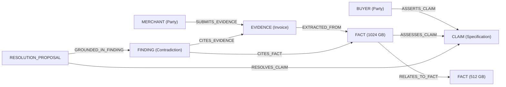

# Bilateral Evidence Graph Architecture

## 1. Overview & Conceptual Model

The **Bilateral Evidence Graph** is the relational and provenance backbone of the ResolveGraph platform. It structures commerce dispute knowledge as a directed, multi-relational knowledge graph connecting buyers, merchants, claims, evidence assets, extracted facts, timeline events, AI findings, and resolution proposals.

Rather than treating claims and evidence as flat, isolated records, the Bilateral Evidence Graph establishes explicit semantic, causal, and provenance links between all assertions and physical or digital records.

---

## 2. Node Taxonomy

| Node Type | Description | Key Attributes |
| :--- | :--- | :--- |
| `CASE` | Dispute case root record | `caseNumber`, `status`, `amountMinor`, `currency`, `category` |
| `BUYER` | Asserting consumer / buyer | `userId`, `fullName`, `email` |
| `MERCHANT` | Asserting seller / merchant | `userId`, `organizationId`, `fullName`, `email` |
| `CLAIM` | Concrete statement or assertion | `claimType`, `partyRole`, `statement`, `status` |
| `EVIDENCE` | Uploaded digital document or media asset | `filename`, `evidenceType`, `mimeType`, `sizeBytes`, `verificationStatus` |
| `FACT` | Atomic normalized extracted attribute | `factType`, `fieldKey`, `rawValue`, `normalizedValue`, `confidenceBand` |
| `FINDING` | Bilateral reasoning outcome | `findingType`, `outcome`, `severity`, `title`, `explanation` |
| `TIMELINE_EVENT` | Chronological event in dispute history | `eventType`, `occurredAt`, `recordedAt`, `timePrecision`, `timeBasis` |
| `RESOLUTION_PROPOSAL` | Candidate settlement remedy | `proposalType`, `amountMinor`, `status`, `reason`, `policyVersion` |

---

## 3. Edge Taxonomy & Provenance

The graph enforces 10 multi-relational directed edge types with explicit provenance tags:
- `RULE`: Deterministic rule or policy evaluation.
- `AI_INFERRED`: Produced by BERR reasoning or fact extraction pipelines.
- `HUMAN_ASSERTED`: Explicitly stated by buyer, merchant, or reviewed by manager.
- `SYSTEM_AUDIT`: Cryptographically verified audit log or database timestamp.

| Edge Type | Allowed Sources | Allowed Targets | Provenance | Semantics |
| :--- | :--- | :--- | :--- | :--- |
| `ASSERTS_CLAIM` | `BUYER`, `MERCHANT` | `CLAIM` | `HUMAN_ASSERTED` | Indicates party claiming a statement |
| `SUBMITS_EVIDENCE` | `BUYER`, `MERCHANT` | `EVIDENCE` | `HUMAN_ASSERTED` | Upload of supporting documentation |
| `EXTRACTED_FROM` | `FACT` | `EVIDENCE` | `AI_INFERRED` | Document fact extraction provenance |
| `ASSESSES_CLAIM` | `FACT` | `CLAIM` | `AI_INFERRED` | Corroborates or contradicts claim |
| `RELATES_TO_FACT` | `FACT` | `FACT` | `AI_INFERRED` / `HUMAN` | Equivalence, contradiction, or supersession |
| `CITES_FACT` | `FINDING` | `FACT` | `AI_INFERRED` | Grounding reference for BERR finding |
| `CITES_EVIDENCE` | `FINDING` | `EVIDENCE` | `AI_INFERRED` | Corroborating evidence link |
| `CORRESPONDS_TO_EVENT` | `EVIDENCE`, `CLAIM`, `CASE` | `TIMELINE_EVENT` | `SYSTEM_AUDIT` | Temporal mapping |
| `GROUNDED_IN_FINDING` | `RESOLUTION_PROPOSAL` | `FINDING` | `RULE` | Policy remedy rationale |
| `RESOLVES_CLAIM` | `RESOLUTION_PROPOSAL` | `CLAIM` | `RULE` | Targeted dispute settlement |

---

## 4. Multi-Tenant Visibility & Redaction

The graph service enforces strict tenant boundaries at query time (`GraphVisibilityService`):
1. **Buyer Persona**:
   - Sees buyer claims and evidence.
   - Sees shared merchant evidence and claims.
   - Merchant internal audit notes, internal risk scoring, and confidential operational metadata are automatically stripped.
2. **Merchant Persona**:
   - Sees buyer claims and shared evidence.
   - Confined strictly to dispute cases owned by their assigned `organizationId`.
   - Cannot query or traverse graph nodes belonging to competing merchant organizations.
3. **Resolution Manager & Platform Admin**:
   - Complete unredacted visibility across all nodes, edges, and internal annotations.

---

## 5. Projections & Frontend Rendering

The Bilateral Evidence Graph provides two unified projection formats:
- **Visual Layout (`projectToVisualLayout`)**:
  - Arranges nodes into 6 deterministic vertical concentric swimlanes (Tiers 0–5: Parties $\to$ Case $\to$ Claims/Evidence $\to$ Facts $\to$ Findings/Timeline $\to$ Resolution Proposals).
  - Eliminates force-directed jitter, ensuring stable, legible SVG navigation with zoom, pan, and interactive selection.
- **Accessible Table (`projectToTable`)**:
  - Full WCAG-compliant HTML table representation detailing node identifiers, party, in/out degrees, confidence band, and connected neighbors.
