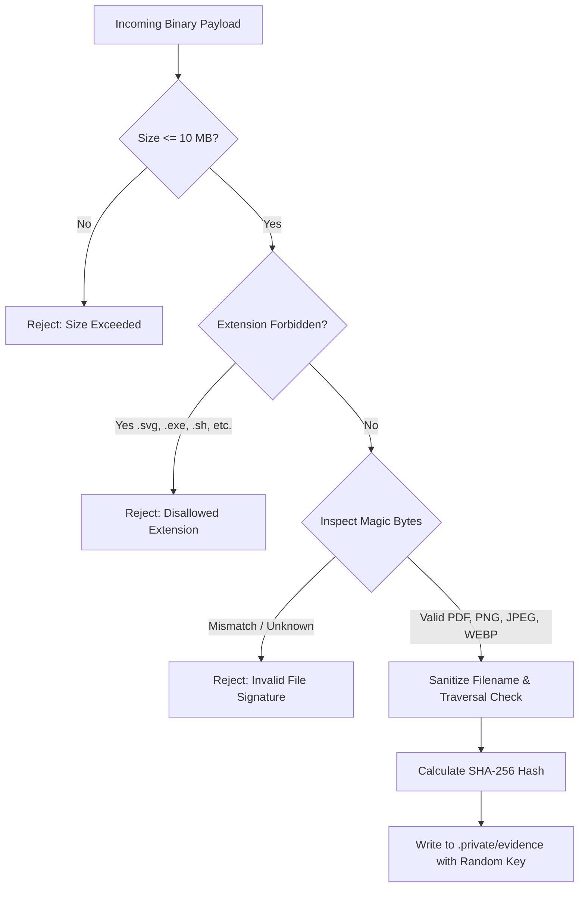

# ResolveGraph Private Evidence Storage

## 1. Storage Overview

In compliance with financial and commerce dispute evidence regulations, ResolveGraph **never stores user evidence in public web-accessible directories** (`/public` or static CDN buckets with public read ACLs).

All uploaded files are written to a private server directory:
- **Default Path**: `./.private/evidence` (configured via `EVIDENCE_STORAGE_DIR`).
- **Permissions**: Mode `0o700` for storage directory, `0o600` for stored evidence binaries.
- **Randomized Storage Keys**: Files are stored with cryptographically random identifiers, such as `ev_6b82967d-949e-4c7b-967a-bb4823ceba88.pdf`, preventing enumeration attacks.

---

## 2. Multi-Stage File Validation Pipeline

Before persisting any byte to disk, the `LocalEvidenceStorage` service validates the submission across 5 security checkpoints:



### 1. File Size Constraint
Maximum allowed size is **10 MB** (`MAX_FILE_SIZE_BYTES = 10 * 1024 * 1024`). Requests exceeding this are rejected immediately before disk I/O.

### 2. Forbidden Extension Blocklist
Extensions capable of client-side or server-side script execution are blocked upfront:
`['exe', 'dll', 'bat', 'cmd', 'sh', 'php', 'phtml', 'py', 'js', 'html', 'htm', 'svg', 'vbs', 'ps1', 'jar', 'msi', 'com', 'scr', 'cgi', 'pl']`

> [!NOTE]
> `.svg` files are explicitly blocked because embedded `<script>` or `onload` XML elements can execute Cross-Site Scripting (XSS) attacks when rendered in web contexts.

### 3. Binary Magic Bytes Verification
ResolveGraph does not trust user-supplied `Content-Type` headers or file extensions. It inspects the actual leading header bytes of the buffer:
- **PDF**: `%PDF-` (`0x25 0x50 0x44 0x46`)
- **PNG**: `89 50 4E 47 0D 0A 1A 0A`
- **JPEG**: `FF D8 FF`
- **WEBP**: `RIFF` ... `WEBP` (`0x52 0x49 0x46 0x46` ... `0x57 0x45 0x42 0x50`)

If an executable or HTML document is renamed to `invoice.pdf`, magic byte detection identifies the spoofing and rejects the file with HTTP 400.

### 4. Path Traversal Guard
Filenames are sanitized using `sanitizeFilename()` to strip null bytes, directory separators (`/`, `\`), and parent directory references (`../`, `..\`). Furthermore, destination paths are resolved and verified with `destinationPath.startsWith(storageDir)`.

### 5. Integrity Fingerprinting (SHA-256)
Every stored file generates an immutable 64-character SHA-256 cryptographic hash recorded in the database `Evidence.sha256` column to guarantee chain of custody.

---

## 3. Secure Streaming & Download Endpoint

Files are retrieved exclusively through the authenticated route:
`GET /api/evidence/[evidenceId]/download`

### Workflow:
1. Validates user session (`requireAuth`).
2. Fetches evidence metadata and parent case record.
3. Evaluates `canViewEvidence(session.user, evidence, caseRecord)`.
4. If unauthorized:
   - Emits an append-only audit event: `EVIDENCE_ACCESS_DENIED`.
   - Returns HTTP 403 Forbidden.
5. If authorized:
   - Emits an append-only audit event: `EVIDENCE_DOWNLOAD`.
   - Streams file using Node stream to Web `ReadableStream`.
   - Injects mandatory defensive security headers:

```http
HTTP/1.1 200 OK
Content-Type: application/pdf
Content-Disposition: attachment; filename="TechStore-Invoice-10842.pdf"
Content-Length: 245000
X-Content-Type-Options: nosniff
Cache-Control: private, no-cache, no-store, must-revalidate
```
