# RESOLVEGRAPH — Feature Visibility & Navigation Accessibility Audit

**Audit Date:** November 2026  
**Auditor:** Principal Software Architect & QA Automation Lead  
**Scope:** Frontend Workspace Navigation, Dashboard Launchpad, Command Palette (`⌘K`), and Responsive Drawers  
**Target:** 100% Feature Discoverability without Manual URL Entry

---

## 1. Executive Summary

Previous audits discovered that while the ResolveGraph backend implemented deep forensic capabilities, several key pages and tools were hidden from the primary navigation hierarchy or accessible only via direct URL typing.

This audit certifies that all features, documentation endpoints, and specialized investigation consoles are:
1. Formally registered in the central navigation tree (`src/lib/navigation.ts`).
2. Discoverable via the universal Command Palette (`⌘K`).
3. Featured in the Main Dashboard Investigation Hub (`/dashboard`).
4. Fully responsive across desktop sidebars, tablet drawer menus, and mobile bottom navigation.

---

## 2. Central Navigation Hierarchy (`src/lib/navigation.ts`)

The application's navigation structure has been consolidated into 5 functional, logically distinct groups:

```mermaid
graph TD
    Nav[Universal Navigation Root] --> Group1[Dispute Resolution]
    Nav --> Group2[Fulfillment & Chain of Custody]
    Nav --> Group3[Finance & Payments]
    Nav --> Group4[AI & Intelligence]
    Nav --> Group5[Governance & Reference]

    Group1 --> D1["Dashboard (/dashboard)"]
    Group1 --> D2["Cases (/cases)"]
    Group1 --> D3["Evidence Locker (/evidence)"]
    Group1 --> D4["Universal Intake (/intake)"]
    Group1 --> D5["Resolution Room (/resolution-room)"]

    Group2 --> F1["Package Passports (/packages)"]
    Group2 --> F2["Purchase Memory (/purchases)"]

    Group3 --> P1["Payment Reconciliation (/reconciliation)"]
    Group3 --> P2["Payment Investigation (/payments)"]
    Group3 --> P3["Payment Incidents & UPI (/incidents)"]
    Group3 --> P4["PayPal Disputes (/paypal/disputes)"]

    Group4 --> A1["AI Copilot & Agents (/copilot)"]
    Group4 --> A2["AI Investigation (/investigation)"]
    Group4 --> A3["Multilingual Intake (/multilingual)"]

    Group5 --> G1["Audit & Security (/admin/security)"]
    Group5 --> G2["Organizations (/organizations)"]
    Group5 --> G3["Technical Documentation (/docs)"]
    Group5 --> G4["BERR Methodology (/methodology)"]
```

### Full Route Registration Table

| Route Path | Navigation Label | Navigation Group | Badge / Pill | Minimum Role |
| :--- | :--- | :--- | :--- | :--- |
| `/dashboard` | Dashboard | Dispute Resolution | — | Buyer |
| `/cases` | Cases & Disputes | Dispute Resolution | Live Ledger | Buyer |
| `/evidence` | Evidence Vault | Dispute Resolution | Forensic | Buyer |
| `/intake` | Universal & Dual-Sight Intake | Dispute Resolution | Dual-Sight | Buyer |
| `/resolution-room` | Resolution Room | Dispute Resolution | Bilateral | Buyer |
| `/packages` | Package Passports | Fulfillment | Tamper-Seal | Merchant |
| `/purchases` | Purchase Memory | Fulfillment | Immutable | Buyer |
| `/reconciliation` | Reconciliation | Finance & Payments | 10-Point Gate | Merchant |
| `/payments` | Payment Investigation | Finance & Payments | Multi-Rail | Support |
| `/incidents` | Payment Incidents & UPI | Finance & Payments | UPI TAT | Buyer |
| `/paypal/disputes` | PayPal Dispute Hub | Finance & Payments | Sandbox Guard | Merchant |
| `/copilot` | Autonomous Copilot | AI & Intelligence | 6 Agents | Investigator |
| `/investigation` | AI Investigation | AI & Intelligence | Deep Reasoning | Investigator |
| `/multilingual` | Multilingual Intake | AI & Intelligence | 10+ Langs | Buyer |
| `/analytics` | Platform Analytics | Governance | Metrics | Merchant |
| `/admin/security` | Audit & Security | Governance | Hash Chain | Admin |
| `/organizations` | Organization Tenancy | Governance | Enterprise | Admin |
| `/docs` | Technical Documentation | Reference | Spec & APIs | Buyer |
| `/methodology` | BERR v2 Methodology | Reference | Benchmark | Buyer |

---

## 3. Main Dashboard Investigation Hub (`/dashboard`)

To ensure investigators and merchants do not rely solely on vertical sidebar menus, the main dashboard now embeds a dedicated 10-card "Core Investigation Workspaces & Subsystems" launchpad directly beneath high-level KPIs.

Each launchpad card provides:
- High-contrast Lucide icon.
- Categorical badge (`brand`, `info`, `success`, `warning`, `neutral`).
- Concise description of the investigative subsystem.
- Real-time or contextual subsystem metric (e.g., `"Active Ledgers"`, `"Cryptographic Dual-Sight"`, `"Tamper Seal Passports"`, `"RBI Rule 2019/10/22"`).
- Direct clickable link to the workspace.

### Subsystem Hub Grid

1. **Universal & Dual-Sight Intake (`/intake`)** — High-speed document OCR, statement normalization, and 30-minute CameraX verification challenge.
2. **Package Passports & Chain-of-Custody (`/packages`)** — Tamper-evident seal registration, carrier dispatch handovers, and tracking checkpoints.
3. **Cross-Provider Payment Investigation (`/payments`)** — Canonical transaction ledger spanning UPI, Card rails, Net Banking, and PayPal.
4. **Autonomous AI Copilot (`/copilot`)** — 6 specialist subagents with deterministic Zod safety boundaries and human-governed approval gates.
5. **India UPI Dispute Resolution (`/incidents`)** — Statutory TAT tracking, debit reversal enforcement, and honest status labeling.
6. **Bilateral Resolution Room (`/resolution-room`)** — Structured remedy proposals, policy boundary compliance, and counter-proposals.
7. **Immutable Purchase Memory (`/purchases`)** — Pre-purchase spec hashing, guarantee snapshotting, and delta engine.
8. **Forensic Evidence Vault (`/evidence`)** — SHA-256 deduplication, EXIF integrity analysis, and perceptual dHash matching.
9. **Multilingual Intake Engine (`/multilingual`)** — 10+ language intake, side-by-side verification, and standardized case linkage.
10. **Cryptographic Audit Hash-Chain (`/admin/security`)** — SHA-256 block hash-chaining, tamper alarm verification, and emergency kill-switch.

---

## 4. Universal Command Palette (`⌘K` / `Ctrl+K`)

All 23 primary routes and operational actions are indexed in `src/components/common/command-palette.tsx`:
- Triggered globally from any screen with keyboard shortcut `⌘K` (macOS) or `Ctrl+K` (Windows/Linux) or by clicking the header search bar.
- Fuzzy filtering matches keywords across title, description, and group.
- Directly routes keyboard users without mouse clicks.

---

## 5. Responsive Design & Mobile Drawer Accessibility

Mobile and tablet accessibility has been audited across viewports (375px mobile, 768px tablet, 1280px desktop):
- On mobile devices, the persistent desktop sidebar gracefully collapses into an accessible slide-over hamburger drawer.
- The drawer replicates the complete 5-group navigation structure, including documentation links.
- High-priority actions (Intake, Cases, Command Palette, Notifications) remain pinned on the mobile header for single-tap access.
