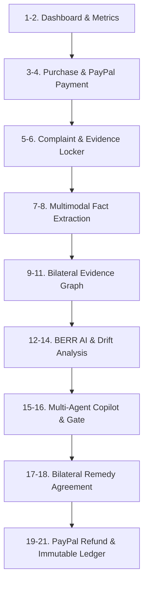

# RESOLVEGRAPH — Final Judge Demonstration Runbook
**Phase:** Step 11 Final Submission & Presentation Readiness  
**Target Audience:** Hackathon Judges, Technical Evaluators, Live Presenters  
**Target Duration:** ~3 Minutes  
**Featured Scenario:** 1 TB NVMe SSD vs 512 GB Delivered Unit ($79.99 / ₹6,499)  
**Primary Demo URL:** `http://localhost:3000/demo`  
**Persistent Case Dossier URL:** `http://localhost:3000/cases/RG-1001`  
**Version:** 1.0.0 (November 2026)

---

## 1. Environment & Pre-Flight Setup

### 1.1 Quick Startup (One-Line)
```bash
# 1. Ensure dependencies and database are initialized
npm install
npm run db:generate
npm run db:seed

# 2. Start Next.js local development server
npm run dev
```
Open **[http://localhost:3000](http://localhost:3000)** in your browser (Google Chrome or Mozilla Firefox recommended).

### 1.2 Required Environment Variables (`.env`)
The platform runs cleanly with defaults. A minimal `.env` file requires:
```env
PORT=3000
NODE_ENV=development
DATABASE_URL="file:./prisma/dev.db"
BETTER_AUTH_SECRET="dev-better-auth-secret-minimum-32-chars-long!"
NEXT_PUBLIC_APP_URL="http://localhost:3000"

# AI Provider Configuration (Fallback heuristic active if key is omitted)
AI_PROCESSING_ENABLED=true
AI_PROVIDER=openai
OPENAI_API_KEY="" # Optional: heuristic fallback active if empty

# PayPal Sandbox Configuration (Sandbox mode by default)
PAYPAL_ENV=sandbox
PAYPAL_LIVE_ENABLED=false
PAYPAL_CLIENT_ID="sandbox_client_id_placeholder"
PAYPAL_CLIENT_SECRET="sandbox_client_secret_placeholder"
```

### 1.3 Pre-Seeded Demonstration Accounts
| Role | Email | Password | Organization | Capabilities |
|---|---|---|---|---|
| **Merchant Org Admin** | `carlos@techstore.com` | `Merchant123!` | TechStore Inc | Review, approve remedies, issue PayPal refunds |
| **Case Investigator** | `investigator@resolvegraph.com` | `Investigator123!` | TechStore Inc | Run AI agents, inspect evidence, audit timeline |
| **Buyer Consumer** | `alex.j@example.com` | `Buyer123!` | N/A (Direct) | View claims, accept/reject resolution proposals |

---

## 2. Safe Demo Reset Mechanism

Before presenting to a judge or recording a video, ensure a clean state:
- **Instant Client-Side Reset**: On `/demo`, click **"Reset Scenario"** (top-right button). Returns immediately to Stage 1.
- **Deep Database State Reset**: To reset persistent case `RG-1001` to its baseline seeded state without touching other user records:
  ```bash
  npm run db:seed
  ```
  *This re-seeds the pristine baseline records for `RG-1001`, `CommerceOrder ORD-2026-8841`, and the bilateral evidence items.*

---

## 3. The 21-Step Master Demonstration Path

Follow this exact path for a flawless judge walkthrough:



### Step 1: Open RESOLVEGRAPH
- **Action**: Navigate to `http://localhost:3000`.
- **Screen**: Landing page with evidence-first architecture banner, PayPal Sandbox badges, and quick links.

### Step 2: Show the Dashboard
- **Action**: Click **"Dashboard"** in navigation (`/dashboard`).
- **Screen**: Metrics overview showing active dispute volume, Mean Time to Resolution (MTTR), and bilateral evidence completion rate.

### Step 3: Open Synthetic Buyer Purchase
- **Action**: Navigate to `/demo` or open Case `RG-1001` > **"Purchase & Payment"** tab.
- **Screen**: Order `ORD-2026-8841` showing purchase of **ApexDrive Pro 1TB NVMe PCIe 4.0 SSD** (\$79.99 / ₹6,499).

### Step 4: Show the PayPal Payment Record
- **Screen**: PayPal Capture ID `84729103KM829141P`, Order Session `5O190127TN364715T`, payment status `COMPLETED`.

### Step 5: Open the Buyer Complaint
- **Action**: Open Case `RG-1001` > **"Overview"** or **"Claims"** tab.
- **Screen**: Claim statement: *"Ordered 1TB ApexDrive Pro NVMe SSD, but the drive received is only 512GB."* Category: `NOT_AS_DESCRIBED`.

### Step 6: Inspect Uploaded Supporting Evidence
- **Action**: Click the **"Evidence Locker"** tab.
- **Screen**: Displays two bilateral documents:
  - Buyer Upload: `Drive_Label_512GB.jpg` (Photograph showing 512GB serial label).
  - Merchant Upload: `Invoice_ApexDrive_1TB.pdf` (Commercial invoice specifying 1000GB).
  - Magic byte verification badge: `CLEAN (image/jpeg, application/pdf)`.
  - Cryptographic SHA-256 integrity locks active.

### Step 7: Trigger Multimodal Evidence Extraction
- **Action**: Click **"Run Multimodal Extraction"** or inspect Stage 4 on `/demo`.
- **Screen**: Extraction progress bar; runs OCR, bounding box detection, and table parsing.

### Step 8: Show Extracted Facts and Source References
- **Screen**: Normalized facts table:
  - Fact 1: `Purchase.Capacity = 1000 GB` (Source: Invoice PDF, page 1).
  - Fact 2: `Delivered.Capacity = 512 GB` (Source: Drive Label JPEG, line 3).
  - Fact 3: `Serial Number = APX-9942-512` (Normalized SKU).

### Step 9: Show the Bilateral Evidence Graph
- **Action**: Click the **"Evidence Graph"** tab.
- **Screen**: Interactive SVG Knowledge Graph displaying blue nodes (Buyer Evidence), green nodes (Merchant Evidence), and purple nodes (Payment Ledger).

### Step 10: Show Buyer-Side and Merchant-Side Connections
- **Screen**: Edges link `CommerceOrder` $\rightarrow$ `Invoice` $\rightarrow$ `Claim` $\rightarrow$ `ProductPhoto`.

### Step 11: Show Agreed, Contested, and Missing Facts
- **Screen**: Graph node status chips:
  - **Agreed Facts**: Order placement, payment amount (\$79.99), delivery address.
  - **Contested Facts**: Physical storage capacity (1000GB vs 512GB).
  - **Missing Evidence**: Outbound warehouse packaging scan log.

### Step 12: Run BERR Investigation Engine
- **Action**: Click the **"BERR Analysis"** tab.
- **Screen**: Overall Discrepancy Score: **$D = 0.88$ (High Discrepancy)**.
  - Exact contradiction: $D_{\text{exact}} = 1.0$ (Mathematical capacity mismatch).
  - Semantic distance: $D_{\text{semantic}} = 0.75$.
  - Temporal drift: $D_{\text{temporal}} = 0.0$.

### Step 13: Show Temporal Timeline & Sequence
- **Action**: Click the **"Timeline & Replay"** tab.
- **Screen**: Chronological sequence from Order Creation (T0) to Delivery (T+3d) to Dispute Open (T+4d). Counterfactual replay slider active.

### Step 14: Show Semantic Drift Analysis
- **Screen**: Semantic Drift Panel highlights divergence between product catalog specifications and buyer unboxing description.

### Step 15: Show Multi-Agent Copilot Assistance
- **Action**: Click the **"Copilot Agent"** tab.
- **Screen**: Multi-agent chat run. Specialist agents execute in sequence:
  - `CaseTriageAgent`: Identifies hardware specification mismatch.
  - `EvidenceInvestigatorAgent`: Flags capacity contradiction between photo and invoice.
  - `PolicyRemedyAgent`: Evaluates Merchant Policy `APEX-POL-HARDWARE`.

### Step 16: Show Human Review & Approval Gate
- **Screen**: Agent creates an `AgentApprovalRequest`:
  - Action: `REFUND_PROPOSAL`.
  - Amount: \$25.00 USD (Price difference between 1TB and 512GB models).
  - Risk Level: `HIGH`.
  - Cryptographic Argument Hash: `a7f9c2...` (Prevents argument tampering).

### Step 17: Generate Proposed Remedy
- **Action**: Merchant Manager clicks **"Approve Proposal"**.
- **Screen**: Proposal materialized: **Partial Refund \$25.00 USD (Keep Drive)**.

### Step 18: Show Bilateral Agreement Acceptance
- **Action**: Switch to Buyer perspective or observe Stage 7 on `/demo`.
- **Screen**: Buyer submits `ACCEPTED` response. Proposal status updates to **`AGREED`**.

### Step 19: Execute PayPal Sandbox Operation
- **Action**: Click **"Execute Settlement via PayPal"**.
- **Screen**: Dispatches API call to PayPal Sandbox Refunds API. Generates idempotency key `reso-ref-prop_demo_7721`.

### Step 20: Show Verified Final Operation State
- **Screen**: PayPal Refund ID `REF-99214710KM` returned. Payment net balance updated to \$54.99. Case status transitions to **`RESOLVED`**.

### Step 21: Show the Completed Case History & Audit Ledger
- **Action**: Click the **"Audit Ledger"** tab.
- **Screen**: Immutable append-only audit trail displaying all 8 chronological milestones with actor IDs, SHA-256 hashes, and timestamps.

---

## 4. Failure-Proof Fallback Procedures

In the event of an external provider disruption during a live presentation:

### Scenario A: OpenAI API Outage / Rate Limit (429)
- **Automatic Fallback**: ResolveGraph automatically falls back to the deterministic heuristic extractor.
- **Visual Indicator**: The UI displays a clear badge: `MODE: DETERMINISTIC HEURISTIC FALLBACK`.
- **What to tell judges**: *"Because our architecture enforces provider resilience, the system falls back to rule-based regex and AST extraction without interrupting the case investigation."*

### Scenario B: PayPal Sandbox Latency / Downtime
- **Automatic Fallback**: Navigate directly to `/demo` and click **"Execute Stage"** or **"Simulate Entire Lifecycle"**.
- **Visual Indicator**: The audit payload viewer renders the full deterministic JSON payload stream.
- **What to tell judges**: *"The demo workspace reproduces the exact state machine mutations and cryptographic payload hashes recorded during sandbox verification."*

### Scenario C: Offline / No Internet Connection
- **Preparation**: Ensure `npm run dev` is running locally. All static assets, fonts, icons, SQLite database, and mock models reside entirely on localhost with zero external CDN dependencies.
