# ResolveGraph Hackathon Product Differentiation & Strategic Positioning

**Event**: PayPal AI Hackathon  
**Product**: ResolveGraph — Evidence-First Commerce Resolution Infrastructure  
**Date**: November 2026  

---

## 1. Hackathon Problem Context

In AI hackathons and fintech accelerators, projects addressing e-commerce disputes typically fall into two recurring archetypes:

```mermaid
flowchart TD
    subgraph Archetype1 [Archetype 1: Support Chatbot Wrapper]
        A1[User Prompt] --> B1[Single Unconstrained LLM]
        B1 --> C1[Unchecked Text Advice / Chat Message]
        style Archetype1 fill:#fee,stroke:#f66
    end
    
    subgraph Archetype2 [Archetype 2: Merchant Chargeback Spammer]
        A2[Card Dispute Alert] --> B2[Template Letter Generator]
        B2 --> C2[Dispute Representment PDF Sent to Bank]
        style Archetype2 fill:#ffe,stroke:#fa0
    end
    
    subgraph ResolveGraphPosition [ResolveGraph: Bilateral Resolution Infrastructure]
        RG1[Bilateral Claims + Evidence Files] --> RG2[Multimodal Extraction + Normalization]
        RG2 --> RG3[Bilateral Evidence Graph + Temporal Drift Engine]
        RG3 --> RG4[BERR Discrepancy Scoring D]
        RG4 --> RG5[Policy-Aware Remedy Engine]
        RG5 --> RG6[Human-Governed Multi-Agent Copilot]
        RG6 --> RG7[PayPal Sandbox Automated Refund & Dispute API]
        style ResolveGraphPosition fill:#efe,stroke:#2b8
    end
```

### Why Archetypes 1 and 2 Fail in Production
- **Archetype 1 (The LLM Support Bot)**: Hallucinates policies, invents nonexistent tracking numbers, makes false verbal promises to buyers, and cannot verify authentic documents.
- **Archetype 2 (The Chargeback Representment Bot)**: Completely ignores the buyer, alienates repeat customers, only activates after dispute fees ($\$15$–$\$25$) have already hit the merchant, and creates an adversarial race to the credit card issuer.

---

## 2. ResolveGraph's Defensible Differentiation

ResolveGraph rejects both extremes by introducing **Bilateral Evidence-First Commerce Resolution Infrastructure**:

| Product Dimension | Generic Hackathon Chatbot | Commercial Chargeback Tool (e.g. Chargeflow) | ResolveGraph |
| :--- | :--- | :--- | :--- |
| **Resolution Paradigm** | Unilateral conversational text | Unilateral merchant chargeback defense | **Bilateral evidence reconciliation before chargeback escalation** |
| **Evidence Model** | Raw text copy-pasted in prompt | Merchant order & shipping attachments | **Directed Multigraph (claims $\leftrightarrow$ facts $\leftrightarrow$ evidence $\leftrightarrow$ policy)** |
| **Reasoning Engine** | Black-box LLM token prediction | Static card network rule matching | **White-box BERR ($D = \alpha D_{\text{exact}} + \beta D_{\text{semantic}} + \gamma D_{\text{temporal}}$)** |
| **Temporal Intelligence** | Ignores timestamp anomalies | Records static shipment date | **Recorded vs Occurred delta analysis, counterfactual replay at timestamp $T$** |
| **Semantic Drift** | Prone to prompt injection | None | **Divergence score between initial offer, order, dispatch & complaint** |
| **Financial Safety** | Unrestricted tool execution or read-only | Unilateral representment filing | **Guarded Action Principle: Deterministic SHA-256 argument hash (`argumentsHash`)** |
| **PayPal Integration** | Mocked button or simple link | Not integrated (uses Stripe/Adyen/Braintree) | **Full PayPal Sandbox: Orders, Captures, Partial Refunds, Disputes, Webhook HMAC signatures, Ledger reconciliation** |
| **Governance** | Unchecked AI autonomy | "Set and forget" automation | **Human-in-the-Loop approval queue with RBAC verification** |

---

## 3. What Makes ResolveGraph Hackathon-Winning

1. **Working End-to-End Execution**:
   - Not an interactive Figma mock or video recording. A running application powered by Next.js 16.4.4, SQLite, Prisma ORM, Better-SQLite3, and the real PayPal SDK.
2. **Mathematical & Scientific Rigor**:
   - Backed by formal research questions (RQ1–RQ8), an empirical 300-scenario benchmark (RECOURSE-BENCH), and ablation experiments proving that each component (Graph, Temporal, BERR) materially reduces hallucination and improves accuracy.
3. **Enterprise Fintech Security**:
   - Cryptographic parameter hashing, Luhn-verified PAN masking, SSRF-protected webhook certificate verification, and strict multi-tenant database isolation.
4. **Bilateral Fair Play**:
   - Designed to help both good-faith buyers get fair remedies and honest merchants protect margins against fraudulent claims, lowering dispute rates for PayPal and the broader e-commerce ecosystem.
