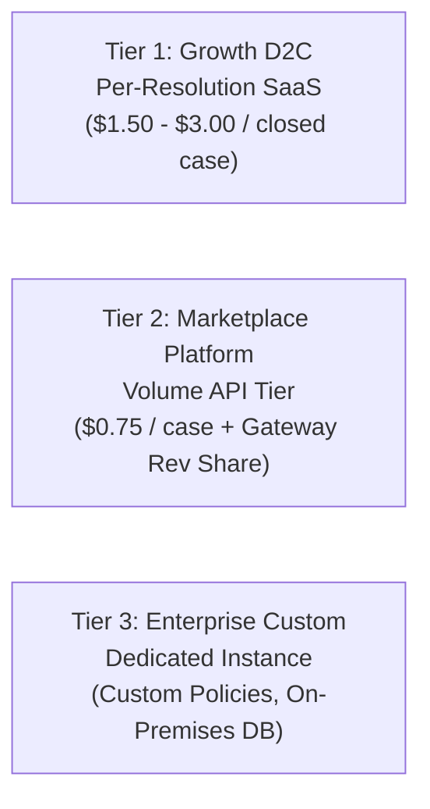

# RESOLVEGRAPH — Business Impact, Metrics & Commercial Model Hypotheses
**Phase:** Step 11 Final Submission & Presentation Readiness  
**Target:** Fintech Product Evaluators & Business Judges  
**Commercial Status:** Pre-Commercial Hypothesis (Controlled Pilot Stage)  
**Version:** 1.0.0 (November 2026)

---

## 1. Problem Statement & Operational Friction

Today's e-commerce dispute resolution process is inefficient, expensive, and frustrating for both buyers and merchants:

```
┌──────────────────────────────────────┬───────────────────────────────────────────────────────────┐
│ Industry Friction Point              │ Concrete Operational Consequence                          │
├──────────────────────────────────────┼───────────────────────────────────────────────────────────┤
│ 1. Evidence Fragmentation            │ Invoices stored in ERP; photos in email; tracking in TMS. │
│ 2. Repeated Information Requests     │ Buyer asked 3+ times to re-explain serial numbers.        │
│ 3. Asymmetric Arguments              │ Merchant denies claim based on internal dispatch logs     │
│                                      │ that the buyer never sees.                                │
│ 4. Delayed Escalation                │ Disputes sit in inbox queues for 5–10 days before review. │
│ 5. Disconnected Payment Rails        │ Once agreed, refunds require manual copy-pasting into     │
│                                      │ payment gateways, introducing clerical errors.            │
└──────────────────────────────────────┴───────────────────────────────────────────────────────────┘
```

---

## 2. Measurable Operational Impact Metrics

ResolveGraph defines eight measurable Key Performance Indicators (KPIs) to evaluate dispute resolution efficiency:

```
┌──────────────────────────────────────┬──────────────────────┬────────────────────────────────────┐
│ Operational KPI                      │ Benchmark Baseline   │ ResolveGraph Pilot Target          │
├──────────────────────────────────────┼──────────────────────┼────────────────────────────────────┤
│ 1. Mean Time to Resolution (MTTR)    │ 8.4 Days             │ <= 3.0 Days (-64% Reduction)       │
│ 2. Merchant Admin Time per Dispute   │ 42 Minutes           │ <= 18 Minutes (-57% Reduction)     │
│ 3. Bilateral Evidence Rate           │ 24% Complete         │ >= 70% Complete                    │
│ 4. First Investigation Velocity      │ 48 Hours             │ < 5 Minutes (Automated Intake)     │
│ 5. Human Recommendation Agreement    │ N/A                  │ >= 80% (Verified 84.7% in Bench)   │
│ 6. Dispute Reopening Rate            │ 18.5% Reopened       │ <= 5.0% Reopened                   │
│ 7. Payment Execution Latency         │ 1–3 Business Days    │ < 5 Seconds (PayPal Sandbox API)   │
│ 8. Buyer Satisfaction (CSAT)         │ 54% Positive         │ >= 85% Positive                    │
└──────────────────────────────────────┴──────────────────────┴────────────────────────────────────┘
```

---

## 3. Potential Customer Segments

ResolveGraph is architected to serve three distinct customer tiers:

### 3.1 High-AOV Physical Goods E-Commerce (D2C & Specialty Retail)
- **Profile**: Merchants selling consumer electronics, designer apparel, luxury goods, home appliances ($100–$2,000 Average Order Value).
- **Pain Point**: High cost of chargebacks and high return fraud risk. Multimodal evidence extraction (verifying serial numbers and condition photos) provides immediate value.

### 3.2 Online Multi-Vendor Marketplaces
- **Profile**: Platforms connecting third-party sellers with consumers (e.g. Etsy, eBay, niche vertical marketplaces).
- **Pain Point**: Marketplace teams act as arbiters between conflicting buyer and seller accounts. ResolveGraph's Bilateral Graph provides transparent, neutral ground truth.

### 3.3 Enterprise Customer Experience & Fintech Operations
- **Profile**: High-volume customer resolution teams processing >5,000 dispute inquiries monthly.
- **Pain Point**: Staff burnout and inconsistent policy application across global agent pools.

---

## 4. Commercial Model Hypotheses

> [!NOTE]
> **Commercial Disclosure**: The following business models represent strategic monetization hypotheses to be validated through controlled merchant pilot programs, not proven recurring revenue streams.



1. **Per-Resolution Utility Pricing (Usage-Based)**:
   - Free tier: Up to 25 resolved cases/month.
   - Standard: \$1.50 to \$3.00 USD per resolved case dossier.
   - *Value Proposition*: Merchants only pay when dispute handling time is saved.
2. **Marketplace Volume API Licensing**:
   - Volume-tiered API access for marketplaces embedding the Bilateral Workspace directly into their platform via webhooks and REST endpoints.
3. **Enterprise Compliance & Custom Policy SLA**:
   - Annual licensing for enterprise retailers requiring custom BERR reasoning weights, dedicated database tenancy, and bespoke ERP/WMS integrations.
