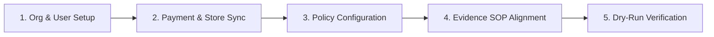

# RESOLVEGRAPH — Merchant Onboarding & Integration Guide
**Phase:** Step 10 Production Engineering & Operational Excellence  
**Status:** OFFICIAL OPERATIONAL MANUAL  
**Audience:** Merchant Operations Leads, Customer Experience Directors, Technical Integrators  
**Version:** 1.0.0  
**Last Updated:** November 2026

---

## 1. Onboarding Journey Overview

Welcome to the **ResolveGraph Merchant Pilot Program**. This guide walks your team through onboarding, platform configuration, integration setup, and policy rules definition in under 45 minutes.

---

## 2. Step 1: Organization Creation & Role Assignment

1. **Sign Up Organization Account**:
   - Navigate to `https://app.resolvegraph.com/signup` (or local/staging environment during sandbox testing).
   - Enter your Business Legal Name, Domain, and primary Administrative Email.
2. **Assign Organizational Roles**:
   ResolveGraph enforces Role-Based Access Control (RBAC) across four tiers:
   - **Org Admin**: Full control over organization settings, PayPal credentials, team invites, and policy rules.
   - **Case Manager**: Can review cases, approve or reject resolution proposals, and authorize refunds up to authorized limits.
   - **Investigator / Agent**: Can inspect evidence, upload merchant evidence, run AI copilot analyses, and add case notes.
   - **Auditor / Viewer**: Read-only access to case histories, reports, and audit trails.

3. **Multi-Factor Authentication (MFA)**:
   - Org Admins and Case Managers are required to enable MFA (TOTP / Authenticator App) before authorizing any financial resolutions.

---

## 3. Step 2: Payment Gateway & E-Commerce Synchronization

### 3.1 PayPal Sandbox / Integration Credentials
1. Navigate to **Dashboard > Settings > Integrations > PayPal**.
2. Input your verified PayPal sandbox (or pilot authorized) Client ID and Client Secret:
   - `PAYPAL_CLIENT_ID`: Stored encrypted in the organization vault.
   - `PAYPAL_CLIENT_SECRET`: Encrypted using AES-256-GCM.
3. Configure the Ingress Webhook URL in your PayPal Developer Portal:
   - Webhook URL: `https://app.resolvegraph.com/api/webhooks/paypal`
   - Subscribed Events:
     - `CHECKOUT.ORDER.APPROVED`
     - `PAYMENT.CAPTURE.COMPLETED`
     - `PAYMENT.CAPTURE.REFUNDED`
     - `CUSTOMER.DISPUTE.CREATED`
     - `CUSTOMER.DISPUTE.RESOLVED`
     - `CUSTOMER.DISPUTE.UPDATED`

---

## 4. Step 3: Dispute Policy & Settlement Rule Configuration

ResolveGraph allows merchants to codify their dispute and return policies into the BERR engine.

1. Navigate to **Dashboard > Settings > Dispute Policies**.
2. Configure your standard parameters:
   - **Default Return Window**: 30 days from confirmed carrier delivery date.
   - **Return Shipping Responsibility**: Merchant pays for defective/damaged items; Buyer pays for remorse returns.
   - **High-Value Threshold**: Claims over \$250.00 USD require physical return receipt and warehouse inspection before refund release.
   - **Micro-Dispute Auto-Settlement**: Claims under \$20.00 USD with buyer trust score $> 0.85$ and valid delivery photograph may be fast-tracked for instant partial refund/store credit recommendation.
   - **Restocking Fees**: 0% for defective items; up to 15% for opened remorse returns if specified in published merchant terms.

---

## 5. Step 4: Merchant Staff Evidence Submission SOP

For optimal AI fact extraction and dispute resolution, merchant support staff must follow evidence submission best practices:

### Required Evidence Types by Dispute Category
- **Item Not Received (INR)**:
  - Carrier tracking number and carrier name (FedEx, UPS, USPS, DHL).
  - Carrier proof of delivery (POD) PDF or signed receipt showing buyer postal code match.
  - GPS drop-off coordinates if provided by courier.
- **Significantly Not As Described (SNAD) / Damaged**:
  - Outbound warehouse packing photos or fulfillment scan logs showing condition at dispatch.
  - Manufacturer serial number / barcode verification log.
  - Published item listing description and specifications at time of sale.
- **Unauthorized Charge**:
  - AVS (Address Verification System) match code.
  - CVV match confirmation.
  - Device fingerprint and IP address logs from checkout.

---

## 6. Step 5: End-to-End Dry-Run & Certification

Before going live, your assigned ResolveGraph Solution Architect conducts a dry-run test:

1. **Synthetic Case Ingestion**: Ingest 3 mock cases covering INR, SNAD, and damaged delivery.
2. **Bilateral Workspace Exercise**: Support staff uploads merchant dispatch log; simulated buyer uploads damaged photo.
3. **BERR Execution**: Verify that the BERR engine identifies discrepancy facts and generates fair resolution options.
4. **Human Review Signoff**: Manager approves the recommended resolution and verifies that the audit log registers actor ID, timestamp, and rationale.
5. **Certification Signoff**: Both Merchant CX Lead and ResolveGraph SRE sign off on pilot readiness checklist.
