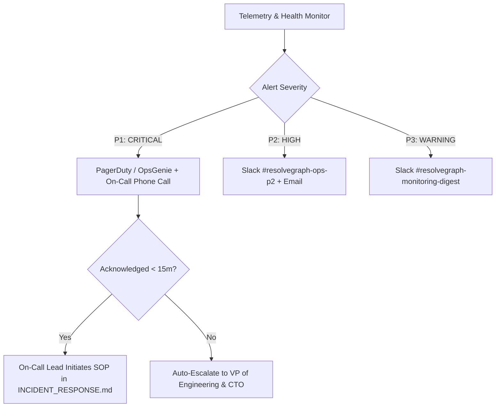

# RESOLVEGRAPH — Observability, Monitoring & Alerting Guide

## 1. Observability Architecture

RESOLVEGRAPH enforces a three-pillar observability standard:
1. **Structured JSON Logs**: Emitted with correlation IDs (`traceId`, `caseId`, `actorId`) via `Logger` (`src/lib/logger.ts`), automatically redacting credentials and PANs.
2. **Real-Time Telemetry & Health Endpoint**: Aggregates database connectivity, queue backlog, PayPal environment, and AI provider status at `/api/health`.
3. **Actionable Alerting Thresholds**: Tiered into P1 (Critical), P2 (High), and P3 (Warning) with zero threshold noise.

---

## 2. Telemetry Metrics Matrix

| Category | Metric Name | Metric Type | Target SLA / Baseline | Alert Trigger | Severity |
| :--- | :--- | :---: | :---: | :---: | :---: |
| **HTTP Application** | `http_request_duration_ms` | Histogram | $p_{95} \le 800\text{ ms}$ | $p_{95} > 2000\text{ ms}$ for 3m | P2 |
| **HTTP Application** | `http_5xx_error_rate` | Gauge | $< 0.1\%$ | $> 1.0\%$ for 2m | P1 |
| **Database** | `db_connection_pool_saturation` | Gauge | $< 60\%$ | $> 85\%$ for 2m | P1 |
| **Database** | `db_query_duration_ms` | Histogram | $p_{95} \le 50\text{ ms}$ | $p_{95} > 250\text{ ms}$ for 3m | P2 |
| **Evidence Storage**| `evidence_upload_failure_count` | Counter | 0 / hr | $> 5$ in 10m | P2 |
| **Evidence Storage**| `magic_byte_quarantine_events` | Counter | $< 1$ / day | $> 3$ in 15m (Attack indicator) | P1 |
| **AI Engine** | `ai_worker_queue_backlog` | Gauge | $< 5$ jobs | $> 25$ jobs for 5m | P2 |
| **AI Engine** | `ai_provider_error_rate` | Gauge | $< 0.5\%$ | $> 5.0\%$ for 3m | P2 |
| **Agent Copilot** | `agent_run_failure_rate` | Gauge | $< 1.0\%$ | $> 10.0\%$ for 5m | P2 |
| **Agent Copilot** | `stuck_agent_runs_count` | Counter | 0 | $> 2$ stuck $>15\text{m}$ | P2 |
| **Financial Controls**| `unauthorized_refund_attempts` | Counter | 0 | $\ge 1$ violation | **P1 (CRITICAL)** |
| **Financial Controls**| `webhook_signature_failures` | Counter | 0 | $> 5$ in 5m (Spoofing) | **P1 (CRITICAL)** |
| **Financial Controls**| `payment_reconciliation_mismatches`| Counter | 0 | $\ge 1$ unsettled mismatch | P2 |

---

## 3. Alert Routing & Escalation Matrix



---

## 4. Health Check Endpoint Reference (`GET /api/health`)

Returns real-time machine-readable JSON status:
```json
{
  "status": "healthy",
  "timestamp": "2026-11-04T06:50:00.000Z",
  "uptimeSeconds": 1420,
  "nodeVersion": "v24.20.0",
  "environment": "development",
  "database": {
    "type": "sqlite",
    "adapter": "@prisma/adapter-better-sqlite3",
    "connected": true,
    "sqliteSizeBytes": 28897280,
    "stats": {
      "users": 7,
      "cases": 109,
      "evidence": 60,
      "claims": 58,
      "commerceOrders": 120,
      "agentRuns": 27
    }
  },
  "aiEngine": {
    "provider": "openai",
    "processingEnabled": true,
    "hasOpenAiKey": true,
    "modelTier": "gpt-4o-mini"
  },
  "paypal": {
    "mode": "mock",
    "configured": true,
    "environment": "sandbox"
  },
  "workerQueue": {
    "queuedJobs": 0,
    "activeJobs": 0,
    "status": "IDLE"
  }
}
```
