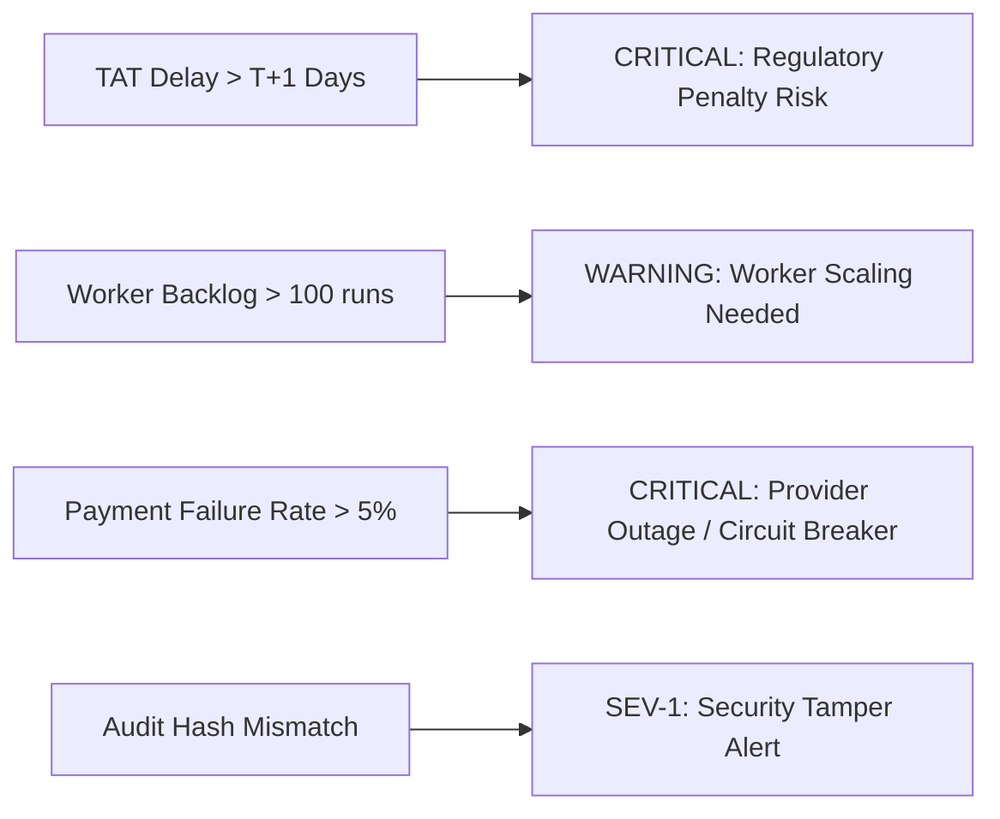

# RESOLVEGRAPH — Production Operations, SRE & Incident Response Manual
**Document ID:** RG-OPS-2026-V2  
**Classification:** Standard Operating Procedure (SOP)  
**Applicability:** Site Reliability Engineers, SecOps, Support Engineers, FinTech Operations

---

## 1. Daily Operational Checklist

Every operational shift begins with the morning health pass:

| Time (UTC) | Task | Command / URL | Expected Result | Action if Failed |
|---|---|---|---|---|
| 06:00 | **Health Endpoint Verification** | `curl -f http://localhost:3000/api/health` | HTTP 200 `healthy` | Restart PM2 `resolvegraph-web` |
| 06:15 | **Audit Hash Chain Integrity** | `GET /api/audit/chained` | `{"verified": true}` | Page SecOps on duty (Sev-1) |
| 06:30 | **Database Snapshot Verification** | `npm run db:drill` | `RESTORATION_VERIFIED` | Inspect disk space & WAL file |
| 07:00 | **Reconciliation Sync Check** | `npm run payments:reconcile` | Zero orphaned transactions | Trigger manual batch retry |
| 07:30 | **Worker Queue Depth** | Check `ai-worker` logs | Pending runs $< 50$ | Scale worker threads |
| 08:00 | **Regulatory TAT Breach Scan** | `GET /api/payments/complaints/upi` | 0 un-escalated breaches | Alert merchant operations |

---

## 2. Key Monitoring Metrics & Alerting Thresholds

ResolveGraph emits operational metrics via API endpoints and structured application logs:

### 2.1 Alert Thresholds



- **Regulatory TAT Breach Window:** Any UPI complaint in state `GHOST_DEBIT` or `DEBITED_NOT_CREDITED` exceeding **24 hours (T+1)** triggers an automatic compensation counter ($₹100/\text{day}$) and fires a `TAT_BREACH_ALERT`.
- **Payment Gateway Error Rate:** If 5xx or `U19`/`91` errors exceed $5\%$ over a 5-minute rolling window, the provider circuit-breaker trips and marks provider status `DEGRADED`.
- **Worker Latency:** If BERR investigation queue latency exceeds 120 seconds per case, workers autoscale or alert the SRE on call.
- **Evidence Vault Free Disk Space:** Alert fires if storage volume drops below $20\text{ GB}$.

---

## 3. Incident Severity Levels & Response Runbook

| Severity | Definition | Response SLA | Mitigation Action |
|---|---|:---:|---|
| **SEV-1 (Critical)** | Audit ledger hash failure, unauthorized refund attempt bypass, global service outage. | **15 minutes** | Activate Administrative Kill-Switch (`/api/admin/kill-switch`), freeze DB, isolate network, notify CTO. |
| **SEV-2 (High)** | Payment provider desynchronization spike, AI inference queue stalled, statutory TAT breach burst. | **30 minutes** | Switch AI to deterministic fallback mode (`BERR Rule Engine`), toggle affected provider switch. |
| **SEV-3 (Medium)** | Background worker dead-letter accumulation, webhook retry failures, storage sync drift. | **2 hours** | Drain dead-letter queue, execute `npm run storage:reconcile`, re-verify webhook subscriptions. |
| **SEV-4 (Low)** | Minor UI reporting discrepancy, non-impacting telemetry latency. | **24 hours** | Create backlog tracking ticket, investigate during regular deployment window. |

---

## 4. Worker Queue & Dead-Letter Management

The AI reasoning engine uses durable database-backed task queues (`scripts/ai-worker.ts`):

### 4.1 Queue Lifecycle
1. Task is created in `AgentRun` with status `QUEUED`.
2. Worker picks up task with optimistic lock (`status: 'RUNNING'`, `startedAt: new Date()`).
3. If task fails with transient error (e.g. OpenAI rate limit), worker increments `retryCount` (max 3 retries with exponential backoff: 2s, 8s, 32s).
4. After 3 failed attempts, task transitions to `DEAD_LETTER` with `lastError` logged.

### 4.2 Inspecting and Retrying Dead-Letter Tasks
To run a single worker iteration or drain the queue:
```powershell
# Run one pass over queued tasks
npm run ai:worker:once

# Run persistent worker loop
npm run ai:worker
```

---

## 5. Routine Database Maintenance (SQLite / Postgres)

### 5.1 SQLite Maintenance
Every Sunday at 02:00 UTC, execute the maintenance script:
```powershell
# Re-index database
npx prisma db execute --stdin "REINDEX;"

# Vacuum and shrink WAL file
npx prisma db execute --stdin "VACUUM; PRAGMA wal_checkpoint(TRUNCATE);"
```

### 5.2 Storage Vault Reconciliation
Run the storage reconciliation tool to verify that all database evidence records match physical files on disk:
```powershell
npm run storage:reconcile
```
Any orphaned files or missing hashes are recorded in `.private/storage-reconciliation-report.json`.

---

## 6. Tamper-Evident Audit Ledger Verification

To independently verify that no database tampering has occurred:
```powershell
# Call the chained audit verification endpoint
curl -s http://localhost:3000/api/audit/chained | jq .
```

Expected output:
```json
{
  "status": "VERIFIED",
  "totalBlocks": 154,
  "headBlockHash": "3a8f...9b2c",
  "genesisBlockHash": "e3b0...c499",
  "tamperDetected": false,
  "verifiedAt": "2026-11-08T09:30:00.000Z"
}
```
If `tamperDetected` is `true`, the system immediately logs a SEV-1 incident and points to the exact block index where the hash signature broke.
