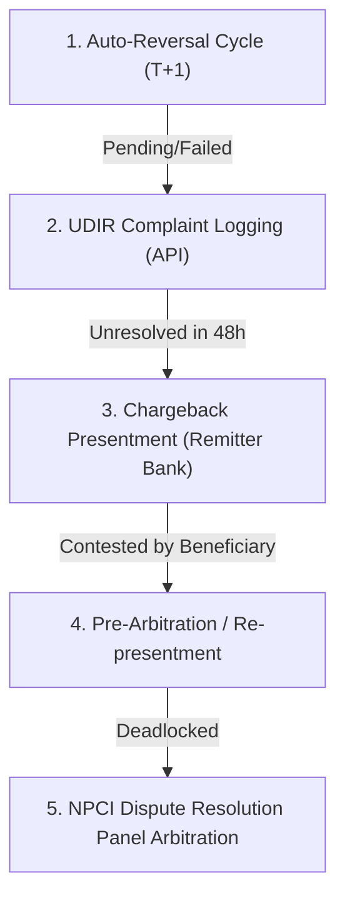

# RESOLVEGRAPH — Statutory Payment Policy, Regulatory TAT & Dispute Resolution Reference
**Document ID:** RG-POL-2026-V2  
**Classification:** Regulatory & Compliance Technical Standard  
**Governing Jurisdictions:** Reserve Bank of India (RBI), National Payments Corporation of India (NPCI), International Card Schemes (Visa/Mastercard)

---

## 1. Executive Regulatory Overview

ResolveGraph integrates regulatory and statutory dispute turnaround times (TAT) directly into its **10-Tier Deterministic Matching Engine** and **12-Stage Forensic Pipeline**. When transactions exhibit status desynchronization or debited-not-credited failures, ResolveGraph's policy engine computes TAT breach windows, penalty calculations, and statutory auto-reversal triggers.

---

## 2. RBI Harmonisation of Turnaround Time (TAT) and Customer Compensation

### 2.1 Directive Reference
- **Circular:** RBI/2019-20/67 — `DPSS.CO.PD No.629/02.01.014/2019-20`
- **Subject:** Harmonisation of Turnaround Time (TAT) and customer compensation for failed transactions using authorized Payment Systems.
- **Statutory Effective Date:** October 15, 2019 (reinforced under master directions 2024–2026).

### 2.2 Payment System Turnaround Time (TAT) & Compensation Matrix

| Payment Channel | Transaction Scenario | Prescribed TAT | Customer Compensation for Delay beyond TAT | ResolveGraph Engine Enforcement |
|---|---|---|---|---|
| **UPI (Unified Payments Interface)** | Customer account debited but transaction confirmation not received at merchant location (Failed transaction). | **T + 1 day** (Auto-reversal by beneficiary / remitter bank) | **₹100 per day** of delay beyond T + 1 day. | Auto-calculates compensation liability in `UpiDisputePolicyService`. Generates statutory claim. |
| **UPI** | Transfer from one bank account to another where account is debited but beneficiary not credited. | **T + 1 day** | **₹100 per day** of delay beyond T + 1 day. | Flags Remitter vs Beneficiary bank desynchronization via URN / RRN cross-check. |
| **IMPS (Immediate Payment Service)** | Account debited but beneficiary account not credited. | **T + 1 day** | **₹100 per day** of delay beyond T + 1 day. | Traces NPCI settlement cycle response codes `91` (System Error) and `U30`. |
| **Card Transactions (Point of Sale / E-Commerce)** | Account debited but confirmation not received at merchant location. | **T + 5 calendar days** | **₹100 per day** of delay beyond T + 5 days. | Automatic chargeback window countdown timer with merchant evidence SLA warning. |
| **Card-to-Card Transfer** | Card account debited but beneficiary card not credited. | **T + 1 day** | **₹100 per day** of delay beyond T + 1 day. | Verifies Issuer and Acquirer authorization network settlement tokens. |
| **Wallets (PPI - Prepaid Payment Instruments)** | Wallet debited but merchant/beneficiary not credited. | **T + 1 day** | **₹100 per day** of delay beyond T + 1 day. | PPI issuer reconciliation log verification with hash verification. |
| **ATM / Cash Recycler** | Account debited but cash not dispensed or partially dispensed. | **T + 5 calendar days** | **₹100 per day** of delay beyond T + 5 days. | Reconciliation against Switch Switch-Journal and EJ (Electronic Journal) logs. |

### 2.3 Formula for Statutory Penalty Accrual
$$\text{Penalty Compensation} = \max(0, (\text{Current Timestamp} - (\text{Tx Timestamp} + \text{TAT Window}))_{\text{in calendar days}}) \times ₹100$$

*Note: ResolveGraph automatically stops penalty accrual upon credit confirmation or dual-signed escrow release.*

---

## 3. NPCI Unified Dispute and Issue Resolution (UDIR) Framework

### 3.1 Five-Stage Escalation Lifecycle

ResolveGraph models the complete NPCI dispute taxonomy within its bilateral reconciliation state machine:

1. **Stage 1: Auto-Reversal Cycle:** Remitter bank initiates automated reversal after End-of-Day (EOD) batch reconciliation with NPCI switch.
2. **Stage 2: UDIR Real-Time Query:** Real-time API query (`CheckTxnStatus`, `ReqPendingTxn`) initiated across Remitter, NPCI Switch, and Beneficiary Bank.
3. **Stage 3: Chargeback Presentment:** If the beneficiary bank holds funds without crediting the merchant/customer, the remitter bank presents a formal chargeback.
4. **Stage 4: Pre-Arbitration:** Beneficiary bank provides evidence (merchant credit confirmation or prior refund proof) within 3 business days.
5. **Stage 5: NPCI Arbitration Panel:** Final binding resolution adjudicated by the NPCI operational committee; loser pays arbitration fees ($₹500$).

---

## 4. Reason Codes & Forensic Root-Cause Taxonomy

ResolveGraph canonicalizes disparate provider error codes into uniform root causes:

### 4.1 UPI / NPCI Reason Codes
- **`U01` / `101`:** Transaction Failed at PSP.
- **`U19` / `119`:** Beneficiary Bank system unavailable / timeout.
- **`U30` / `130`:** Debit Success, Credit Pending (Ghost Debit archetype).
- **`U69` / `169`:** Transaction duplicate / double debit.
- **`RB` / `ZA`:** Transaction declined by customer's bank (Exceeds limit / Insufficient funds).
- **`91`:** Remitter Bank or Beneficiary Bank switch down.

### 4.2 Card Scheme (Visa / Mastercard) Chargeback Reason Codes
- **Visa 13.1 / Mastercard 4853:** Merchandise / Services Not Received (Defective fulfillment).
- **Visa 13.3 / Mastercard 4853:** Not as Described / Defective Goods.
- **Visa 10.4 / Mastercard 4837:** Fraudulent Transaction / No Cardholder Authorization.
- **Visa 11.3 / Mastercard 4834:** Duplicate Processing / Multiple Debits.

### 4.3 PayPal Dispute Codes
- **`MERCHANDISE_OR_SERVICE_NOT_RECEIVED` (INR):** Buyer claims delivery did not occur.
- **`MERCHANDISE_OR_SERVICE_NOT_AS_DESCRIBED` (SNAD):** Buyer claims physical tamper, missing items, or counterfeit product.
- **`UNAUTHORISED`:** Buyer claims account compromise or unauthorized charge.

---

## 5. Merchant Evidence SLA & Statutory Refund Directives

### 5.1 Evidence Response SLAs
- **Standard Dispute:** Merchant must submit Bilateral Evidence (Package Passport, Carrier Manifest, Unboxing Proof) within **5 calendar days**.
- **Expedited Financial Investigation:** Merchant response required within **48 hours** for transactions $> ₹50,000$ or $\$500$.
- **Automated Default:** If no merchant evidence is provided within the window, the dispute automatically rules in favor of the remitter/buyer.

### 5.2 Consumer Protection (E-Commerce) Rules, 2020
- **Rule 5(3)(b):** Requires automated tracking and acknowledgment of complaints within 48 hours.
- **Rule 6(5):** Refunds must be initiated and credited within statutory timeline (not exceeding **3 to 7 working days** depending on original payment mode).
- **Prohibition of Unilateral Cancellation:** Merchants cannot unilaterally cancel confirmed orders without full penalty-free refund initiation.

---

## 6. Implementation Verification in ResolveGraph

The rules above are executed in:
- `src/lib/services/upi-dispute-policy.service.ts`: Implements TAT T+1 calculations and ₹100/day statutory compensation ledger.
- `src/lib/services/transaction-matching.service.ts`: Implements 10-Tier deterministic correlation matching.
- `src/lib/services/canonical-transaction.service.ts`: Canonicalizes multi-provider status payloads into the unified taxonomy.
