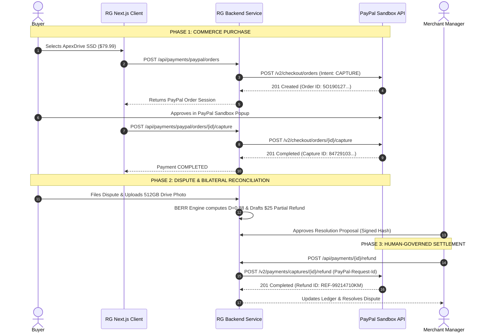

# RESOLVEGRAPH — Complete PayPal Architecture & Integration Explanation
**Phase:** Step 11 Final Submission & Presentation Readiness  
**Target:** PayPal Hackathon Technical Judges & Solutions Architects  
**Official API Reference:** PayPal REST APIs V2 & Customer Disputes API V1  
**Execution Environment:** PayPal Sandbox (Live Rails Hard-Blocked)  
**Version:** 1.0.0 (November 2026)

---

## 1. Architectural Overview & Integration Boundaries

ResolveGraph integrates deeply with PayPal's developer platform to establish a continuous, verifiable financial lifecycle from initial checkout to post-purchase dispute settlement.



---

## 2. Granular PayPal API Implementations

### 2.1 Authentication & Token Lifecycle (`PayPalAuthService`)
- **Endpoint**: `POST /v1/oauth2/token`
- **Mechanism**: Basic HTTP Auth exchanging `PAYPAL_CLIENT_ID` and `PAYPAL_CLIENT_SECRET` for an ephemeral OAuth 2.0 Bearer Token.
- **Resilience**: Single-flight promise caching prevents token stampedes under concurrent load; auto-refreshes 60 seconds before expiration.

### 2.2 Orders V2 & Capture (`PayPalOrderService`)
- **Create Order**: `POST /v2/checkout/orders`
  - Enforces strict minor unit arithmetic (cents / paise) converted to two-decimal strings (`"79.99"`).
  - Specifies application context, brand name, and return/cancel URLs.
- **Capture Order**: `POST /v2/checkout/orders/{id}/capture`
  - Idempotent execution using custom request tracking.
  - Persists `PayPalPayment` entity linking PayPal Capture ID, payer email, transaction fees, and payment status (`COMPLETED`).

### 2.3 Refunds & Idempotency Safeguards (`RefundService`)
- **Endpoint**: `POST /v2/payments/captures/{capture_id}/refund`
- **Financial Controls**:
  - `PayPal-Request-Id`: Uses a deterministic SHA-256 idempotency header (`reso-ref-{proposalId}`) ensuring network retries cannot cause duplicate debiting.
  - Partial Refund Accounting: Tracks `refundedMinor` cumulative balance against `amountMinor`. Rejects any refund exceeding captured balance.

### 2.4 Customer Disputes API V1 (`PayPalDisputeService`)
- **Endpoint**: `GET /v1/customer/disputes` and `POST /v1/customer/disputes/{dispute_id}/provide-evidence`
- **Capabilities**:
  - Ingests active PayPal disputes into ResolveGraph case dossiers.
  - Compiles bilateral evidence into PayPal-compliant metadata packages (invoice excerpts, delivery tracking, damage assessment).
  - Maps allowed merchant actions: `ACCEPT_CLAIM`, `MAKE_OFFER`, `ESCALATE_TO_PAYPAL`.

### 2.5 Webhook Synchronization & SSRF Protection (`PayPalWebhookService`)
- **Endpoint**: `POST /api/webhooks/paypal`
- **Cryptographic Signature Verification**:
  - Validates `PAYPAL-TRANSMISSION-ID`, `PAYPAL-TRANSMISSION-TIME`, and `PAYPAL-TRANSMISSION-SIG`.
  - **SSRF Prevention**: Strictly verifies that the `PAYPAL-CERT-URL` header resolves to a trusted PayPal domain (`*.paypal.com`) over HTTPS before fetching public verification certs.
- **Handled Events**:
  - `CHECKOUT.ORDER.APPROVED`
  - `PAYMENT.CAPTURE.COMPLETED`
  - `PAYMENT.CAPTURE.REFUNDED`
  - `CUSTOMER.DISPUTE.CREATED`
  - `CUSTOMER.DISPUTE.RESOLVED`

---

## 3. Financial State Machine Terminology & Distinctions

To ensure auditability, ResolveGraph strictly distinguishes between these financial states:

```
┌──────────────────────────────────────┬───────────────────────────────────────────────────────────┐
│ Financial State Term                 │ Precise Technical Definition                              │
├──────────────────────────────────────┼───────────────────────────────────────────────────────────┤
│ 1. Payment Authorized                │ Funds reserved on buyer's payment instrument, not settled.│
│ 2. Payment Captured                  │ Funds transferred to merchant sandbox balance.           │
│ 3. Refund Requested                  │ Internal proposal drafted; no external API call made yet. │
│ 4. Refund Authorized                 │ Human merchant manager cryptographically signs proposal.  │
│ 5. Refund Captured / Completed       │ PayPal API returns 201 Created with verified Refund ID.   │
│ 6. Dispute Resolved                  │ Both parties accept terms or PayPal closes dispute case.  │
└──────────────────────────────────────┴───────────────────────────────────────────────────────────┘
```

---

## 4. Current Configuration & Known Sandbox Boundaries

1. **Sandbox Environment Only**: ResolveGraph operates against `https://api-m.sandbox.paypal.com`.
2. **Hardcoded Live Safeguard**: `PAYPAL_LIVE_ENABLED=false` is enforced by `FeatureFlags` and startup `EnvValidator`. Setting this to `true` in non-production throws a fatal configuration exception.
3. **No Direct Cardholder Data**: ResolveGraph never touches, stores, or processes raw Primary Account Numbers (PANs) or CVVs. All checkout flows utilize PayPal's Hosted Fields / React SDK popup modal.
