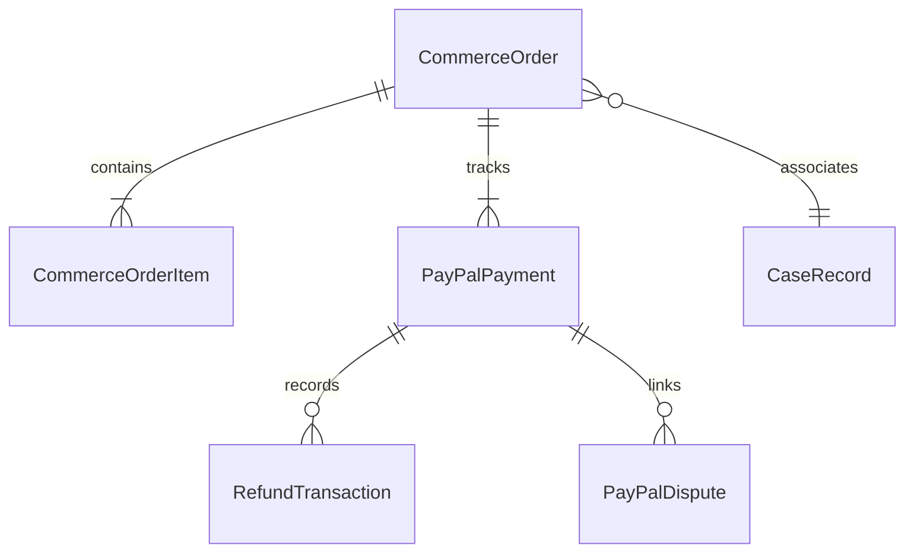
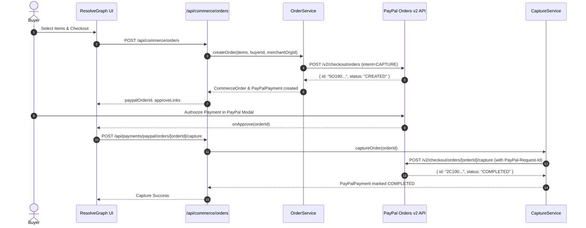

# RESOLVEGRAPH — PayPal Payments, Orders & Capture Architecture

ResolveGraph connects buyer problem reports, merchant resolution workflows, and authoritative payment ledgers into a single coherent system.

---

## 1. Commerce Order & Payment Data Model

All transactions are tracked across three relational database models:

### Models

1. **`CommerceOrder`**:
   - Represents the internal purchase order with order number (`ORD-YYYYMMDD-XXXX`), buyer ID, merchant organization, and authoritative total amount in minor units (`Int`).
   - Links optionally to an internal `CaseRecord`.
2. **`CommerceOrderItem`**:
   - Itemized line items specifying `productReference`, `title`, `sku`, `quantity`, and `unitAmountMinor`.
3. **`PayPalPayment`**:
   - Represents the provider-side payment record containing `providerOrderId` (PayPal Order ID), `captureId` (PayPal Capture ID), `paymentStatus` (`COMPLETED`, `APPROVED`, etc.), and captured timestamp.
4. **`RefundTransaction`**:
   - Append-only ledger recording full or partial refunds with idempotency key (`refundRequestId`), PayPal refund ID, refund reason, and approving actor.

---

## 2. Integer Minor Units Standard

> [!IMPORTANT]
> To eliminate floating-point rounding errors (IEEE-754 precision bugs), ResolveGraph strictly calculates and stores all monetary values in integer minor units (cents, paise):
> - `$19.99` $\rightarrow$ `1999`
> - `$0.50` $\rightarrow$ `50`
> - Zero-decimal currencies (such as `JPY`, `KRW`) are respected without division.

### Utility Methods (`src/server/paypal/utils/money.ts`)
- `toMinorUnits(amountStr, currency)`: Validates and converts decimal strings to minor units.
- `toDecimalString(amountMinor, currency)`: Formats integer minor units to PayPal-compliant decimal strings (e.g. `1999` -> `"19.99"`).
- `calculateRemainingRefundable(capturedMinor, refunds)`: Computes authoritative remaining refundable balance.

---

## 3. Order Lifecycle & Workflow

---

## 4. Idempotency Protection

Every mutating transaction (orders, captures, refunds) records a persistent idempotency record in the `PayPalApiOperation` table:
- Generates a unique `PayPal-Request-Id` (e.g. `RG-ORDER_CAPTURE-xxx-yyy`).
- Stores payload SHA-256 hash to prevent semantic conflicts on retry.
- Re-executing an operation with the same request ID returns the existing completed transaction without duplicate provider requests or financial charges.
