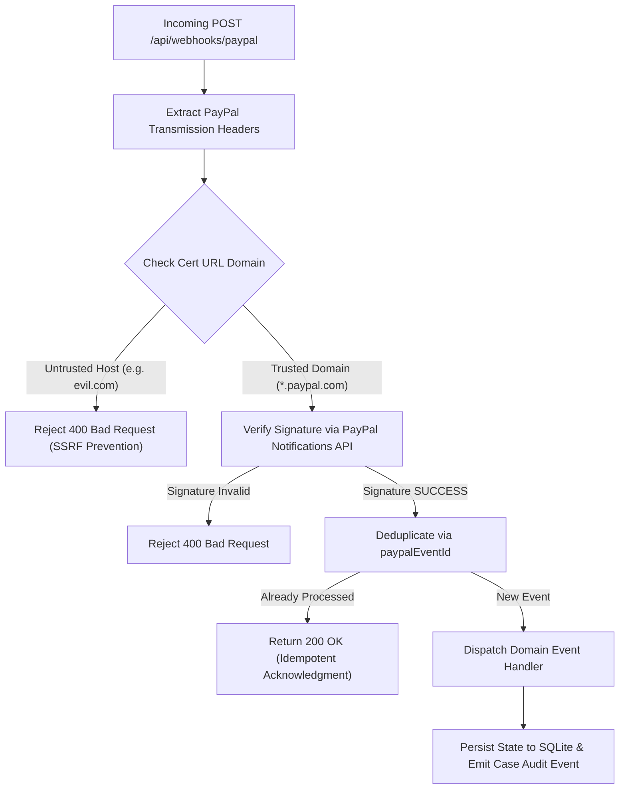

# RESOLVEGRAPH — Cryptographic Webhook Verification & Processing Architecture

ResolveGraph consumes asynchronous event notifications from PayPal to keep payment, capture, refund, and dispute states strictly in sync with the financial rail.

---

## 1. Webhook Signature Verification Pipeline

To guard against malicious spoofing and replay attacks, ResolveGraph verifies every incoming webhook event before dispatching it to application handlers.

### Transmission Headers Required

1. `PAYPAL-AUTH-ALGO`: Asymmetric algorithm (e.g. `SHA256withRSA`).
2. `PAYPAL-CERT-URL`: Public certificate location on trusted PayPal domains (`api.paypal.com` or `api.sandbox.paypal.com`).
3. `PAYPAL-TRANSMISSION-ID`: Unique UUID generated by PayPal per transmission attempt.
4. `PAYPAL-TRANSMISSION-SIG`: Base64-encoded digital signature.
5. `PAYPAL-TRANSMISSION-TIME`: Timestamp of event transmission in ISO 8601 format.

---

## 2. SSRF Protection on Certificate URLs

`WebhookVerificationService.isValidCertUrl(certUrl)` validates that the certificate URL strictly uses HTTPS and resolves to an authorized PayPal infrastructure domain:
- `api.paypal.com`
- `api.sandbox.paypal.com`
- `api-m.paypal.com`
- `api-m.sandbox.paypal.com`

Any external domain is immediately rejected without issuing outgoing HTTP requests, safeguarding the backend from Server-Side Request Forgery.

---

## 3. Supported Webhook Event Types

| Event Type | Action Taken |
| :--- | :--- |
| `CHECKOUT.ORDER.APPROVED` | Marks `PayPalPayment` and `CommerceOrder` as `APPROVED`. |
| `PAYMENT.CAPTURE.COMPLETED` | Updates `PayPalPayment` to `COMPLETED`, records `captureId` and timestamp, sets `CommerceOrder.status = 'CAPTURED'`. |
| `PAYMENT.CAPTURE.DENIED` | Updates `PayPalPayment` to `DENIED` and marks `CommerceOrder.status = 'CANCELLED'`. |
| `PAYMENT.CAPTURE.REVERSED` | Marks `PayPalPayment` as `REVERSED` and emits audit events. |
| `PAYMENT.CAPTURE.REFUNDED` | Inserts `RefundTransaction` record into internal ledger, recalculates remaining refundable balance, updates order status to `REFUNDED` or `PARTIALLY_REFUNDED`. |
| `CUSTOMER.DISPUTE.CREATED` | Inserts new `PayPalDispute` record, links to matching order/capture, maps lifecycle stage (`INQUIRY` or `CHARGEBACK`). |
| `CUSTOMER.DISPUTE.UPDATED` | Updates dispute status, allowed actions, and seller response deadlines. |
| `CUSTOMER.DISPUTE.RESOLVED` | Sets dispute status to `RESOLVED` and updates linked case record. |

---

## 4. Idempotency & Deduplication

Every received event is recorded in the `PayPalWebhookEvent` table using the unique `paypalEventId` constraint:
- If an event is retransmitted by PayPal due to network timeouts, the system detects `processingStatus === 'PROCESSED'` and acknowledges immediately with HTTP 200 without executing side-effects twice.
- If processing fails, the event is marked `FAILED` with the sanitized error code and incremented `attemptCount`.
