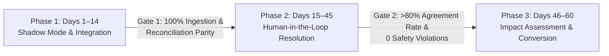

# RESOLVEGRAPH — Controlled Merchant Pilot Program Framework
**Phase:** Step 10 Production Engineering & Operational Excellence  
**Status:** PROGRAM SPECIFICATION (CONTROLLED PILOT READY)  
**Cohort Capacity:** 2–5 Qualified Merchants  
**Duration:** 60-Day Evaluation Window  
**Version:** 1.0.0  
**Last Updated:** November 2026

---

## 1. Executive Summary & Purpose

The ResolveGraph Pilot Program is a controlled, high-touch deployment initiative designed to validate the **Bilateral Evidence-First Commerce Resolution Infrastructure** in live commercial operating conditions.

Rather than launching an open, unmonitored production service, ResolveGraph initiates real-world validation with a tightly scoped cohort of **2 to 5 consenting merchants**. This guarantees strict oversight, zero risk of uncontrolled financial leakage, and continuous human validation of AI recommendations.

> [!IMPORTANT]
> **Pilot Status Clarification**: As of Step 10, the platform is operationally architected, security-audited, and certified **CONTROLLED_PILOT_READY**. Merchant agreements are in active pre-onboarding and qualification stages. No live financial fund movements occur without explicit merchant contractual execution and human authorization.

---

## 2. Pilot Merchant Qualification Criteria

To qualify for participation in Cohort 1, merchant candidates must satisfy the following minimum requirements:

| Dimension | Mandatory Requirement | Justification |
|-----------|------------------------|---------------|
| **Monthly Dispute Volume** | 20 to 150 disputes/month | Sufficient statistical sample size for resolution velocity metrics without overwhelming pilot SRE teams. |
| **Catalog Category** | Physical Goods (Consumer Electronics, Apparel, Home Goods, Specialty Retail) | Tests multimodal evidence extraction (packaging photos, serial numbers, carrier tracking receipts). |
| **Payment Stack** | Active PayPal Business Account & E-Commerce Integration (Shopify, WooCommerce, or Custom API) | Seamless integration with ResolveGraph PayPal webhook and dispute reconciliation modules. |
| **Operational Commitment** | Designated Dispute Manager (2–4 hours/week for reviews and feedback sessions) | Ensures continuous human-in-the-loop oversight and timely ground-truth evaluation. |
| **Technical Readiness** | Ability to run dual-track / shadow mode during initial phase | Guarantees zero disruption to existing merchant chargeback operations during ramp-up. |

---

## 3. 60-Day Pilot Phasing & Milestones

The 60-day pilot is partitioned into three distinct phases with unambiguous progression gates:



### Phase 1: Shadow Mode & Ingestion Parity (Days 1–14)
- Merchant connects store data and PayPal Sandbox or parallel read-only dispute webhooks.
- Historical disputes (last 30 days) imported for retrospective BERR reconciliation.
- ResolveGraph runs in shadow mode: AI agents analyze cases, extract multimodal facts, and generate draft resolution packages without customer exposure.
- **Exit Gate 1**: 100% webhook ingestion success, zero data loss, merchant team validates that AI extractions match human factual observations.

### Phase 2: Human-Governed Active Resolution (Days 15–45)
- Active cases routed into ResolveGraph Bilateral Buyer-Merchant Portal.
- Buyers submit multimodal photos and unboxing videos through guided intake forms.
- BERR engine generates bilateral resolution proposals (Refund, Replacement, Partial Settlement, Claim Denied).
- Merchant Dispute Manager reviews, adjusts, and authorizes each recommendation.
- **Exit Gate 2**: Minimum 50 cases processed with $\ge 80\%$ merchant concurrence rate; zero unapproved actions.

### Phase 3: Comprehensive Impact Assessment & Production Conversion (Days 46–60)
- End-of-pilot retrospective benchmarking against merchant historical baseline.
- Formal security, privacy, and financial audit.
- Conversion to long-term commercial SLA and production graduation.

---

## 4. Key Performance Indicators & Target Metrics

The pilot’s success is evaluated against five measurable quantitative benchmarks:

```
┌──────────────────────────────────────┬─────────────────┬─────────────────┐
│ Metric                               │ Baseline Pre-RG │ Pilot Target    │
├──────────────────────────────────────┼─────────────────┼─────────────────┤
│ 1. Mean Time to Resolution (MTTR)    │ 8.4 Days        │ <= 3.0 Days     │
│ 2. Merchant Admin Time per Dispute   │ 42 Minutes      │ <= 18 Minutes   │
│ 3. Bilateral Evidence Provision Rate │ 24%             │ >= 70%          │
│ 4. Human Recommendation Agreement    │ N/A             │ >= 80%          │
│ 5. Buyer Satisfaction (CSAT)         │ 54%             │ >= 85%          │
└──────────────────────────────────────┴─────────────────┴─────────────────┘
```

---

## 5. Risk Controls & Safety Guardrails

To protect merchant brand reputation and financial assets, strict operational guardrails are enforced:

1. **Hard Refund Caps**: Maximum automated/one-click refund during pilot capped at \$100.00 USD. Any resolution exceeding \$100.00 requires two-party senior merchant authorization.
2. **Deterministic Fallback**: If multimodal extraction confidence falls below 0.70, or if buyer/merchant factual statements diverge significantly without visual corroboration, the case automatically escalates to manual Tier 2 investigation.
3. **No Unilateral Customer Communication**: Pilot email/SMS notifications to buyers are drafted by agents but sent only after merchant reviewer approval.
4. **Instant Opt-Out / Kill Switch**: Merchants can pause ResolveGraph routing within 60 seconds from the merchant settings dashboard, immediately returning all disputes to the legacy merchant workflow.
