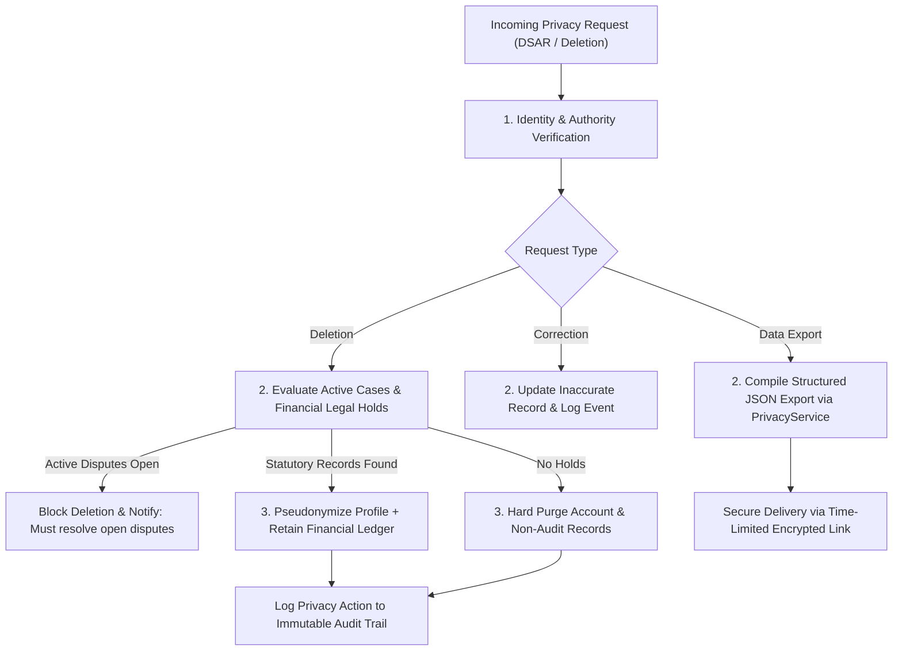

# RESOLVEGRAPH — Privacy Operations & Subject Rights Runbook

## 1. Subject Rights Workflows

RESOLVEGRAPH operationalizes privacy rights via automated APIs and governed administrative workflows managed by `PrivacyService` (`src/server/services/privacy.service.ts`).

---

## 2. Standard Operating Procedures (SOPs)

### SOP-PRIV-01: Data Subject Access Request (DSAR / Data Export)
- **SLA**: Delivered within 72 business hours (statutory ceiling: 30 calendar days).
- **Procedure**:
  1. Operator receives request via support portal or API endpoint (`POST /api/privacy/export`).
  2. Authenticate requester session token or multi-factor authentication.
  3. Invoke `PrivacyService.exportUserData(userId)`.
  4. Package output into a password-protected JSON archive containing account profile, case records, claims, evidence metadata, and audit logs.
  5. Deliver through an authenticated single-use download link expiring in 48 hours.

### SOP-PRIV-02: Right to Erasure / Account Deletion
- **Trigger**: User requests deletion of account and associated records.
- **Verification of Exceptions (Legal Holds)**:
  - **Open Disputes**: If the user is party to any case in `OPEN`, `UNDER_REVIEW`, or `ACTION_REQUIRED` status, deletion is postponed until dispute finalization.
  - **Financial Recordkeeping (7-Year Hold)**: PayPal transaction records, settled capture IDs, and refund transactions cannot be destroyed due to AML and tax audit statutes.
- **Execution**:
  - Personal identifiable information (email, name) is pseudonymized to `anonymized_${userId.slice(0, 8)}@privacy.resolvegraph.internal`.
  - Non-essential evidence items are securely purged.
  - Financial references are preserved under statutory legal hold tags.

### SOP-PRIV-03: Revocation of AI Consent
- **Trigger**: User revokes consent for AI document analysis.
- **Procedure**:
  1. Update `AIProcessingConsent` status to `REVOKED`.
  2. Immediately halt queued AI jobs for that case in `AnalysisQueue`.
  3. Revert case analysis workflow to manual human review mode.

---

## 3. Privacy Contact & Escalation Protocol

- **Data Protection Officer (DPO)**: `dpo@resolvegraph.com`
- **Escalation Window**: Response acknowledged within 24 hours; resolved within 30 days.
- **Regulatory Notification**: In the event of a confirmed personal data breach affecting $>100$ individuals, notification will be dispatched to supervisory authorities (and affected users) within 72 hours in accordance with applicable data protection laws.
