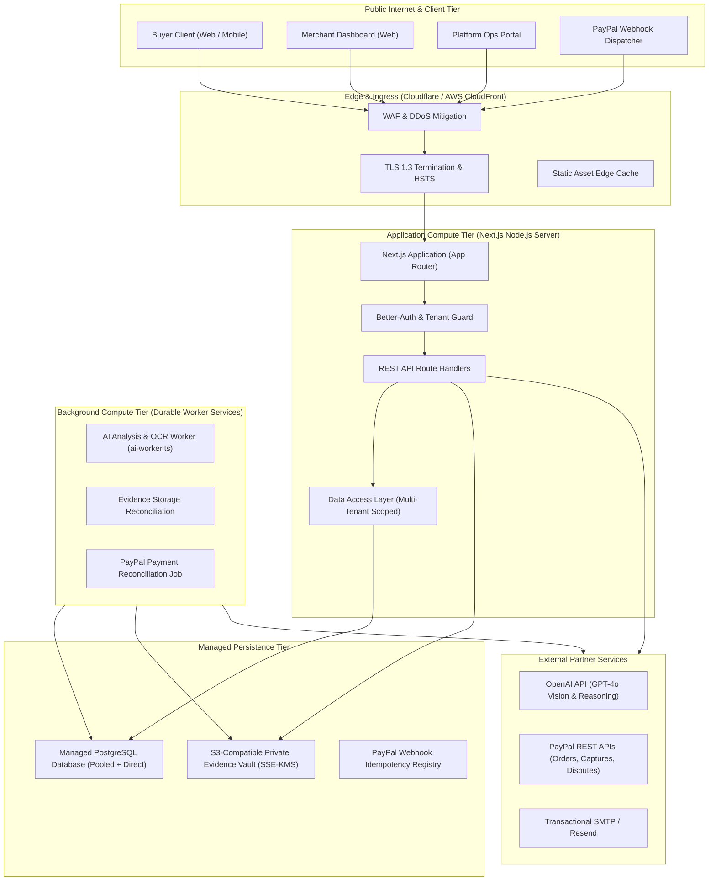
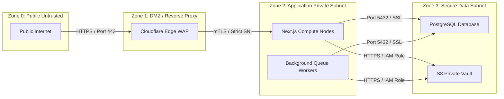

# RESOLVEGRAPH — Production Architecture Specification

## 1. Architectural Philosophy

RESOLVEGRAPH adopts a **modular monolith** deployment topology designed for high maintainability, strict security boundaries, low operational complexity, and seamless scalability without the overhead of unneeded microservices or Kubernetes clusters.

---

## 2. Component Responsibilities

### A. Web Application (Next.js Server & Client)
- **Role**: Serves authenticated React 19 UI workspaces, server-rendered views, and API route endpoints.
- **Runtime**: Node.js v20+ LTS running standalone in containerized environment.
- **Trust Boundary**: Untrusted input boundary. All inputs pass through Zod schema validation, content sanitization, and session permission checks before touching backend services.

### B. Application Database (Managed PostgreSQL)
- **Role**: Primary relational system of record for accounts, organizations, cases, claims, evidence metadata, graph snapshots, resolution proposals, and audit logs.
- **Configuration**: Managed PostgreSQL (AWS RDS / Neon / Supabase) with connection pooling (PgBouncer) for API handlers and direct connection for schema migrations.
- **Isolation**: Row-level tenant isolation enforced via DAL joins on `organizationId` and `buyerId`.

### C. Private Evidence Storage (S3-Compatible Object Store)
- **Role**: Encrypted binary vault for customer-uploaded evidence (invoices, receipts, damage photos).
- **Security**: Server-Side Encryption with KMS keys (`SSE-KMS`). Public bucket access is completely blocked. Downloads require ephemeral HMAC-signed pre-signed URLs with a 5-minute time-to-live.

### D. AI Processing Background Workers
- **Role**: Decoupled asynchronous worker (`scripts/ai-worker.ts`) handling computationally intensive PDF parsing, image OCR, and BERR fact extraction without blocking user HTTP threads.
- **Resilience**: Backoff retries with maximum attempt caps (default 3), dead-letter status marking, and fallback to deterministic local rule engines.

### E. Agent Orchestration Engine
- **Role**: Coordinates specialist subagents (Triage, Investigator, Policy, Drafter, QualityReview) with durable checkpointing in `AgentRun` and `AgentStep` tables.
- **Safety Gate**: Evaluates `FinancialActionGuardrails` before high-risk actions. High-risk proposals are locked behind `AgentApprovalRequest` records awaiting human sign-off.

### F. Payment Integration (PayPal REST & Webhooks)
- **Role**: Manages checkout sessions, captures, refunds, and dispute representments.
- **Security**: Strict CRC32/RSA certificate verification on webhooks. Atomic database idempotency table prevents double-processing or replay attacks.

### G. Transactional Notification Service
- **Role**: Emits milestone notifications (evidence requested, proposal drafted, refund approved) via configurable SMTP/Resend channels.

### H. Observability & Telemetry
- **Role**: Centralized structured JSON logging with correlation IDs (`traceId`), error tracking (Sentry), query latency metrics, and health telemetry.

---

## 3. Trust & Network Boundaries

### Boundary Rules
1. **No Direct Database Access**: Database is bound strictly to private subnets with zero public IP addresses assigned.
2. **Private Storage Isolation**: Object storage rejects all anonymous requests. IAM roles restrict access exclusively to compute instances.
3. **Egress Restrictions**: Compute nodes restrict outbound connections to approved endpoints: PayPal API (`api-m.paypal.com`), OpenAI API (`api.openai.com`), and SMTP relay.

---

## 4. Failure Modes & Graceful Degradation

| Subsystem Failure | Immediate Operational Impact | Graceful Degradation Strategy |
| :--- | :--- | :--- |
| **Database Network Disconnect** | Write operations fail | Retry connection with exponential backoff (up to 5s); API returns `503 Service Unavailable` with `Retry-After: 5` header. |
| **Object Storage Outage** | Evidence uploads rejected | Case creation succeeds; evidence upload is marked `RETRY_QUEUED`; existing metadata remains readable. |
| **OpenAI API Unavailability** | Complex multimodal extraction stalls | Queue worker pauses AI dispatch and automatically falls back to deterministic local BERR rule engine. |
| **PayPal API Timeout** | Checkout/Capture hangs | Idempotency keys prevent double-charge; user is prompted to check status; webhook processes capture asynchronously. |
| **Webhook Delivery Drop** | Merchant out-of-sync | Scheduled payment reconciliation job (`scripts/reconcile-payments.ts`) polls PayPal transaction API every 60 minutes to catch missed state transitions. |

---

## 5. Scaling Strategy & Deployment Topology

### Compute Sizing (Controlled Pilot Baseline)
- **Web Nodes**: 2 $\times$ Containerized instances (2 vCPU, 4GB RAM) behind load balancer for high availability.
- **Database**: 1 $\times$ Managed PostgreSQL instance (2 vCPU, 8GB RAM, 100GB SSD) with read replica.
- **Worker**: 1 $\times$ Dedicated worker process handling background AI queue and storage jobs.

### Vertical & Horizontal Scaling Thresholds
- **Auto-Scale Trigger**: CPU utilization $>70\%$ or request queue depth $>50$ concurrent requests sustained for 2 minutes $\implies$ Spawn additional application containers (up to 6 nodes).
- **Database Connection Pool**: PgBouncer configured with `max_client_conn = 500`, `default_pool_size = 25` per compute instance to prevent connection exhaustion.
