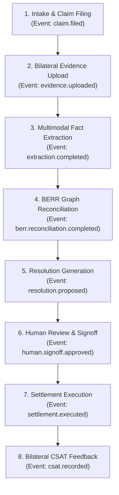

# RESOLVEGRAPH — Privacy-Preserving Product Analytics & KPIs
**Phase:** Step 10 Production Engineering & Operational Excellence  
**Status:** SPECIFICATION & TELEMETRY DICTIONARY  
**Version:** 1.0.0  
**Last Updated:** November 2026

---

## 1. Analytics Philosophy & Privacy-by-Design

ResolveGraph's product analytics pipeline is engineered with **strict privacy-by-design principles**. Traditional commercial tracking often leaks personal data, IP addresses, or sensitive transaction details. ResolveGraph enforces:

1. **Zero Client-Side Ad Trackers**: No third-party ad networks, tracking pixels (Facebook/Google Ads), or external session replay scripts are embedded in the application.
2. **Zero PII in Analytics Events**: Event payloads contain only synthetic entity IDs, timestamps, categorical enums, and quantitative metrics (e.g. latency, confidence scores). Names, email addresses, credit card tokens, and evidence media are strictly excluded.
3. **K-Anonymity ($k \ge 5$)**: Reporting queries automatically suppress cohort slices containing fewer than 5 distinct cases or participants to eliminate re-identification risk.
4. **Differential Privacy in AI Quality Metrics**: Factual agreement and model drift rates are aggregated across organizations without exposing individual dispute narratives.

---

## 2. Core Operational & Product KPIs

```
┌──────────────────────────────────────┬───────────────────────────────────────────────────────────┐
│ Metric Dimension                     │ Calculation & Definition                                  │
├──────────────────────────────────────┼───────────────────────────────────────────────────────────┤
│ 1. Mean Time to Resolution (MTTR)    │ Timestamp(Case Closed) - Timestamp(Case Created)          │
│ 2. Bilateral Participation Rate      │ Count(Cases with Buyer & Merchant Evidence) / Total Cases │
│ 3. BERR Agreement Rate               │ Count(Human Accepted AI Resolution) / Count(AI Proposals)│
│ 4. Human Adjustment Rate             │ Count(Human Adjusted Terms) / Count(AI Proposals)         │
│ 5. Human Override / Rejection Rate   │ Count(Human Overrode AI Resolution) / Count(AI Proposals) │
│ 6. Agent Execution Velocity (p95)    │ 95th Percentile Duration of Agent Multi-Step Runs         │
│ 7. Payment Reconciliation Drift      │ Unreconciled Internal vs Provider Ledger Deltas           │
│ 8. Buyer CSAT Score                  │ Average post-resolution 1–5 star rating converted to %    │
└──────────────────────────────────────┴───────────────────────────────────────────────────────────┘
```

---

## 3. Dispute Resolution Funnel Architecture

The ResolveGraph resolution funnel tracks progress through 8 deterministic lifecycle milestones:



### Funnel Drop-off & Velocity Tracking
- **Intake-to-Evidence Gap**: Time elapsed until both parties submit sufficient proof. Alert triggered if $> 48$ hours.
- **Extraction Latency**: Multimodal parsing duration (target: $< 4.0$ seconds per document).
- **Human Decision Latency**: Duration between AI proposal presentation and human manager authorization (target: $< 4$ hours during business hours).
- **Settlement Execution Latency**: API turnaround time to trigger PayPal sandbox/live refund capture (target: $< 2.5$ seconds).

---

## 4. Telemetry Event Schema

Every system-generated telemetry event adheres to the standard schema:

```typescript
export interface ProductAnalyticsEvent {
  eventId: string;             // UUIDv4
  timestamp: string;           // ISO 8601 UTC
  eventType: 
    | 'case.created'
    | 'evidence.uploaded'
    | 'extraction.completed'
    | 'berr.evaluated'
    | 'resolution.proposed'
    | 'resolution.actioned'
    | 'settlement.executed'
    | 'csat.submitted';
  context: {
    caseId: string;            // Anonymized UUID
    organizationId: string;    // Anonymized Org UUID
    claimType: string;         // 'ITEM_NOT_RECEIVED' | 'SNAD' | etc.
    claimAmountUsd: number;    // Rounded to 2 decimal places
  };
  metrics: {
    durationMs?: number;
    aiConfidenceScore?: number;
    evidenceCount?: number;
    humanDecision?: 'ACCEPTED' | 'ADJUSTED' | 'OVERRIDDEN';
    csatScore?: number;        // 1 - 5
  };
}
```

---

## 5. Reporting Dashboards & Access Controls

- **Merchant Operations Dashboard**:
  - Displays MTTR, bilateral completion rate, win/loss ratio, and dispute volume by product category.
  - Accessible only to authenticated Org Admins and Managers for their own organization.
- **Platform Executive & SRE Dashboard**:
  - Aggregates platform-wide throughput, API error rates, agent recovery actions, and AI drift.
  - Restricted to ResolveGraph platform operators via role-gated admin console.
