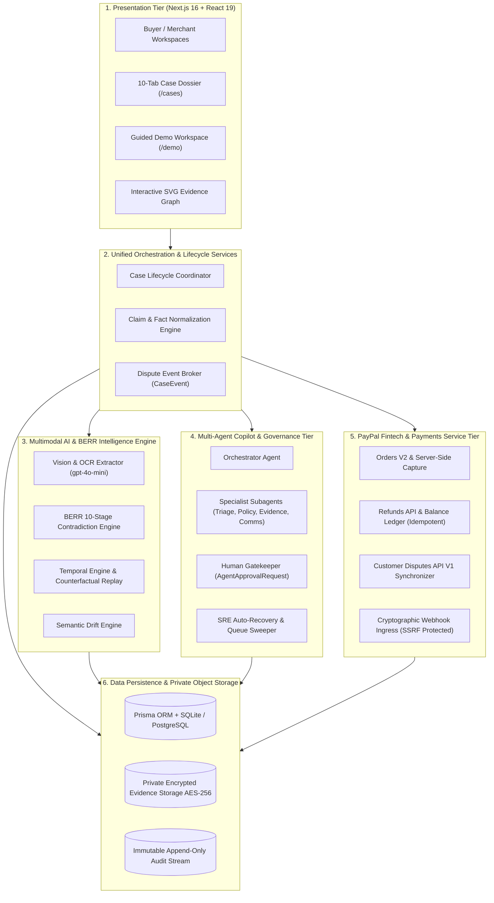

# RESOLVEGRAPH — Complete Project Architecture & Subsystem Blueprint
**Phase:** Step 11 Final Submission & Presentation Readiness  
**Target:** Principal System Architects, Judges & Engineers  
**Pattern:** Modular Monolith with Event-Driven SRE & Human-in-the-Loop Governance  
**Version:** 1.0.0 (November 2026)

---

## 1. System Topology & Architectural Layers

ResolveGraph is architected as an enterprise-grade **Modular Monolith** engineered for high transactional consistency, auditable provenance, and low-latency investigation pipelines:

---

## 2. Granular Layer Responsibilities

### 2.1 Presentation Tier
- Built with **Next.js 16.4.4** (App Router with Turbopack) and **React 19**.
- Zero external UI libraries: Uses lightweight primitives with Tailwind CSS v4 design tokens (`bg-surface`, `text-fg`, `border-line`).
- Interactive SVG Force-Directed Graph renders complex multi-relational graphs client-side with zero layout flicker and accessible table fallbacks.

### 2.2 Unified Orchestration Layer (`src/server/orchestration/`)
- Acts as the operational boundary between HTTP Route Handlers and internal domain logic.
- Enforces atomic state transitions (e.g. cases cannot transition from `DRAFT` directly to `RESOLVED` without an agreed remedy proposal).

### 2.3 BERR Intelligence Engine (`src/server/intelligence/`)
- **Contradiction Detection**: Evaluates $D = \alpha D_{\text{exact}} + \beta D_{\text{semantic}} + \gamma D_{\text{temporal}}$.
- **Temporal Alignment**: Validates chronological causality across commercial phases (Purchase $\rightarrow$ Fulfillment $\rightarrow$ Delivery $\rightarrow$ Dispute).
- **Counterfactual Replay**: Reconstructs exact state of evidence and claims as of historical timestamp $T$.

### 2.4 Multi-Agent Copilot & Governance (`src/server/agents/`)
- Orchestrates multi-step investigation plans with strict 12-step execution budgets.
- Separates high-risk financial actions from low-risk read operations: refunds, dispute submissions, and external communications require cryptographic human approval.

### 2.5 PayPal Fintech Layer (`src/server/paypal/`)
- Enforces minor currency unit arithmetic (cents / paise) to prevent floating-point rounding errors.
- Provides strict idempotency locks via `PayPal-Request-Id` preventing network replay debits.
- Hardcoded safety block (`PAYPAL_LIVE_ENABLED=false`) guarantees zero accidental live money movement.

### 2.6 Persistence & Security Tier
- **Prisma ORM 7** with 27 models.
- **Magic-Byte Sniffing**: Inspects real binary file headers to block disguised executables.
- **Privacy Service**: Provides GDPR/DPDPA DSAR exports and 7-year statutory financial retention pseudonymization.
