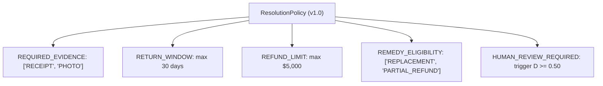
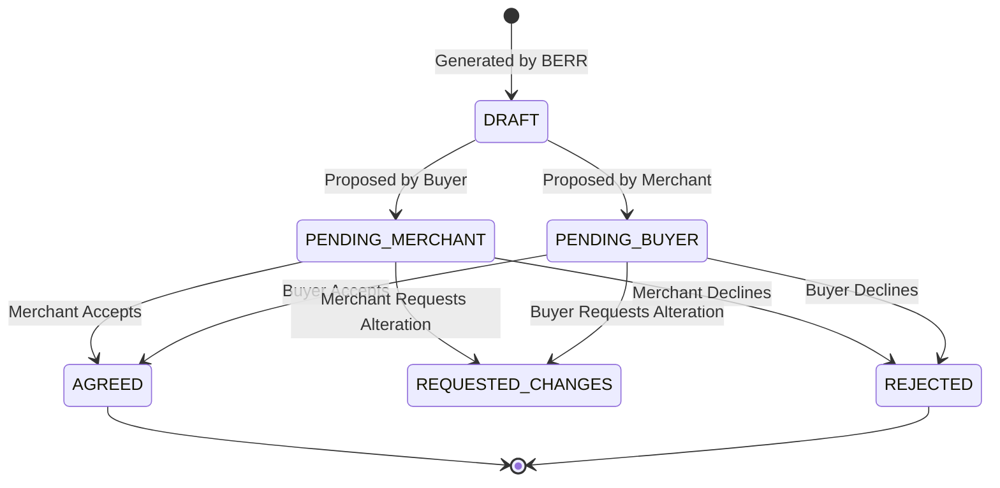

# Resolution Intelligence & Policy Engine

## 1. Overview & Ethical Execution Boundaries

ResolveGraph's **Resolution Intelligence Engine** translates evidentiary findings and policy rules into grounded, fair, and explainable dispute settlement proposals.

### Strict Safety & Governance Boundaries:
> [!IMPORTANT]
> - ResolveGraph **NEVER** executes autonomous payouts, payment refunds, or escrow disbursements.
> - ResolveGraph **NEVER** closes a dispute case unilaterally without bilateral consensus or human arbitrator review.
> - All proposals require explicit agreement (`AGREED`) from both Buyer and Merchant counterparties before any settlement status is finalized.

---

## 2. Resolution Policy & Rule Schemas

Merchant and platform organizations configure versioned policies (`ResolutionPolicy`) containing prioritized rules (`ResolutionRule`). Each rule configuration is strictly validated by Zod (`PolicyValidator`):

### Supported Rule Schemas:
1. **`REQUIRED_EVIDENCE`**:
   - Ensures that mandatory fulfillment or condition evidence is present before proposing refunds.
   - Example: `{ "requiredTypes": ["RECEIPT", "PHOTO"] }`
2. **`RETURN_WINDOW`**:
   - Calculates elapsed days from purchase or delivery to dispute filing date.
   - Example: `{ "maxDays": 30, "basis": "DELIVERY_DATE" }`
3. **`REFUND_LIMIT`**:
   - Enforces an automated financial ceiling. Amounts exceeding the ceiling require manager approval.
   - Example: `{ "maxAmountMinor": 500000, "currency": "USD", "allowOverrideWithApproval": true }`
4. **`REMEDY_ELIGIBILITY`**:
   - Restricts permitted remedy types based on organization dispute categories.
5. **`HUMAN_REVIEW_REQUIRED`**:
   - Automatically escalates disputes exceeding discrepancy thresholds.

---

## 3. Bilateral Proposal Workflow & State Transitions

Resolution proposals follow a strict bilateral state machine (`ProposalWorkflowService`):

### Authorization Boundaries:
- A buyer cannot accept or reject a proposal on behalf of the merchant.
- A merchant cannot accept or reject a proposal on behalf of the buyer.
- Third parties or unassigned users are strictly forbidden from submitting party responses.
- When both counterparties accept, the system emits an immutable `RESOLUTION_AGREED` audit event.
