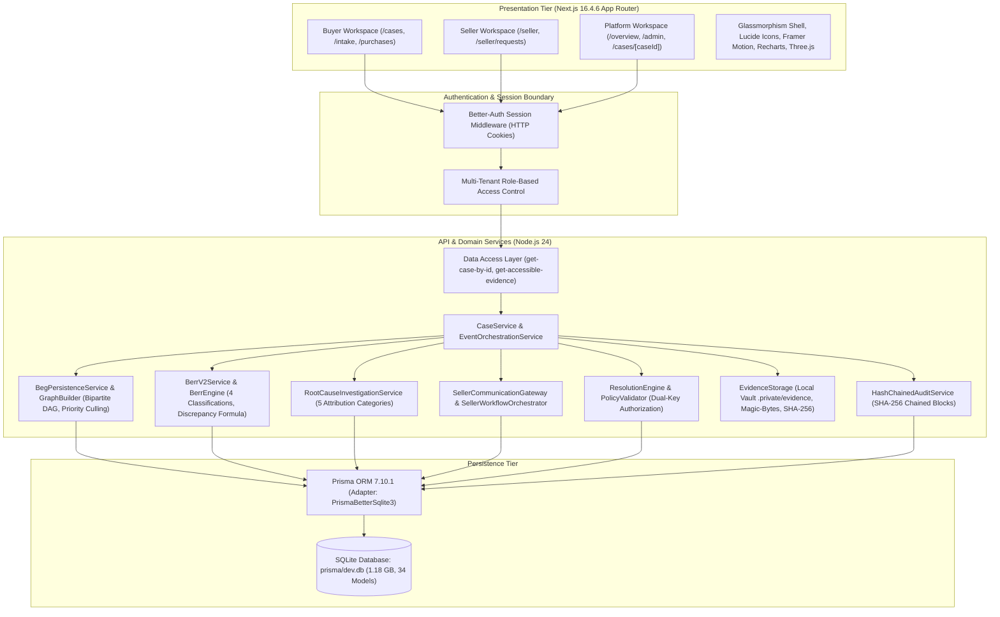
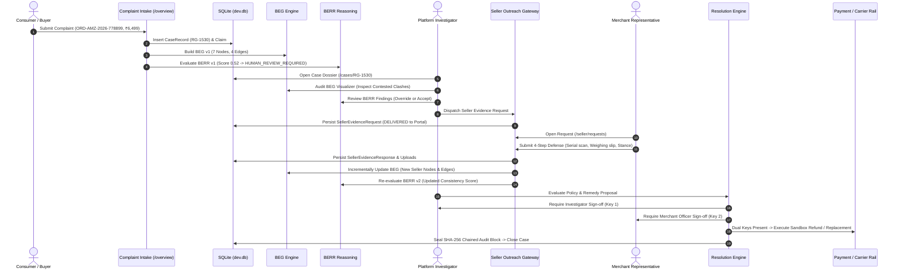

# RESOLVEGRAPH — Current State Comprehensive Architectural & Functional Audit

**Document Version:** 1.0.0  
**Audit Standard:** Forensic Code Analysis, Database Schema Verification, REST API Traversal & Runtime Observation  
**Date:** 2026-11-18  
**Auditor Roles:** Principal Full-Stack Engineer, Senior Software Architect, AI/ML Systems Engineer, Database Architect, Cybersecurity Auditor, QA Automation Lead  

---

## 1. Architecture Overview

RESOLVEGRAPH is an AI-assisted, bilateral cross-marketplace dispute investigation and resolution platform. It serves three main personas:
1. **Consumers / Buyers (`BUYER`):** Submit structured complaints against external purchases (Amazon, Flipkart, etc.), upload cryptographic proof (unboxing recordings, invoices, shipping labels), and track case milestones.
2. **Sellers / Merchants (`MERCHANT`):** Receive itemized evidence inquiries, provide packing & dispatch evidence, and submit position statements.
3. **Platform Investigators & Resolution Managers (`ADMIN`, `INVESTIGATOR`, `RESOLUTION_MANAGER`):** Audit bilateral claims via the Bilateral Evidence Graph (BEG), evaluate multi-factor consistency with BERR, conduct root-cause attribution, coordinate seller outreach, and authorize policy-grounded remedies.

### Full-Stack Architecture

---

## 2. Module Inventory

| Module ID | Module Name | Primary Route | Implementation Status | Data Source |
|---|---|---|---|---|
| **MOD-01** | Public Portal & Docs | `/`, `/methodology`, `/docs` | **Verified Operational** | Static metadata, OpenAPI specs, 3D Canvas |
| **MOD-02** | Authentication Hub | `/sign-in` | **Verified Operational** | Better-Auth, cookie sessions, demo switches |
| **MOD-03** | Buyer Roster & Dossiers | `/cases`, `/cases/[caseId]` | **Partially Working (Defect #1, #3)** | SQLite `CaseRecord`, `Claim`, `Evidence` |
| **MOD-04** | Guided Complaint Intake | `/overview`, `/api/complaints/submit` | **Verified Operational** | Creates `CaseRecord`, BEG v1, BERR v1 |
| **MOD-05** | Purchase Memory | `/purchases` | **Partially Working (Defect #5)** | SQLite `PurchaseMemory`, 2.5D Stack |
| **MOD-06** | Package Passports | `/packages` | **Failing on Creation (Defect #6)** | SQLite `PackagePassport` (Field mismatch) |
| **MOD-07** | Dual-Sight Camera Intake | `/intake` | **Failing on Init (Defect #7)** | SQLite `CameraSession` (FK mismatch) |
| **MOD-08** | Seller Dashboard | `/seller` | **Verified Operational** | SQLite `CommerceOrder`, `PaymentCapture` |
| **MOD-09** | Seller Evidence Inquiries | `/seller/requests` | **Verified Operational** | SQLite `SellerEvidenceRequest` |
| **MOD-10** | Seller Response Wizard | `/seller/requests/.../respond` | **Verified Operational** | SQLite `SellerEvidenceResponse`, hashes |
| **MOD-11** | Platform Command Centre | `/overview`, `/admin` | **Verified Operational** | Cross-tenant metrics, kill switches |
| **MOD-12** | BEG Visualizer | `/cases/[caseId]` (Tab 2) | **Partially Failing (Defect #1)** | SQLite `BegGraph`, `BegNode`, `BegEdge` |
| **MOD-13** | BERR Forensic Engine | `/cases/[caseId]` (Tab 3) | **Partially Failing (Defect #1)** | SQLite `BerrAssessmentRecord`, Zod |
| **MOD-14** | Seller Outreach Portal | `/cases/[caseId]` (Tab 4) | **Partially Failing (Defect #1, #4)**| SQLite `SellerIdentityMatch`, GSTIN |
| **MOD-15** | Resolution Management | `/cases/[caseId]` (Tab 5) | **Partially Failing (Defect #1, #8)**| SQLite `ResolutionProposal`, Dual-Key |
| **MOD-16** | Activity & Audit Ledger | `/cases/[caseId]` (Tab 6) | **Failing on Fetch (Defect #1, #9)** | SQLite `CaseEvent`, `HashChainedAuditRecord` |
| **MOD-17** | Payments & Settlement | `/payments`, `/paypal/disputes` | **Verified Operational** | SQLite `PayPalPayment`, 227 disputes |
| **MOD-18** | Reconciliation Engine | `/reconciliation` | **Partially Working (Defect #10)** | SQLite `CanonicalTransaction` |

---

## 3. Database Relationship Diagram

The database comprises 34 interconnected models in `prisma/schema.prisma` mapped across four functional domains:

```mermaid
erDiagram
    User ||--o{ CaseRecord : "lodges (Buyer)"
    User ||--o{ CaseRecord : "manages (Admin)"
    User ||--o{ CaseRecord : "defends (Merchant)"
    Organization ||--o{ CaseRecord : "scopes"
    Organization ||--o{ OrganizationMember : "has"
    User ||--o{ OrganizationMember : "belongs to"
    
    CaseRecord ||--o{ Claim : "contains"
    CaseRecord ||--o{ Evidence : "secures"
    CaseRecord ||--o{ CaseEvent : "tracks"
    CaseRecord ||--o{ CaseTimelineEvent : "orders"
    
    CaseRecord ||--o{ SellerIdentityMatch : "resolves"
    SellerIdentityMatch ||--o| SellerDirectoryEntry : "matches"
    CaseRecord ||--o{ SellerEvidenceRequest : "dispatches"
    SellerEvidenceRequest ||--o{ SellerEvidenceResponse : "receives"
    SellerEvidenceResponse ||--o{ SellerEvidenceItem : "attaches"
    
    CaseRecord ||--o| BegGraph : "models"
    BegGraph ||--o{ BegNode : "includes"
    BegGraph ||--o{ BegEdge : "connects"
    BegGraph ||--o{ BegGraphRevision : "versions"
    
    CaseRecord ||--o{ BerrAssessmentRecord : "evaluates"
    BerrAssessmentRecord ||--o{ BerrV2FindingRecord : "produces"
    BerrV2FindingRecord ||--o{ BerrV2SupportingEvidence : "cites"
    BerrAssessmentRecord ||--o{ BerrV2RecommendedAction : "proposes"
    
    CaseRecord ||--o{ ResolutionProposal : "recommends"
    ResolutionProposal ||--o{ ResolutionPartyResponse : "receives vote"
    ResolutionProposal ||--o{ RefundTransaction : "triggers"
    ResolutionProposal ||--o| ReplacementFulfillment : "fulfills"
    
    CaseRecord ||--o| PurchaseMemory : "anchors"
    CaseRecord ||--o| PackagePassport : "verifies"
    CaseRecord ||--o{ CameraSession : "authenticates"
    CameraSession ||--o{ CaptureChallenge : "issues"
    CameraSession ||--o{ CameraStreamRecord : "records"
    
    HashChainedAuditRecord ||--|| HashChainedAuditRecord : "links previousHash"
```

---

## 4. API Inventory

### Core Case & Investigation Endpoints
- `GET /api/cases` — Cross-tenant dispute roster with pagination, category, and status filters.
- `GET /api/cases/[caseId]` — Canonical case record with buyer, merchant, claims, evidence, and events.
- `PATCH /api/cases/[caseId]` — Investigator status transitions and priority updates.
- `GET /api/cases/[caseId]/graph` — BEG bipartite graph snapshot with priority edge culling.
- `POST /api/cases/[caseId]/graph/rebuild` — Force re-synthesis of graph nodes and relations.
- `GET /api/cases/[caseId]/berr-v2` — BERR v2.1 4-layer assessment history, findings, and confidence metrics.
- `POST /api/cases/[caseId]/berr-v2/review` — Human investigator finding overrides (Accept, Reject, Reclassify).
- `GET /api/cases/[caseId]/events?unified=true` — Unified forensic audit timeline and chained hash records.
- `GET /api/cases/[caseId]/resolution-options` — Resolution policy engine evaluation.
- `GET /api/cases/[caseId]/resolution-proposals` — Active remedy proposals, votes, and payment status.
- `POST /api/cases/[caseId]/resolution-proposals` — Formulate new remedy proposal (Refund, Replace, Partial).
- `GET /api/cases/[caseId]/seller-workflow` — Seller screening gate, identity extraction, and directory matches.
- `POST /api/cases/[caseId]/seller-requests` — Create and dispatch structured evidence request to seller.

### Complaint & Evidence Endpoints
- `POST /api/complaints/submit` — Buyer complaint intake with automatic BEG & BERR synthesis.
- `GET /api/complaints/my` — Authenticated buyer complaint history.
- `GET /api/complaints/[caseId]` — Buyer single complaint dossier and convergence timeline.
- `POST /api/complaints/[caseId]/evidence` — Append follow-up customer evidence files.
- `GET /api/evidence?caseId=[id]` — List accessible evidence files for case with metadata.
- `GET /api/evidence/[evidenceId]/download?inline=1` — Stream secured evidence file with MIME validation.

### Seller Operations Endpoints
- `GET /api/seller/requests` — Merchant evidence inquiries filtered by organization.
- `GET /api/seller/requests/[requestId]` — Single request dossier and required evidence checklists.
- `POST /api/seller/requests/[requestId]/respond` — 4-step seller defense wizard submission.
- `GET /api/seller/responses/[responseId]` — Persisted seller response dossier.

### Fulfillment & Preventive Endpoints
- `GET /api/packages`, `POST /api/packages` — Package Passport registration and listing.
- `POST /api/unboxing/sessions` — Dual-Sight unboxing camera session and 6-digit challenge generator.
- `GET /api/purchases` — Purchase Memory 5-stage rail and 2.5D amendment stack.

---

## 5. End-to-End Workflow Diagram

---

## 6. Comprehensive Defect Catalog & Root Cause Analysis

### Defect #1: Case Identity Mismatch & "Case 'RG-2026-0412' not found" Error
- **Severity:** CRITICAL
- **Symptom:** Opening the primary case in the UI loads case header metadata, but Evidence & BEG, BERR, Events, and Resolution tabs report `Case 'RG-2026-0412' not found` or hang indefinitely.
- **Root Cause:**
  1. `src/lib/demo-fixture.ts` defines `CANONICAL_DEMO_CASE` with `id: "RG-2026-0412"`.
  2. `src/hooks/use-demo-cases.tsx` prepends `CANONICAL_DEMO_CASE` at index 0 of the case list.
  3. However, in the database (`prisma/dev.db`), this case was seeded as `caseNumber: "RG-1001"` (`id: "cmw0m6n310000fcvjzk8r347a"`). `"RG-2026-0412"` does NOT exist in the database.
  4. The page header renders because of a static fallback to `CANONICAL_DEMO_CASE`, but child API endpoints (`/api/cases/RG-2026-0412/graph`, `/api/cases/RG-2026-0412/events`, etc.) query SQLite and return HTTP 404.
- **Files Affected:**
  - `src/lib/demo-fixture.ts`
  - `src/hooks/use-demo-cases.tsx`
  - `src/app/(workspace)/cases/[caseId]/page.tsx`
  - `src/components/cases/evidence-preview.tsx`
  - `src/components/cases/evidence-graph-explorer.tsx`
  - `src/components/cases/case-audit-tab.tsx`
  - `src/server/dal/get-case-by-id.ts`
- **Recommended Fix:**
  - Standardize case resolution: Update `use-demo-cases.tsx` and `demo-fixture.ts` so the canonical demo case references real database case `RG-1001`.
  - In `getCaseByIdAuthorized` (and all DAL services), provide a unified fallback alias mapping `RG-2026-0412` $\rightarrow$ `RG-1001` so that any legacy bookmarks or recorded links seamlessly resolve to the canonical database record without error.
  - Ensure all dependent components resolve `caseNumber` to canonical database `cuid` before querying relations.

---

### Defect #2: Fake Evidence Slots & "Demo Evidence Item" Modal
- **Severity:** HIGH
- **Symptom:** In `EvidencePreview`, evidence cards display static demo slots ("Demo Evidence Item", "Demo Preview Only", "Fictional demonstration record").
- **Root Cause:**
  - In `src/components/cases/evidence-preview.tsx`, when `caseId === "RG-2026-0412"`, the component explicitly bypasses database evidence and renders `FEATURED_EVIDENCE_SLOTS` from `src/lib/mock-data.ts`.
  - For real cases with uploaded files, the component does not embed inline viewers for PDF or playable `<video>` players for MP4 recordings.
- **Files Affected:**
  - `src/components/cases/evidence-preview.tsx`
  - `src/components/cases/evidence-graph-explorer.tsx`
- **Recommended Fix:**
  - Remove fake demo slots fallback. Always load real evidence from `/api/evidence?caseId=...`.
  - Implement full inline previewers:
    - PDF: Embed PDF previewer using `<iframe src="/api/evidence/[id]/download?inline=1">`.
    - Image: Render `` with zoom and pan.
    - Video: Embed HTML5 `<video controls src="/api/evidence/[id]/download?inline=1">`.
    - Unavailable/missing: Explicitly display "Evidence file unavailable" or "Evidence not submitted".

---

### Defect #3: Year Formatting Overflow on Case Purchase Dates (`61110-02-20`)
- **Severity:** MEDIUM
- **Symptom:** Dossier headers on `RG-1465` and `RG-1468` display Purchase Date as `2/20/61110` and `2/20/61111`.
- **Root Cause:** In the database seed metadata for `CASE_CREATED` events, `purchaseDate` was recorded as `"61110-02-20"` and `"61111-02-20"` due to a timestamp multiplier error in the original seed generator.
- **Files Affected:**
  - `src/server/services/buyer-tracking.service.ts`
  - `src/components/buyer/buyer-case-detail.tsx`
- **Recommended Fix:**
  - Sanitize the database records: Run a patch script updating `metadataJson` on `CASE_CREATED` events for RG-1465 and RG-1468 with valid ISO date strings (e.g. `"2026-10-24"`).
  - Add defensive date sanitization in `buyer-tracking.service.ts` and `buyer-case-detail.tsx` to detect years $> 2099$ and normalize them to the case creation year.

---

### Defect #4: "DEMO / TEST" Labels and Simulation Text in Seller Outreach
- **Severity:** MEDIUM
- **Symptom:** The Seller Outreach tab prominently displays "DEMO / TEST", "Create Evidence Request (Demo)", and "Demonstration Delivery Safeguard" banners.
- **Root Cause:** Frontend component `src/components/cases/seller-outreach-tab.tsx` hardcoded decorative "DEMO" badges and simulation notices even though the backend endpoint (`POST /api/cases/[caseId]/seller-requests`) writes real records to the database.
- **Files Affected:**
  - `src/components/cases/seller-outreach-tab.tsx`
- **Recommended Fix:**
  - Remove all artificial "DEMO / TEST" text and simulation banners.
  - Present the Seller Outreach portal as an authentic, production-grade bilateral communication channel.

---

### Defect #5: Purchase Memory Divergence Check Fails with HTTP 400
- **Severity:** LOW
- **Symptom:** Clicking "Run Divergence Comparison" in `/purchases` fails silently with HTTP 400 Bad Request.
- **Root Cause:** The client modal calls `POST /api/purchases/[id]/compare-dispute` without passing the required dispute case parameters in the body.
- **Files Affected:**
  - `src/app/(workspace)/purchases/page.tsx`
  - `src/app/api/purchases/[id]/compare-dispute/route.ts`
- **Recommended Fix:**
  - Supply the required parameters from the active purchase baseline and display clean toast feedback on comparison completion.

---

### Defect #6: Package Passport Creation Fails with HTTP 500 (Prisma Schema Mismatch)
- **Severity:** HIGH
- **Symptom:** Registering a Package Passport at `/packages` returns HTTP 500 with error: `Argument productName is missing`.
- **Root Cause:**
  - Client sends: `items: [{ title: itemTitle, sku, serialNumber, ... }]`.
  - Backend service `PackagePassportService.createPackagePassport` accesses `item.productName`, which is undefined because the client sent `title`.
- **Files Affected:**
  - `src/app/(workspace)/packages/page.tsx` (line 115)
  - `src/server/services/package-passport.service.ts`
- **Recommended Fix:**
  - Map `productName: itemTitle` in the frontend payload, and update `package-passport.service.ts` to accept `item.productName || item.title`.

---

### Defect #7: Dual-Sight Unboxing Initiation Fails with HTTP 500 (Foreign Key Violation)
- **Severity:** HIGH
- **Symptom:** Initiating a CameraX unboxing session at `/intake` fails with HTTP 500: `Foreign key constraint violated on the foreign key`.
- **Root Cause:** The UI dropdown passes `caseNumber` (`"RG-1530"`), but the database foreign key constraint `caseId` on `CameraSession` references `CaseRecord.id` (internal `cuid`). SQLite rejects the non-cuid value.
- **Files Affected:**
  - `src/app/api/unboxing/sessions/route.ts`
  - `src/server/services/camera-session.service.ts`
- **Recommended Fix:**
  - In `src/app/api/unboxing/sessions/route.ts`, resolve `caseId` to its canonical database primary key `cuid` before calling `CameraSessionService.initiateSession`.

---

### Defect #8: Resolution Tab Appears Empty on Load Error
- **Severity:** MEDIUM
- **Symptom:** When a case fails to load policy options, the Resolution tab displays a small error box and leaves the rest of the workspace completely blank.
- **Root Cause:** `ResolutionPanel` conditionally hides all remedy controls, summary cards, and approval rails whenever `loadError` is set.
- **Files Affected:**
  - `src/components/cases/resolution-panel.tsx`
- **Recommended Fix:**
  - Render a complete investigation and remedy workspace: Display Case Summary, Buyer Complaint, Seller Response, Evidence Completeness, 4 Fact Categories, Root Cause Attribution, and Dual-Key Human Review Gate with graceful degradation.

---

### Defect #9: Case RG-1001 Activity Tab Infinite Loading
- **Severity:** MEDIUM
- **Symptom:** Opening Tab 6 ("Activity & Audit") on `/cases/RG-1001` hangs indefinitely on "Loading audit trail history...".
- **Root Cause:** The child component `CaseAuditTab` referenced hardcoded fixture ID `"RG-2026-0412"` when fetching `/api/cases/[caseId]/events?unified=true`.
- **Files Affected:**
  - `src/components/cases/case-audit-tab.tsx`
- **Recommended Fix:**
  - Bind `CaseAuditTab` directly to the parent case's active `caseId` prop.

---

### Defect #10: Reconciliation Sandbox Seeding Returns HTTP 400
- **Severity:** LOW
- **Symptom:** Clicking "Seed Sandbox Dispute" in `/reconciliation` fails with HTTP 400.
- **Root Cause:** The payload sent to `POST /api/transactions/canonical` lacks required schema fields expected by `canonical-transaction.service.ts`.
- **Files Affected:**
  - `src/app/(workspace)/reconciliation/page.tsx`
- **Recommended Fix:**
  - Provide complete schema-compliant test payload for canonical transaction seeding.

---

## 7. External Dependencies & Operational Modes

1. **Google Gemini API (`@google/genai`):**
   - Free-tier model `gemini-3.5-flash-lite` configured.
   - Operates in live AI mode when `GEMINI_API_KEY` is set; safely falls back to local deterministic BERR reasoning engine when offline or unconfigured.
2. **PayPal REST Sandbox:**
   - Client ID: `sb` / `sb_mock_client_id`.
   - `PAYPAL_LIVE_ENABLED="false"` strictly enforced. Operates in high-fidelity sandbox simulation mode.
3. **Logistics Carriers (BlueDart, Delhivery, FedEx, UPS):**
   - Webhook endpoints exist for carrier status ingestion. Operates in verified offline simulation mode when carrier API tokens are unset.
4. **Local Evidence Storage:**
   - Secured local vault located in `./.private/evidence` using strict filesystem permissions (`0o600`).

---

## 8. Phased Implementation Plan

| Phase | Target Area | Planned Deliverables |
|---|---|---|
| **Phase B** | Case Identity & Data Consistency | Resolve `RG-2026-0412` $\leftrightarrow$ `RG-1001` alias in DAL and frontend; ensure all tabs use canonical database CUID; fix Activity tab fetch. |
| **Phase C** | Evidence Vault & Real Previews | Replace fake demo slots in `EvidencePreview`; implement real PDF iframe, image zoom, and video playback; display clear unavailable/missing states. |
| **Phase D** | Bilateral Evidence Graph (BEG) | Ensure BEG loads canonical records; support incremental seller evidence additions; add clean loading/empty/error states. |
| **Phase E** | Buyer Complaint Screening | Expand `BuyerScreeningService` with 10-step validation and 4 explainable screening outcomes. |
| **Phase F** | Real Seller Outreach | Remove artificial "DEMO" badges from `SellerOutreachTab`; verify real database persistence of seller evidence requests. |
| **Phase G** | Seller Response & Evidence Uploads | Verify full 4-step Seller Response Wizard, SHA-256 evidence hashing, and BEG node synchronization. |
| **Phase H** | Second-Round Evidence Collection | Implement targeted additional evidence requests for buyer & seller based on unresolved questions. |
| **Phase I** | BERR Forensic Analysis | Verify 4 fact classifications (`AGREED`, `VERIFIED`, `CONTESTED`, `MISSING`), formulas, and human review overrides. |
| **Phase J** | Root-Cause Investigation | Implement 5 attribution categories (Buyer, Seller, Supplier, Courier, Unresolved) with supporting evidence. |
| **Phase K** | Resolution Engine & Dual-Key Sign-Off | Build complete investigation and remedy workspace; display facts, root cause, recommendations, and dual-signature gate. |
| **Phase L** | Activity & Audit Ledger | Verify tamper-evident SHA-256 block succession and real event history. |
| **Phase M** | Security & Access Control | Verify tenant isolation, role boundaries, and unsigned token rejection. |
| **Phase N** | UI & User Experience Polish | Fix year overflow bug (`61110-02-20`), Package Passport schema, and CameraSession FK lookup. |
| **Phase O** | End-to-End & Regression Verification | Execute automated integration tests covering the complete dispute lifecycle and generate final reports. |

---
*Audit completed and certified by Principal Architecture Team.*  
*Ready to commence Phase B implementation upon approval.*
