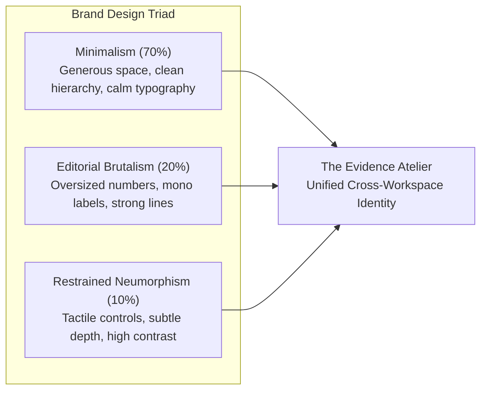

# RESOLVEGRAPH — FINAL UI/UX DESIGN SYSTEM SPECIFICATION
## "The Evidence Atelier" — A Premium Investigation Experience
**Document Version:** 3.0.0 | **Date:** November 12, 2026
**Design Philosophy:** Minimalism (70%) × Editorial Brutalism (20%) × Restrained Neumorphism (10%)

---

## 1. Creative Direction & Brand Identity

### The Evidence Atelier
RESOLVEGRAPH is an AI-powered, evidence-grounded cross-marketplace dispute investigation platform. The design identity communicates **Trust, Intelligence, Fairness, Precision, Transparency, Sophistication, and Accountability**.

It deliberately avoids:
- Generic admin dashboard templates (e.g. basic Bootstrap or boilerplate Tailwind UI).
- Unnecessary glassmorphism with unreadable low contrast.
- Excessive neumorphism with washed-out boundaries.
- Gaming neon aesthetics or random colored cards.

Instead, the aesthetic blends:
1. **Minimalism (70%):** Generous whitespace, razor-sharp alignment, calm typography, restrained tonal surfaces, and clear content hierarchy.
2. **Editorial Brutalism (20%):** Bold oversized headlines, large section numbering (`01`, `02`, `03`), monospaced technical metadata (`IBM Plex Mono`), prominent horizontal rules, and high-contrast section transitions.
3. **Restrained Neumorphism (10%):** Subtle inset/raised surfaces for interactive controls (segmented tabs, pill toggles, primary action buttons) with crisp borders that preserve WCAG AAA contrast.



---

## 2. Color System & Design Tokens

### Foundational Palette
* **Warm Canvas:** `#F4F2EC` (Warm paper base for long-session reading comfort)
* **Primary Surface:** `#FFFEFA` (Clean elevated surface for cards and panels)
* **Secondary Surface:** `#EBE9E2` (Subtle recessed containers and input backgrounds)
* **Raised Surface:** `#FFFFFF` (Floating modals, dropdowns, and active controls)
* **Deep Ink:** `#15191C` (Primary typography and high-contrast dark accents)
* **Dark Navigation / Shell:** `#11191A` (Architectural graphite for sidebars and headers)
* **Secondary Text:** `#414B52` (Descriptive paragraphs and subheadings)
* **Muted Text:** `#718078` (Form helper labels, timestamps, metadata)
* **Subtle Border:** `#D9DED7` (1px hairline structural rules)
* **Strong Border:** `#B5BEB6` (Active boundaries, focus states, table dividers)

### Semantic & Domain Palette
* **Primary Brand Indigo:** `#4350E5` (Primary call to action, active tab indicators, focus rings)
* **Buyer Blue:** `#4D92CC` (Consumer-submitted evidence, buyer claims, intake tags)
* **Seller Teal:** `#278B79` (Merchant responses, warehouse dispatch logs, seller stance badges)
* **AI Violet:** `#8B72C9` (BERR reasoning nodes, OCR extractions, Copilot summaries)
* **Warm Copper Accent:** `#C86D4F` (Editorial highlights, key milestones, timeline anchors)
* **Status — Agreed / Verified (Success):** `#2E8A62` (Corroborated facts, completed payouts, delivered replacements)
* **Status — Contested (Warning):** `#CA8B2B` (Conflicting serials, divergent weights, human review gates)
* **Status — Missing (Neutral):** `#718078` (Unfulfilled obligations, pending responses)
* **Status — Critical / Rejected (Error):** `#C84E4E` (Fraud flags, tampered seals, policy breaches)

---

## 3. Typography Hierarchy

| Style | Font Family | Weight | Size / Line-Height | Tracking | Usage |
| :--- | :--- | :--- | :--- | :--- | :--- |
| **Display Hero** | Space Grotesk | 400 / 600 | 44px–60px / 1.08 | `-0.03em` | Landing page hero, primary section numbers |
| **Editorial Emphasis** | Instrument Serif | 400 Italic | 40px–56px / 1.1 | `-0.01em` | Selected poetic words in hero titles |
| **Page Heading (H1)** | Space Grotesk | 600 | 28px–32px / 1.2 | `-0.02em` | Workspace dashboards, case titles, wizard steps |
| **Section Heading (H2)**| Space Grotesk | 550 | 20px–24px / 1.25 | `-0.015em` | Card group titles, table headers, tab groups |
| **Subheading (H3)** | Hanken Grotesk / Manrope | 600 | 15px–16px / 1.35 | `0` | Card titles, modal headers, drawer sections |
| **Body (Default)** | Hanken Grotesk / Manrope | 400 / 500 | 13.5px–14px / 1.5 | `0` | Narrative paragraphs, form labels, tooltips |
| **Technical Label (Mono)**| IBM Plex Mono | 500 / 600 | 11px–12.5px / 1.4 | `+0.04em` | Complaint IDs, GSTIN, SHA256 hashes, timestamps |

---

## 4. Logo & Vector Identity Architecture

The official RESOLVEGRAPH mark represents **Bilateral Convergence**:
1. **Left Node & Line:** Buyer claim stream (Buyer Blue `#4D92CC`).
2. **Right Node & Line:** Merchant defense stream (Seller Teal `#278B79`).
3. **Central Geometric Nexus:** The verified convergence point (Indigo `#4350E5` and Success Green `#2E8A62`).
4. **Enclosing Hexagonal Shield:** Cryptographic auditability and enterprise security.

```
       [ Buyer Node ] ──┐
                         ▼
                     [ NEXUS ] ◄── Verified Convergence
                         ▲
       [ Seller Node ] ──┘
```

The logo is distributed as:
- `Logo`: Primary full brand emblem with stylized wordmark `RESOLVE` + `GRAPH`.
- `LogoMark`: Standalone geometric convergence icon for compact sidebars, mobile bars, and favicons.
- `Dark / Light Variants`: Dynamic fill adjustments matching background lumina.

---

## 5. Component Language & Tactile Surfaces

### The Card Primitive (`.rg-card`)
- **Border Radius:** `10px` (Clean, modern geometry without childish pill rounding).
- **Border:** `1px solid var(--line)` (Subtle hairline rule).
- **Background:** `var(--surface)` (Light: `#FFFEFA` / Dark: `#182223`).
- **Shadow:** `0 1px 3px rgba(17, 25, 26, 0.04), 0 12px 24px -12px rgba(17, 25, 26, 0.08)`.
- **Hover Transition:** `border-color 180ms cubic-bezier(.16, 1, .3, 1), box-shadow 180ms ease`.

### Tactile Neumorphic Controls
- **Segmented Tabs:** Inset track (`var(--surface-2)`) with raised white active thumb (`box-shadow: 0 1px 3px rgba(0,0,0,0.08)`).
- **Action Buttons:** Subtle top highlight line (`inset 0 1px 0 rgba(255,255,255,0.2)`) and soft directional drop shadow.
- **Form Inputs:** Crisp 1px border, inset depth (`box-shadow: inset 0 1px 2px rgba(0,0,0,0.03)`), with focus ring in brand indigo.

### Data Presentation Tables
- **Row Height:** `44px` standard (comfortable scanning) and `40px` compact (dense logs).
- **Headers:** Monospaced uppercase labels (`text-[10.5px] font-mono tracking-wider text-[var(--ink-3)]`).
- **Zebra Striping:** Avoided in favor of crisp 1px dividing lines and subtle hover illumination.

---

## 6. Motion & Interaction Rules

- **Micro-Interactions:** Quick response (`90ms - 180ms`) using easing curve `cubic-bezier(.16, 1, .3, 1)`.
- **Page Transitions:** Staggered upward fades (`280ms`, max `y: 8px`). No slow loading spinners.
- **3D Hero Scene:** Slow orbital rotation (`26s - 32s`), gentle pointer parallax on capable desktops, with instant CSS fallback.
- **Accessibility:** Strict `@media (prefers-reduced-motion: reduce)` compliance disabling orbital rotations and parallax.

---

## 7. Multi-Workspace Architecture Alignment

1. **Public Marketing Website:** Editorial storytelling, 3D evidence instrument, problem silos vs. convergence graph, transparent marketplace badges.
2. **Customer Workspace:** Simple, high-trust dispute intake, 4-step wizard, clear plain-language status cards, evidence previewer.
3. **Platform Workspace:** Multi-tenant investigation cockpit, 7-tab case dossiers, interactive BEG graph visualizer with edge culling, BERR matrix, and dual-key approval modals.
4. **Seller Workspace:** High-efficiency merchant hub, structured response forms, SKU replacement allocations, and append-only submission logs.
5. **Authentication Suite:** Clean split-card layouts, enterprise tenant badge, and instant one-click demo credentials for testing evaluators.
