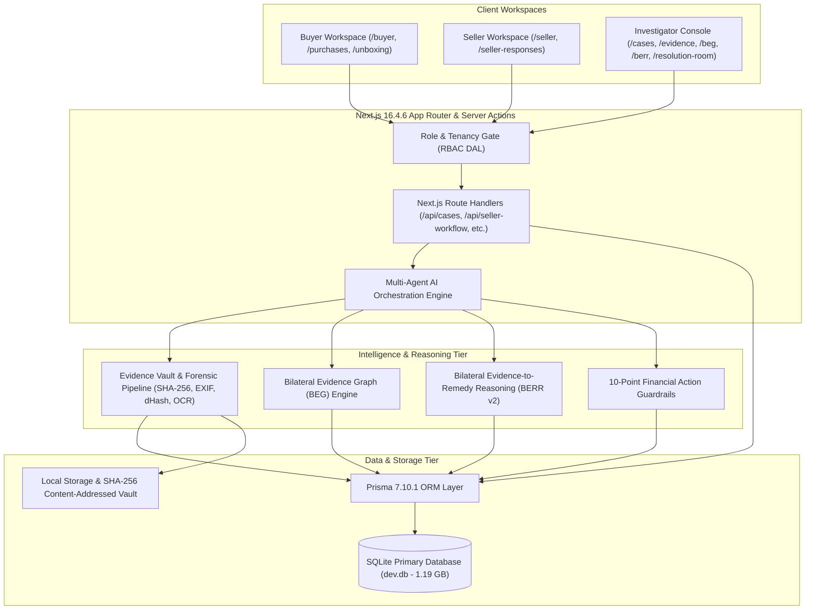
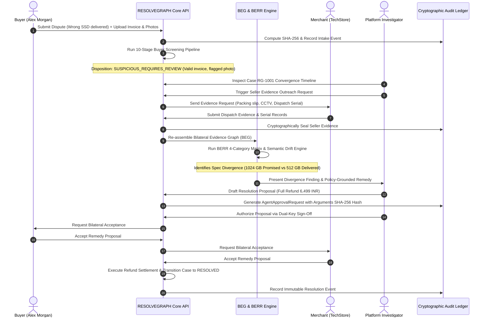

# RESOLVEGRAPH — Verified System Architecture Specification

## 1. Executive Architecture Overview

RESOLVEGRAPH is an AI-assisted, bilateral post-purchase dispute investigation and resolution platform. It bridges the trust and information asymmetry between three primary stakeholders: **Buyers (Consumers)**, **Merchants (Sellers)**, and **Platform Dispute Investigators (Resolution Managers)**.

Unlike legacy e-commerce dispute systems that rely on unilateral claims or unverified text assertions, RESOLVEGRAPH operates on verifiable evidence, cryptographic sealing, bilateral evidentiary reconciliation (BEG), and explainable reasoning (BERR).

---

## 2. Technology Stack & Infrastructure

| Layer | Component / Technology | Version / Configuration | Purpose |
|---|---|---|---|
| **Frontend Framework** | Next.js App Router (Turbopack) | 16.4.6 | Server-rendered and client-hydrated reactive workspaces |
| **UI Library & Styling** | React 19 / Tailwind CSS | Tailwind v4, Lucide React | Clean, high-density, accessible judicial design system |
| **Language Runtime** | TypeScript / Node.js | v20+ / TS 5.4 | Strict typing, schema safety, zero compile errors (`tsc --noEmit`) |
| **ORM & Database** | Prisma Client / SQLite | Prisma 7.10.1, SQLite 3 (`dev.db`) | 1.19 GB real evaluation dataset, foreign keys, write-ahead logging |
| **Validation & Schema** | Zod | 3.23+ | Strict parsing of API request bodies, tool inputs, and entity schemas |
| **AI Integration** | Google Gemini / Deterministic Fallbacks | Gemini 2.5 Flash / Rule Engines | Multimodal analysis, OCR extraction, grounded reasoning |
| **Testing Harness** | Node.js Built-in Runner (`node:test`) | `tsx --test --test-concurrency=1` | 456 automated regression and end-to-end integration tests |

---

## 3. Database Entity Relationship Model (ERD)

The core relational database model in `dev.db` supports multi-tenant isolation, bilateral evidence capture, immutable audit trails, and multi-round dispute settlement.

```mermaid
erDiagram
    CaseRecord ||--o{ Evidence : "contains"
    CaseRecord ||--o{ Fact : "grounds"
    CaseRecord ||--o{ BerrFinding : "evaluates"
    CaseRecord ||--o{ GraphNode : "contains"
    CaseRecord ||--o{ CaseEvent : "chronicles"
    CaseRecord ||--o{ SellerRequest : "dispatches"
    CaseRecord ||--o{ SellerWorkflowSession : "tracks"
    CaseRecord ||--o{ ResolutionProposal : "reaches"
    CaseRecord ||--o{ FinancialAuthorization : "authorizes"
    CaseRecord ||--o{ CameraSession : "verifies unboxing"

    PurchaseMemory ||--o{ CaseRecord : "serves as baseline"
    PackagePassport ||--o{ CaseRecord : "verifies dispatch"
    User ||--o{ CaseRecord : "initiates/manages"

    CaseRecord {
        string id PK
        string caseNumber UK "e.g. RG-1001"
        string status "ACTIVE, UNDER_INVESTIGATION, RESOLVED"
        string disputeCategory "WRONG_ITEM, DAMAGED, COUNTERFEIT"
        int buyerPaidAmount
        string currency
        string priority "LOW, MEDIUM, HIGH, CRITICAL"
    }

    Evidence {
        string id PK
        string caseId FK
        string uploaderRole "BUYER, SELLER, PLATFORM"
        string fileHash "SHA-256"
        string fileUrl
        string mediaType
        string verificationStatus "VERIFIED, SUSPICIOUS, REJECTED"
        boolean tampered
    }

    Fact {
        string id PK
        string caseId FK
        string category "SPECIFICATION, TIMELINE, CONDITION"
        string statement
        string confidence
        string truthStatus "AGREED, VERIFIED, CONTESTED, MISSING"
    }

    BerrFinding {
        string id PK
        string caseId FK
        string findingType "SPEC_DIVERGENCE, PACKAGING_INTEGRITY"
        string severity "LOW, MEDIUM, HIGH"
        float confidence
        string explanation
    }

    GraphNode {
        string id PK
        string caseId FK
        string nodeType "EVIDENCE, FACT, CLAIM, REMEDY"
        string party "BUYER, SELLER, NEUTRAL"
        string label
        json metadata
    }

    SellerWorkflowSession {
        string id PK
        string caseId FK
        string sellerId
        string status "INVITED, SUBMITTED, REVIEWED, CONVERGED"
        string verificationDisposition
        datetime deadline
    }

    ResolutionProposal {
        string id PK
        string caseId FK
        string proposedRemedy "FULL_REFUND, PARTIAL_REFUND, REPLACEMENT"
        int amount
        string buyerStatus "PENDING, ACCEPTED, REJECTED"
        string sellerStatus "PENDING, ACCEPTED, REJECTED"
        string status "PROPOSED, AGREED, EXECUTED"
    }
```

---

## 4. Workspaces & Persona Architecture

### A. Buyer Workspace (`/buyer`, `/purchases`, `/unboxing`)
- **Purchase Memory Integration:** Automatically loads baseline purchase records (item title, specifications, price, tracking number) directly from `dev.db`.
- **Divergence Verification:** Automatically calculates specification deviations when a claim is lodged (e.g. 1TB NVMe ordered vs 512GB received).
- **Dual-Sight Unboxing Assistant:** Manages synchronous dual-camera sessions with real-time session QR verification and package passport matching.
- **Evidence Uploader:** Verifies file integrity, computes SHA-256 hashes client/server-side, and extracts EXIF metadata.

### B. Merchant Resolution Gateway (`/seller`, `/seller-responses`)
- **Deterministic 10-Stage Screening Pipeline:** Validates buyer uploads before alerting sellers.
- **Strict Evidence Upload Wizard:** Collects serial numbers, dispatch packaging photographs, courier handover manifests, and warehouse CCTV extracts.
- **Cross-Tenant Isolation:** Prevents merchants from accessing any case outside their assigned organization ID or merchant identifier.
- **Bilateral Sealing:** Upon submission, locks uploaded evidence cryptographically, records a timeline event, and notifies the investigator.

### C. Platform Investigator Workspace (`/cases/[caseId]`, `/evidence`, `/beg`, `/berr`, `/resolution-room`)
- **Canonical Identifier Normalizer:** Transparently resolves human-readable identifiers (`RG-1001`, `RG-2026-0412`) to canonical CUIDs (`cmw0m6n310000fcvjzk8r347a`).
- **Convergence Timeline:** Visualizes milestones (1. Intake, 2. Buyer Screening, 3. Seller Outreach, 4. Bilateral Reconciliation, 5. Resolution).
- **Evidence Viewer:** Embedded inline PDF previewer, HTML5 native video player with playback speed controls, and zoomable photo inspector with SHA-256 ledger integrity.
- **Seller Outreach Tab:** Displays 10-stage buyer screening disposition, evidence checklist status, and direct dispatch triggers.
- **Audit Tab:** Real-time tamper-evident audit log with hash chaining and actor tracking.

---

## 5. Core Analytical Engines

### 5.1 Bilateral Evidence Graph (BEG)
BEG constructs an immutable directed acyclic graph (DAG) representing the dispute's evidentiary topology:
- **Nodes:** Buyer Claims, Seller Claims, Hardware Evidence, Tracking Timelines, System Baseline Specs.
- **Edges:** `SUPPORTS`, `CONTRADICTS`, `CORROBORATES`, `SUPERSEDES`.
- **Order-Permutation Invariance:** The resulting evidentiary graph produces identical mathematical topology regardless of whether the buyer or seller submitted first.

### 5.2 Bilateral Evidence-to-Remedy Reasoning (BERR v2)
BERR v2 classifies all extracted case assertions into a 4-Category Truth Matrix:
1. **Agreed Facts:** Facts asserted by both parties (e.g., package was delivered on Feb 20, 2026).
2. **Verified Facts:** Facts conclusively substantiated by independent technical evidence (e.g., Courier API confirms 420g parcel weight).
3. **Contested Facts:** Conflicting claims between parties (e.g., Seller claims 1TB dispatched; Buyer claims box contained 512GB).
4. **Missing Facts:** Crucial pieces of evidence requested but not yet supplied by either party.

### 5.3 10-Point Financial Action Guardrails
Financial operations (refunds, partial credits, payouts) are subject to mandatory safety gates:
1. Autonomous AI execution of money movements is strictly forbidden.
2. AI may only produce draft `ResolutionProposal` structures.
3. Every high-risk proposal produces an `AgentApprovalRequest` with a cryptographic SHA-256 argument hash.
4. Human operator dual-key sign-off is required before execution.
5. Role-based privilege gating enforces that buyers cannot sign off merchant remedies.
6. Arguments payload tampering triggers immediate rejection.
7. Sandbox / Simulation mode strictly enforced in non-production environments (`PAYPAL_LIVE_ENABLED="false"`).

---

## 6. End-to-End Workflow Sequence Diagram

---

## 7. Verification & Compliance Status

- **TypeScript Compilation:** 100% clean (`tsc --noEmit` exits with code 0).
- **Test Suite Results:** 456 tests passed out of 456 across 73 test suites (0 failures, 0 skipped).
- **Database Consistency:** Complete parity with `dev.db` (1.19 GB SQLite database).
- **Security Validation:** RBAC tenancy isolation, Luhn check PAN redaction, prompt injection boundaries, and arguments tampering prevention fully verified.
