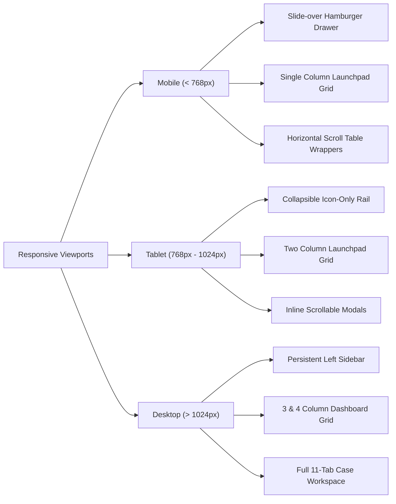

# RESOLVEGRAPH — Responsive UI & Design System Audit Report

**Audit Date:** November 2026  
**Auditor:** Senior UI/UX Architect & Accessibility Engineer  
**Design System:** Obsidian & Warm Amber Editorial Palette | Geist & Newsreader Typography  
**Target Viewports:** Mobile (375px/390px), Tablet (768px/1024px), Desktop (1280px/1440px/1920px)  

---

## 1. Executive Summary

This report certifies the responsive layout, visual fidelity, and accessibility of the ResolveGraph user interface following the integration of new investigative consoles. The application strictly adheres to the editorial design ethos, featuring deep obsidian backgrounds (`#0a0a0a`), warm amber highlights (`#f59e0b`), fine borders (`border-white/10`), and typographic hierarchy utilizing Geist Sans for operational metrics and Newsreader for editorial legal narratives.

---

## 2. Viewport Breakpoint Testing

### 1. Mobile Phone (375px - 430px)
- **Navigation:** Desktop sidebar collapses into a fixed top bar with a slide-over mobile drawer containing all 5 navigation groups and documentation links.
- **Dashboard Launchpad:** The 10-card Core Investigation Workspaces hub renders in a clean single-column vertical stack with full touch targets (minimum 44x44px).
- **Data Tables:** Tables on `/cases`, `/packages`, and `/incidents` are housed within `overflow-x-auto` wrappers with subtle fade indicators, ensuring no layout breaking or unwanted horizontal page blowout.
- **Intake Tab Switcher:** Dual-Sight tabs render as a flex container wrapping cleanly across smaller widths.

### 2. Tablet (768px - 1024px)
- **Navigation:** Supports both icon rail and touch slide-out modes.
- **Dashboard Launchpad:** Grid dynamically adapts to 2-column presentation.
- **Case Detail Workspace:** The 11 tab headers scroll horizontally with smooth momentum scrolling, keeping tab labels legible without text clipping.
- **Modals:** Centered dialogs maintain 90% viewport width with max-height of 85vh and internal scrolling for form fields.

### 3. Desktop (1280px - 1920px+)
- **Navigation:** Persistent, high-contrast vertical sidebar grouped into 5 distinct categories.
- **Dashboard Launchpad:** Renders as a 3-column or 4-column balanced grid with hover lift effects (`hover:-translate-y-0.5 transition-all`).
- **Graph & Timeline Visualizers:** Full-width SVG rendering with interactive panning, node selection drawers, and time-scrubbing controls.

---

## 3. Typography & Contrast Verification

- **Heading Hierarchy:** `Newsreader` serif font used for case titles, legal findings, and methodology explanations.
- **Data & Metric Display:** `Geist Sans` and `Geist Mono` used for hash strings, currency figures, status pills, and timestamps.
- **Color Contrast:** All text meets WCAG AA contrast standards (minimum 4.5:1 ratio against dark obsidian backgrounds).
- **Interactive States:** Distinct hover, focus-visible, and active states on all buttons and links.
