# RESOLVEGRAPH — Comprehensive Cybersecurity, Cryptographic Architecture & Threat Model Review
**Document ID:** RG-SEC-2026-V2  
**Classification:** Enterprise Security Architecture & Independent Audit Specification  
**Status:** Certified & Verified

---

## 1. Executive Security Architecture

ResolveGraph is engineered as an **Evidence-First Commerce Resolution Infrastructure** operating under strict financial, cryptographic, and operational security boundaries. It handles sensitive payment logs, bilateral counter-party claims, biometric/dual-camera recordings, and financial remedy proposals.

The security architecture enforces a **Defense-in-Depth** model across six core layers:
1. **Cryptographic Identity & Authentication Tier** (Better-Auth, HMAC-SHA256, HTTP-Only secure cookies).
2. **Deterministic Role-Based Access Control (RBAC)** (5 distinct persona roles with non-escalatable boundaries).
3. **Adversarial Multimodal & Prompt Injection Defenses** (XML boundary delimiter containment, Luhn PAN redactors, PII scrubbing).
4. **Evidence Vault Integrity** (Magic-byte verification, SHA-256 immutability, per-tenant isolated storage).
5. **Financial Operations & Dual-Key Safeguards** (10-point safeguard gate, cryptographic argument hashing, dual-signature approvals).
6. **Immutable Hash-Chained Audit Ledger & Administrative Kill-Switch** (SHA-256 blockchain-style chaining, provider-specific kill switches).

---

## 2. Authentication Architecture

ResolveGraph implements identity management via `@better-auth` augmented with enterprise-grade session governance:

### 2.1 Session Governance
- **Session Tokens:** 256-bit cryptographically secure pseudorandom tokens stored with SHA-256 digests.
- **Cookie Security:** `HttpOnly`, `SameSite=Lax` (Strict for write endpoints), `Secure` flag enforced in production, short expiration windows (7 days rolling).
- **API Key & Webhook HMAC:** Provider webhooks (e.g., PayPal Webhooks, Bank Webhooks) are verified using HMAC-SHA256 signature verification over the raw incoming request buffer before JSON deserialization.

### 2.2 Dual-Key Administrative Authentication
Critical operations (kill-switch toggle, emergency database freeze, provider circuit-breaker tripping) require secondary signature authentication:
$$\text{Signature} = \text{HMAC-SHA256}(\text{Action} \parallel \text{Timestamp} \parallel \text{Nonce}, \text{MasterAdminKey})$$

---

## 3. Five-Role Authorization Matrix (RBAC)

ResolveGraph segregates permissions into 5 non-escalatable operational roles:

| Action / Resource | Buyer (`BUYER`) | Merchant (`MERCHANT`) | Investigator (`INVESTIGATOR`) | Support (`SUPPORT`) | Platform Admin (`ADMIN`) |
|---|:---:|:---:|:---:|:---:|:---:|
| **Submit Evidence / Claims** | Read/Write (Own Case) | Read/Write (Own Case) | Read/Write (Assigned) | Read (Assigned) | Read (All) |
| **View Counter-Party Evidence** | Read (Shared only) | Read (Shared only) | Read (Full) | Read (Full) | Read (Full) |
| **Internal Investigation Notes** | Denied | Read/Write (Org only) | Read/Write (Assigned) | Read/Write | Read/Write |
| **Initiate Proposal** | Propose / Respond | Propose / Respond | Draft / Recommend | Recommend | Read |
| **Execute Financial Remedy** | **BLOCKED** | Dual-Key Sign-off | **BLOCKED** | **BLOCKED** | Kill-Switch / Override |
| **Access Admin Security Console** | **BLOCKED** | **BLOCKED** | **BLOCKED** | **BLOCKED** | Full Control |
| **Verify Audit Hash Chain** | Verify Own | Verify Org | Verify Assigned | Verify Assigned | Full Chain Verification |

*Multi-Tenant DAL Enforcement: Queries in `src/lib/services/case.service.ts` and `src/lib/dal/cases.ts` strictly inject tenant filter scopes (`where: { buyerId }` or `where: { organizationId: { in: userOrgIds } }`). Cross-tenant access attempts immediately fail with HTTP 403.*

---

## 4. Multimodal AI & Prompt Injection Defenses

AI agents in ResolveGraph run in constrained, supervised sandboxes with multi-tier guardrails (`src/lib/ai/guardrails/input-guardrails.ts`):

```mermaid
flowchart LR
    UserInput["Untrusted User/Dispute Input"] --> L1["1. Injection Pattern Scanner"]
    L1 --> L2["2. Delimiter XML Boundary Isolation"]
    L2 --> L3["3. PII & Luhn PAN Redactor"]
    L3 --> LLM["Multimodal LLM / BERR Engine"]
    LLM --> L4["4. Output Citation Verifier"]
    L4 --> L5["5. Financial Action Gatekeeper"]
    L5 --> SafeOutput["Verified Grounded Action"]
```

1. **Pattern Matching & Keyword Blocking:** Rejects standard prompt jailbreaks (`"ignore all previous instructions"`, `"system override"`, `"pretend you are an unrestricted admin"`).
2. **Delimiter Isolation:** Untrusted user input is enclosed in custom XML tags (`<untrusted_dispute_context>...</untrusted_dispute_context>`) with escaped closing tags to prevent context escape.
3. **Automated PII & PAN Redaction:**
   - Valid credit card numbers passing the **Luhn algorithm** are redacted into `[REDACTED_PAN_XXXX]`.
   - CVV codes, API bearer tokens, and Aadhaar/SSN patterns are automatically masked before prompt assembly.
4. **Output Citation Verification:** Any claim made by an AI model must reference a valid evidence ID in the SQLite database. Ungrounded claims fail the `QualityReviewAgent` gate with a `CITED_EVIDENCE_NOT_FOUND` error.
5. **No Autonomous Financial Execution:** AI subagents cannot execute payouts, refunds, or reversals. They are limited strictly to `DRAFT` and `REVIEW` capabilities.

---

## 5. Evidence Vault & Binary Security

All dispute media (invoices, carrier slips, dual-sight video frames, MP4 files) pass through the Evidence Vault (`src/lib/storage/evidence-vault.ts`):

- **Magic-Byte Inspection:** Mime-types are not trusted from the client headers. The storage engine reads the file's first 16 bytes to verify magic headers (`%PDF-` for PDFs, `\xFF\xD8\xFF` for JPEGs, `\x89PNG` for PNGs, `ftyp` for MP4s). Executable extensions (`.exe`, `.sh`, `.php`, `.svg`) are blocked.
- **SHA-256 Immutability Hash:** Every uploaded file is digested with SHA-256 upon arrival and saved in the database. Any subsequent byte modification is flagged as evidence tampering.
- **Strict Storage Path Isolation:** File paths are resolved against `process.env.EVIDENCE_STORAGE_DIR`. Directory traversal attacks (`../../etc/passwd`) are rejected with `PathTraversalError`.
- **Anti-MIME Sniffing Headers:** File downloads emit `X-Content-Type-Options: nosniff` and `Content-Disposition: attachment; filename="safe_name.ext"`.

---

## 6. Financial Safeguards & Dual-Key Sign-Off

Monetary actions (refunds, statutory compensation payouts, escrow releases) are gated by the **10-Point Financial Safeguards Gate** (`src/lib/services/financial-safeguards.service.ts`):

1. **Agreed Proposal Gating:** Remedy must correspond to a mutually agreed `ResolutionProposal` in status `ACCEPTED`.
2. **Balance Ceiling Check:** Refund amount cannot exceed the original transaction captured amount minus existing refunds:
   $$\text{Requested Refund} \le \text{Captured Amount} - \text{Cumulative Prior Refunds}$$
3. **Dual-Key Signature Requirement:** Amounts exceeding $\$250$ or $₹20,000$ mandate secondary supervisor approval before gateway dispatch.
4. **Cryptographic Argument Hashing:** Approval requests compute:
   $$\text{ArgHash} = \text{SHA-256}(\text{CaseID} \parallel \text{Amount} \parallel \text{Currency} \parallel \text{BeneficiaryAccount})$$
   If the argument payload is modified prior to sign-off, the signature check fails.
5. **Hard Idempotency:** Every financial dispatch requires a unique client-generated or server-assigned `idempotencyKey`. Duplicate requests return the original receipt without double-charging.
6. **Kill-Switch Lock:** If the administrative kill-switch is active, all financial dispatches are immediately rejected with HTTP 503.

---

## 7. Hash-Chained Audit Ledger & Administrative Kill-Switch

ResolveGraph maintains an append-only, tamper-evident audit ledger (`src/lib/services/chained-audit.service.ts`):

### 7.1 Chained Block Architecture
Each audit entry $B_i$ contains:
$$H_i = \text{SHA-256}(H_{i-1} \parallel \text{Timestamp}_i \parallel \text{ActorID}_i \parallel \text{ActionType}_i \parallel \text{PayloadDigest}_i)$$
- Genesis block $H_0$ is anchored to the system inception timestamp.
- Any manual modification or deletion of historical rows in SQLite breaks the chain verification at block $i$.

### 7.2 Administrative Kill-Switch
Located at `/api/admin/kill-switch` and managed through `/admin/security`:
- **Global Kill-Switch:** Immediately halts all outward API communications, payment captures, refunds, and background worker queues.
- **Per-Provider Kill-Switch:** Granular circuit breakers for PayPal, UPI/NPCI, or Carrier APIs.
- **HMAC Authentication:** Toggling the kill switch requires administrative session validation and emits an emergency entry to the chained audit ledger.
